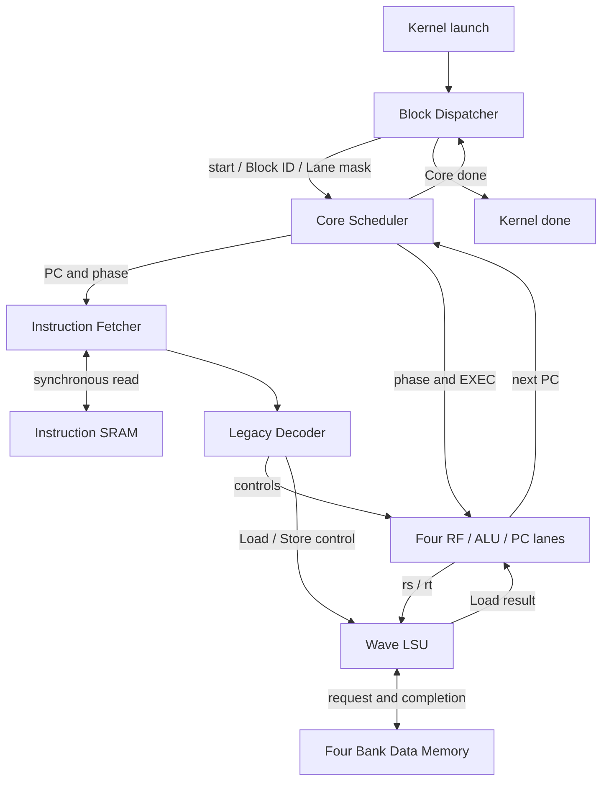
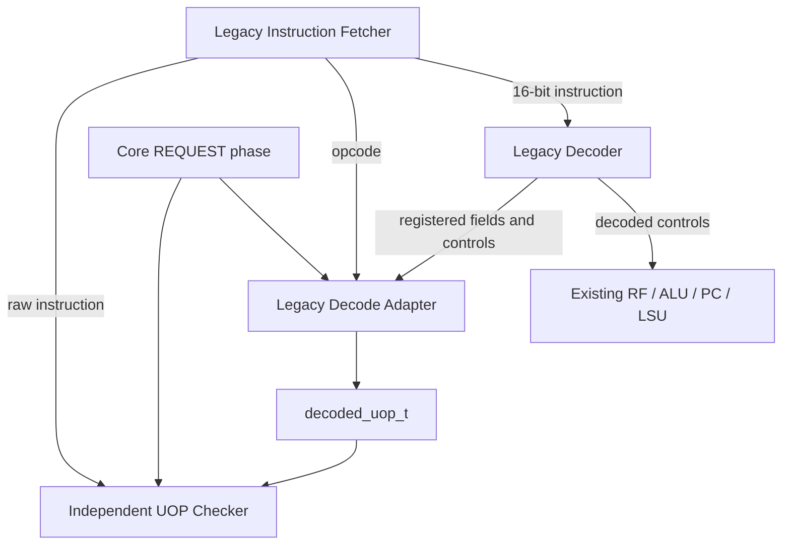
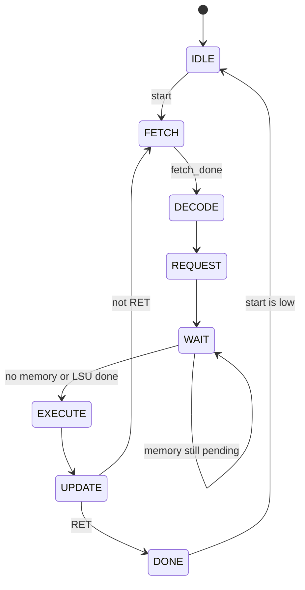

# TinyGPU M1：原始 TinyGPU Baseline 与 UOP 兼容桥规格

版本：M1 baseline summary v1  
归档日期：2026-10-03（北京时间）  
依据工程：`baseline_1003.zip`，以工程内当前 RTL、TB 和报告为准  
状态：完整可执行 Baseline 与兼容桥已交付；工程附带回归通过记录；VCS2016/Verdi2016 最终验收待执行  
前置基线：可执行的单 Core、单常驻 Wave、4 Lane Legacy TinyGPU  
后续里程碑：M2 多 Wave 控制平面；M3 带 Wave ID 的真实前端与执行通路

本文件参照 `M2_MULTI_WAVE_CONTROL_SPEC.md` 的章节结构，完整归档两部分：原 TinyGPU 的派发、Core、ISA、RF/ALU/PC、同步取指和四 Bank 访存规格，以及 M1 新增的 Legacy ISA → `decoded_uop_t` 兼容桥。

“原 TinyGPU Baseline”在本文中指 `baseline_1003.zip` 当前保留的 Legacy 可执行通路，包括已完成的同步 SRAM 化和 byte PC 规则；不将早期 ZIP 的旧 memory 接口或 word PC 规则混入当前规格。文档描述现状，不改变 RTL。

## 1. M1 的一句话目标

M1 要形成一套可独立执行和验证的 TinyGPU 基线：把一维 Kernel 拆成多个 Block，在单 Core 的四个 Lane 上执行 Legacy 指令，通过同步指令 SRAM 和四 Bank 数据 SRAM 完成计算，并建立统一 UOP 描述，作为后续多 Wave 升级的起点。

可执行 Baseline 负责真实取指、译码、寄存器读写、算术、分支、访存和 Kernel 完成。M1 新增的兼容桥负责统一表达译码结果：旧 Core 继续使用原 `decoded_*` 控制执行，Adapter 在旁路生成 UOP，供独立 Checker 检查。

## 2. M1 完成后的可观察能力

1. 一次启动被拆成 `ceil(thread_count / 4)` 个 Block，每个 Block 是一个四 Lane Wave。
2. 多个 Block 顺序复用同一个 Core，最后一个 Block 具有正确的 Lane valid mask。
3. Core 从同步指令 SRAM 取回 16-bit 指令，按阶段完成寄存器读、执行和写回。
4. 每 Lane 具有独立 RF、ALU、NZP 和 next PC，整个 Wave 共用取指 PC 和控制阶段。
5. NOP、BRNZP、CMP、ADD、SUB、MUL、DIV、LDR、STR、CONST、RET 共 11 类指令可以执行。
6. 程序可以通过 Block ID、Block size 和 Lane ID 计算全局线程索引。
7. Load/Store 使用四个同步 SRAM Bank，不同 Bank 可并行，同 Bank 冲突逐个服务。
8. LSU 按 Lane 跟踪完成，数据返回到正确 Lane，访存完成后 Core 继续执行。
9. 检测到 active Lane 的 next PC 不一致时，输出分歧标志，并按最低 active Lane 的路径继续。
10. RET 结束本 Wave；所有 Block 结束后，Kernel `done` 脉冲一个周期。
11. 零线程启动无需派发 Core 工作即可完成。
12. 公共 Package 和 Adapter 将真实执行中的 Legacy 指令描述为统一 UOP。
13. UOP 在 REQUEST 有效，其余阶段为零；不支持的 opcode 被标记为 illegal。
14. 六个 Baseline 场景与合法 opcode `0–9/F` 的 UOP 检查组成完整阶段回归。

这里的“有效 UOP”表示一份译码描述有效，不表示指令已经执行完成。

## 3. M1 的边界

### 3.1 M1 必须实现

- 单 Core、单常驻 Wave、四 Lane 的完整可执行 Top。
- 一维 Kernel / Block 拆分、partial Block mask 和完成统计。
- 共享 PC 的分阶段执行，以及每 Lane RF/ALU/PC-NZP 数据通路。
- 完整 Legacy ISA 的译码、执行和写回。
- 同步指令 SRAM 的取指时序。
- 阻塞 Wave LSU、四 Bank 仲裁和读写完成路由。
- 分歧检测及最低 active Lane PC 选择策略。
- 公共架构常量和可综合的 packed UOP 类型。
- Legacy Decoder 输出到 UOP 的组合转换。
- Adapter 在现有 Core 中的实例化和连线。
- REQUEST 阶段的有效性约定。
- 旧指令字段、控制和 UOP 映射的独立检查。
- RTL/TB 分离，以及 Package 优先的编译顺序。
- 保留六场景回归和 VCS2016/Verdi2016 运行入口。

### 3.2 M1 不在本阶段实现

- 真实 CDNA5 二进制指令的 Fetch/Decode。
- 用 UOP 替换旧 `decoded_*` 执行控制。
- Wave32 分拍执行、多个常驻 Wave 或 Round-Robin Wave 调度。
- 真实 SGPR/VGPR/AccVGPR 文件及寄存器 Scoreboard。
- 非阻塞访存、依赖计数器、WAITCNT 或完整 Barrier。
- 分歧路径分别执行、路径栈与重新汇聚。
- SALU、矩阵/Tensor 运算或多 Core 存储互连。

Package 可以预先定义这些功能使用的类型；定义类型本身不会生成对应硬件。

## 4. M1 默认配置

### 4.1 实际运行的 Legacy 基线

| 项目 | 当前值 | 说明 |
| --- | ---: | --- |
| Core 数量 | 1 | `gpu_top` 内固定 `NUM_CORES=1` |
| 常驻 Wave 数量 | 1 | 多个 Block 顺序执行 |
| 每 Wave Lane 数 | 4 | `LANES_PER_WAVE=4` |
| 每 Block 线程数 | 4 | 一个 Block 对应一个 Wave |
| 指令宽度 | 16 bit | Legacy ISA |
| PC 宽度 | 8 bit | Byte address，顺序前进 2 字节 |
| 数据及 RF 元素宽度 | 8 bit | ALU 和旧寄存器通路保持现状 |
| 每 Lane RF | 16 × 8 bit | R0–R12 通用，R13–R15 为派发信息 |
| 指令 SRAM | 128 × 16 bit | 同步读，PC 转换为 word address |
| 数据地址宽度 | 8 bit | 总容量 256 byte |
| 数据 SRAM | 4 Bank，每 Bank 64 × 8 bit | 单端口同步读写 |
| 线程数量输入 | 8 bit | `THREAD_COUNT_BITS=8` |
| LSU | 阻塞式 | 本 Wave 访存完成后继续执行 |
| 分歧策略 | 检测后选最低 active Lane 的 PC | 不执行全部分歧路径 |

当前 ALU/ISA 对 `DATA_BITS=8`、`PC_BITS=8`、`INSTRUCTION_BITS=16` 有实际限制。不能仅修改顶层参数就认为已完成 32-bit 数据通路或多 Core 升级。

### 4.2 Package 中为升级路径定义的配置

| 项目 | `gpu_pkg.sv` 定义 | M1 含义 |
| --- | ---: | --- |
| 数据元素 | 32 bit | 公共数据类型和 UOP immediate 的宽度 |
| 地址 / PC | 64 bit | 后续架构类型 |
| 逻辑 Wave | 32 Lane | 后续 Wave32 配置 |
| EXEC / VCC | 64 bit | 后续架构存储类型 |
| 物理 SIMD | 4 Lane | 后续分拍执行的配置起点 |
| 每 Wave beats | 8 | `32 / 4`，M1 尚未实现该执行机制 |
| 常驻 Wave Context | 4 | 后续控制面的默认配置 |
| SGPR / VGPR 数量 | 32 / 64 | 初始实现容量的定义，M1 尚未实例化 |
| 寄存器索引 | 10 bit | Legacy 4-bit 索引零扩展后放入此类型 |

因此，M1 的运行基线是 4 Lane、8-bit 数据；公共类型已经面向后续 Wave32、32-bit 数据升级。两组配置属于不同层次。

### 4.3 参数和程序约束

- 当前 Top 固定一个 Core，`THREADS_PER_BLOCK==LANES_PER_WAVE`；一个 Block 不能拆成多个 Wave。
- 当前可执行规格固定 8-bit 数据 / PC、16-bit 指令；其余参数暴露不代表所有组合都已验证。
- Backend 要求 `NUM_BANKS` 为 2 的幂、`LANES_PER_WAVE>1`、`ADDR_BITS>$clog2(NUM_BANKS)`。
- 起始 PC 和分支目标须按 2 byte 对齐；Fetcher 丢弃 PC bit0，没有新增对齐异常。
- 程序和数据分别限制在各自 256-byte 地址空间；结果超过 8-bit 表示范围时按现有宽度截断。

## 5. M1 顶层微架构

### 5.1 完整可执行 Baseline



每个 Lane 执行同一条 instruction，操作数和结果可以不同。指令 SRAM 与数据 SRAM 独立；当前 Top 没有外部程序装载总线，验证环境在启动前初始化 SRAM。

### 5.2 M1 新增的 UOP 兼容桥

下面聚焦 M1 新增的兼容桥及其与旧执行通路的关系：



完整可执行系统仍由 `gpu_top.sv` 连接旧 Dispatcher、Core、指令 SRAM 和四 Bank 数据存储。`decoded_uop` 位于 `core.sv` 内部，TB 通过层次引用观察它；当前 `gpu_top` 未增加 UOP 输出端口。

Adapter 输出目前不被执行模块消费。综合工具可能优化掉未使用的旁路逻辑；后续将其接到实际消费者后才形成执行路径。

## 6. Baseline 状态、寄存器与 UOP 的拆分

### 6.1 原 TinyGPU 保存的硬件状态

| 所有者 | 保存内容 | 当前组织 |
| --- | --- | --- |
| Dispatcher | 启动参数、派发 / 完成数量、Core busy 和 Block 元数据 | 一个 Kernel，顺序派发 |
| Core Scheduler | `core_state`、共享 `current_pc`、`exec_mask`、分歧标志 | 一个四 Lane Wave |
| Instruction Fetcher | 取指状态、`saved_pc`、当前 instruction | 一条在取指的指令 |
| 每 Lane RF | 16 个寄存器及已寄存的 `rs/rt` | 四份独立 16×8-bit RF |
| 每 Lane ALU | `alu_out` | 四份 8-bit 结果寄存器 |
| 每 Lane PC 单元 | `saved_nzp`、`next_pc` | 三位 NZP 和 8-bit next PC |
| Wave LSU | 指令 mask、pending mask、各 Lane 地址 / 数据和 Load 结果 | 一条阻塞访存指令 |
| 每 Bank Backend | Bank state、在途 Lane ID、row、写数据、读写类型 | 每 Bank 最多一个正在服务的请求 |
| SRAM | 程序和数据内容、同步读输出 | 无复位存储阵列 |

Baseline 没有常驻 Context Table。上表是一个物理 Wave 的状态分散保存在各模块中，不能像 M2 一样同时保存并切换多个 Wave。

### 6.2 Legacy 寄存器定义

| 寄存器 | 属性 | 内容 |
| --- | --- | --- |
| R0–R12 | 读写 | 13 个通用寄存器 |
| R13 | 程序只读 | 当前 `block_id`，对应 `%blockIdx` |
| R14 | 程序只读 | `THREADS_PER_BLOCK=4`，对应 `%blockDim` |
| R15 | 程序只读 | 当前物理 Lane ID 0–3，对应 `%threadIdx` |

全局线程编号由程序计算：`global_id = R13 * R14 + R15`。例如 Block1 的 Lane2 对应线程 `1×4+2=6`。

active Lane 每拍刷新 R13–R15；普通指令写回仅允许 `rd<13`。RF 在 REQUEST 同步读取 rs/rt，在 UPDATE 同步写回。失活 Lane 不读写 RF、不执行 ALU/PC，也不参与访存。

R0–R12 和保存的 NZP 仅在复位时清零，新 Block 启动不自动清空它们。程序必须先初始化将要使用的通用寄存器和分支条件；不能假定每个 Block 都获得全新的零值 RF。

### 6.3 统一 UOP 描述

`decoded_uop_t` 是一个 `typedef struct packed`。它可以整体清零、通过端口传递，或在后续阶段装入流水寄存器/FIFO；M1 Adapter 本身不保存它。

| 字段组 | 实际字段 | 用途 |
| --- | --- | --- |
| 有效性和指令身份 | `valid`、`inst_format`、`isa_opcode`、`inst_dwords` | 标识描述是否有效、来自何种格式 |
| 执行语义 | `uop_class`、`function_code` | 区分 VALU/VMEM/BRANCH/SYSTEM 与具体操作 |
| 目的操作数 | `dst_valid`、`dst_kind`、`dst_index`、`dst_count` | 描述目的寄存器及连续寄存器数量 |
| 三个源操作数 | `src0/1/2_kind`、`src0/1/2_index`、`src0/1/2_count` | 描述源操作数种类、索引和数量 |
| 立即数 | `immediate`、`immediate_valid`、`immediate_signed` | 保存立即数及解释方式 |
| 分支 | `branch_condition`、`branch_condition_value` | 描述分支条件，实际判定仍由执行端完成 |
| 运算修饰 | `src_neg`、`src_abs`、`op_sel`、`op_sel_hi`、`clamp`、`output_modifier` | 为后续指令保留，Legacy 映射中为零 |
| 访存 | `mem_space`、`mem_operation`、`mem_size`、`mem_signed`、`mem_offset` | 描述空间、操作、元素宽度和偏移 |
| 架构写控制 | `use_exec`、`write_scc`、`write_vcc`、`write_exec`、`write_pc` | 描述参与掩码和状态写入意图 |
| 结束和异常标记 | `end_program`、`illegal` | 描述程序结束或不支持的 opcode |

关键宽度：`isa_opcode=12 bit`，寄存器索引 `10 bit`，寄存器数量 `5 bit`，`immediate=32 bit`，`mem_offset=24 bit`。

当前 UOP 不含 `wave_id`、指令 PC、实际 RF 读值或访存返回值。后续多 Wave 管线需要把 Wave ID、PC 等元数据与 UOP 一起传递。

## 7. M1 模块与唯一职责

### 7.1 `gpu_top.sv` 与 `core.sv`

`gpu_top` 做系统集成：一个 Dispatcher、一个 Core、一块指令 SRAM、一个数据 Memory Subsystem。Top 不含程序初始化或验证逻辑。

`core` 做 Wave 数据通路集成：一个 Scheduler、一个 Fetcher、一个 Decoder、一个 Wave LSU 和一个 Adapter；每 Lane 分别实例化 RF、ALU 和 PC 单元。Core 不额外保存 SRAM，也不新增独立的执行状态机。

### 7.2 `dispatcher.sv`

接收启动参数，计算 Block 数，生成各 Block 的 ID 和 Lane mask，通过 `core_start` 派发，接收 `core_done` 并统计整个 Kernel 完成。它不决定每条指令的 PC，也不做 Lane 级仲裁。

### 7.3 `scheduler.sv`

拥有单 Wave 的八阶段 Core FSM、共享 PC 和 EXEC mask。等待 Fetch/LSU 完成，在 UPDATE 选择最低 active Lane 的 next PC，并检测其他 active Lane 是否请求不同 PC。

EXEC mask 只在 Wave 启动时载入，当前指令集不修改它。分支不会自动分割 EXEC 或保存另一条路径。

### 7.4 `instruction_fetcher.sv`

保存本次 PC，通过 IDLE → ISSUE → CAPTURE → DONE 完成同步指令 SRAM 读取。它只取指，不解析 opcode，也不决定分支方向。

### 7.5 `decode.sv`：模块名 `decoder`

在 DECODE 的上升沿寄存指令字段和控制。每次先把控制恢复默认零值，再按 opcode 置位；字段和控制保持到下一次 DECODE。

### 7.6 `register_file.sv`、`alu.sv`、`pc.sv`

RF 在 REQUEST 捕获 rs/rt，在 UPDATE 选择 ALU、LSU 或 immediate 写入 R0–R12。ALU 在 EXECUTE 计算 8-bit 算术或 `{N,Z,P}`。PC 单元在 EXECUTE 计算 next PC，在 CMP 的 UPDATE 保存 NZP。

这三个模块每 Lane 各一份。ALU 的比较结果、RF 的数据和 PC 单元的条件状态按 Lane 独立；取指 PC 最终由共享 Scheduler 选择。

### 7.7 `wave_lsu.sv`

一次只处理当前 Wave 的一条 LDR/STR。REQUEST 捕获参与 Lane mask；PREPARE 等 RF 数据已经寄存后保存地址 / 写数据并建立 pending mask；WAITING 收集 completion；全部 Lane 完成后保持 DONE，直到 Core UPDATE。

它不仲裁 Bank、不直接控制 SRAM，也没有多 Wave 请求队列。

### 7.8 `memory_backend.sv`、`memory_subsystem.sv`、`sram_model.sv`

Backend 将 Lane 请求按地址低位分 Bank，每个 Bank 选择最低 Lane ID，保存请求元数据，控制 SRAM，并按保存的 Lane ID 路由返回。Bank 间独立并行，Bank 内使用固定优先级，不是 Round-Robin。

Memory Subsystem 只集成 Backend 和四个 `single_port_sram`。SRAM 使用 `clk/ce/we/addr/wdata/rdata` 单端口接口；读数据寄存，写操作不更新 rdata。

### 7.9 `gpu_pkg.sv` 与 `legacy_decode_adapter.sv`

Package 统一类型，不保存状态；Adapter 把旧 Decoder 输出组合映射成 REQUEST 阶段的有效 UOP。`core.sv` 已补入该旁路，但实际执行继续使用旧控制。

当前 Package 同时含有后续 M2 的生命周期和 Counter 类型；这些是共享文件的扩展，不属于 M1 已执行的功能。

### 7.10 `tb/tb_gpu.sv` 与 `tb/legacy_uop_checker.sv`

主 TB 初始化 SRAM、启动 Kernel、设置超时并检查结果。Checker 从原始 instruction 独立解析字段，检查 UOP 及有效阶段。两者均在独立 TB filelist 中，不进入生产 RTL。

旧 `scheduler.sv` 是执行阶段状态机；M2 的 `wave_scheduler.sv` 是 READY Wave 仲裁器，两者职责不同。

## 8. Baseline 状态机

### 8.1 Core 八阶段执行

| 状态 | 编码 | 主要操作 |
| --- | --- | --- |
| IDLE | `3'b000` | 等待 Core start，载入起始 PC 和 Lane mask |
| FETCH | `3'b001` | 等待 Fetcher 完成同步 SRAM 取指 |
| DECODE | `3'b010` | Decoder 寄存字段和执行控制 |
| REQUEST | `3'b011` | RF 读取源寄存器；Adapter 输出有效 UOP |
| WAIT | `3'b100` | 访存指令等待 LSU；非访存指令继续到 EXECUTE |
| EXECUTE | `3'b101` | ALU 生成结果，各 Lane 计算 next PC |
| UPDATE | `3'b110` | RF 写回、CMP 保存 NZP、共享 PC 更新 |
| DONE | `3'b111` | Core 结束，向 Dispatcher 报告完成 |



REQUEST 总是先进入 WAIT。M1 的 WAIT 是旧阻塞执行阶段，不等于 M2 由显式 Wait 指令建立的 `WAVE_STATE_WAITCNT`。

### 8.2 Dispatcher

| 状态 | 编码 | 行为 / 转换 |
| --- | --- | --- |
| IDLE | `2'b00` | 接收 start 并保存参数；非零线程进入 RUN，零线程直接进入 DONE |
| RUN | `2'b01` | 派发未执行 Block，统计完成；所有 Block 完成且 Core 空闲后进入 DONE |
| DONE | `2'b10` | `done=1`，下一拍回到 IDLE；此状态 `busy=0` |

### 8.3 Instruction Fetcher

| 状态 | 编码 | 行为 |
| --- | --- | --- |
| IDLE | `2'b00` | Core 处于 FETCH 时保存 PC，转 ISSUE |
| ISSUE | `2'b01` | `imem_ce=1`，本周期结束的上升沿由 SRAM 接受读 |
| CAPTURE | `2'b10` | 周期结束时将已返回的 `imem_rdata` 寄存到 instruction |
| DONE | `2'b11` | `fetch_done=1`，直到 Core 进入 DECODE 后回 IDLE |

### 8.4 Wave LSU

| 状态 | 编码 | 行为 |
| --- | --- | --- |
| IDLE | `2'b00` | REQUEST 出现 LDR/STR 时捕获 instruction mask，转 PREPARE |
| PREPARE | `2'b01` | 捕获已稳定 rs/rt；pending mask 载入 instruction mask |
| WAITING | `2'b10` | 发出 pending 请求，采样 done/data，清除已完成位；pending 为零后转 DONE |
| DONE | `2'b11` | 保持完成状态，Core UPDATE 后回 IDLE |

### 8.5 每个数据 Bank

| 状态 | 编码 | 行为 |
| --- | --- | --- |
| IDLE | `2'b00` | 接受最低编号 Lane 请求，保存 Lane ID、row、写数据和读写类型 |
| ISSUE | `2'b01` | 驱动 SRAM ce；读进入 READ_CAPTURE，写直接进入 COMPLETE |
| READ_CAPTURE | `2'b10` | 捕获 SRAM 返回数据到对应 Lane 的 read_data |
| COMPLETE | `2'b11` | 对保存的 Lane ID 输出 done，下一拍回 IDLE |

Bank 完成后经过 IDLE 再接受下一项，不实现无气泡流水 SRAM 服务。

## 9. 原 TinyGPU ISA、执行控制与 UOP 映射

### 9.1 原始指令字段

| 字段 | 指令位段 | 使用方式 |
| --- | --- | --- |
| opcode | `[15:12]` | 选择旧指令类别 |
| rd | `[11:8]` | 目的寄存器 |
| rs | `[7:4]` | 第一个源寄存器或访存地址寄存器 |
| rt | `[3:0]` | 第二个源寄存器或 Store 数据寄存器 |
| NZP mask | `[11:9]` | BRNZP 的条件选择 |
| immediate | `[7:0]` | CONST 常量或 BRNZP 绝对 byte target |

字段按指令重叠解释，不表示每条指令同时使用所有字段。

### 9.2 原 ISA 的执行语义

| Opcode | 指令 | 原 TinyGPU 的实际操作 |
| --- | --- | --- |
| `0` | NOP | 不写 RF / NZP / memory，PC 顺序加 2 |
| `1` | BRNZP | 每 Lane 检查 `(saved_nzp & mask) != 0`；成立则取绝对目标，否则 PC 加 2 |
| `2` | CMP | 无符号比较 R[rs] 与 R[rt]，保存 `{N,Z,P}`，不写通用寄存器 |
| `3` | ADD | `R[rd] = R[rs] + R[rt]`，保留低 8 bit |
| `4` | SUB | `R[rd] = R[rs] - R[rt]`，保留低 8 bit |
| `5` | MUL | `R[rd] = R[rs] * R[rt]`，保留低 8 bit |
| `6` | DIV | 无符号整数除法，`R[rd] = R[rs] / R[rt]` |
| `7` | LDR | `R[rd] = memory[R[rs]]`，读取一个 byte |
| `8` | STR | `memory[R[rs]] = R[rt]`，写入一个 byte |
| `9` | CONST | `R[rd] = immediate[7:0]` |
| `F` | RET | 结束当前 Block / Wave，向 Dispatcher 报告完成 |

算术和 CONST 的 RF 写回受 `rd<13` 限制。ADD/SUB/MUL 的截断对应模 256 的结果，例如 `250+10→4`、`3-5→254`。普通算术不更新 NZP；分支需要先有有效 CMP 结果。

CMP 的位序为 `N=alu_out[2]`、`Z=alu_out[1]`、`P=alu_out[0]`。其中 N 表示无符号 `rs<rt`，不是某个有符号减法结果的符号位；Z 表示相等，P 表示 `rs>rt`。

### 9.3 原 Decoder 控制表

下表的写回列为 `decoded_reg_input_mux` 的使用方式；“—”表示 `decoded_reg_write_enable=0`，否则为 1。未使用的 mux 保持默认 0。

| 指令 | RF 写回源 | 算术 mux | 比较 mux | Memory | NZP write | PC branch mux | RET |
| --- | --- | --- | ---: | --- | ---: | ---: | ---: |
| NOP | — | — | 0 | — | 0 | 0 | 0 |
| BRNZP | — | — | 0 | — | 0 | 1 | 0 |
| CMP | — | — | 1 | — | 1 | 0 | 0 |
| ADD | ALU `00` | `00` | 0 | — | 0 | 0 | 0 |
| SUB | ALU `00` | `01` | 0 | — | 0 | 0 | 0 |
| MUL | ALU `00` | `10` | 0 | — | 0 | 0 | 0 |
| DIV | ALU `00` | `11` | 0 | — | 0 | 0 | 0 |
| LDR | LSU `01` | — | 0 | read=1 | 0 | 0 | 0 |
| STR | — | — | 0 | write=1 | 0 | 0 | 0 |
| CONST | immediate `10` | — | 0 | — | 0 | 0 | 0 |
| RET | — | — | 0 | — | 0 | 0 | 1 |

比较 mux 对应 `decoded_alu_output_mux`，NZP write 对应 `decoded_nzp_write_enable`，PC branch mux 对应 `decoded_pc_mux`。

### 9.4 11 类指令的 UOP 映射

| Opcode | 旧指令 | UOP class | Function | 源和目的描述 | 关键控制 |
| --- | --- | --- | --- | --- | --- |
| `0` | NOP | SYSTEM | NOP | 无 | 不写目的、不使用 EXEC |
| `1` | BRNZP | BRANCH | BRANCH | immediate 为绝对目标，NZP mask 为条件值 | `write_pc=decoded_pc_mux` |
| `2` | CMP | VALU | CMP | `VGPR[rs]`、`VGPR[rt]`；无通用目的寄存器 | `write_vcc=decoded_nzp_write_enable` |
| `3` | ADD | VALU | ADD | `VGPR[rs] + VGPR[rt] → VGPR[rd]` | ALU 结果写回 |
| `4` | SUB | VALU | SUB | `VGPR[rs] - VGPR[rt] → VGPR[rd]` | ALU 结果写回 |
| `5` | MUL | VALU | MUL | `VGPR[rs] × VGPR[rt] → VGPR[rd]` | ALU 结果写回 |
| `6` | DIV | VALU | DIV | `VGPR[rs] / VGPR[rt] → VGPR[rd]` | ALU 结果写回，除数须非零 |
| `7` | LDR | VMEM | LOAD | 地址来自 `VGPR[rs]`，结果到 `VGPR[rd]` | GLOBAL、LOAD、B8 |
| `8` | STR | VMEM | STORE | 地址来自 `VGPR[rs]`，数据来自 `VGPR[rt]` | GLOBAL、STORE、B8，无目的寄存器 |
| `9` | CONST | VALU | MOV | immediate → `VGPR[rd]` | 无符号立即数写回 |
| `F` | RET | SYSTEM | END | 无 | `end_program=decoded_ret` |

上表是合法 Decoder 输出下的映射。实际 Adapter 中 ADD/SUB/MUL/DIV 的 function 来自 `decoded_alu_arithmetic_mux`；CMP function 来自 `decoded_alu_output_mux`。目的有效性也结合 `decoded_reg_write_enable` 和写回 mux，而不是仅复制 opcode 名称。

### 9.5 兼容映射的解释

- `isa_opcode` 是旧 4-bit opcode 的 12-bit 零扩展，不是 AMD 指令的 opcode 编号。
- `VGPR` 是旧每 Lane 寄存器在公共类型中的分类；实际仍是 8-bit Legacy RF。
- CMP 通过 `write_vcc` 描述比较状态写入意图；实际保存的仍是每 Lane 三位 NZP，没有新增真实 VCC 寄存器。
- BRNZP 的条件是 `BRANCH_CONDITION_LEGACY_NZP`，没有改成 CDNA5 SCC/VCC 分支。
- Adapter 不执行算术、分支或访存；它只描述操作。
- Adapter 的 `dst_valid` 反映 Decoder 写回意图；旧 RF 另外执行 `rd<13` 的只读保护，Adapter 没有把这条 RF 地址保护再次编码进 UOP。

## 10. Top 和跨模块接口规格

### 10.1 `gpu_top` 启动接口

| 信号 | 方向 | 默认宽度 | 协议 |
| --- | --- | ---: | --- |
| `clk` | 输入 | 1 | 所有控制和 SRAM 使用同一个时钟 |
| `rst_n` | 输入 | 1 | 控制 / 数据寄存器异步低有效复位 |
| `start` | 输入 | 1 | IDLE 中接受一个周期的 Kernel 启动脉冲 |
| `start_pc` | 输入 | 8 | 首条指令的 byte address，按 2 byte 对齐 |
| `thread_count` | 输入 | 8 | 一维 Kernel 线程数，包含最后一个 partial Block |
| `busy` | 输出 | 1 | Dispatcher 处于 RUN |
| `done` | 输出 | 1 | Dispatcher 处于 DONE，持续一个周期 |
| `divergence_detected` | 输出 | 1 | Core 最近一次 UPDATE 的 next PC 分歧结果 |

Top 不输出 `start_ready`，也没有启动队列。外部只在空闲阶段启动；RUN / DONE 内的 start 不被当前 Dispatcher 接受。参数在接受启动的上升沿保存，之后由保存值驱动派发。

### 10.2 Core 的存储边界

| 接口 | 方向（相对 Core） | 默认宽度 / 数量 | 含义 |
| --- | --- | --- | --- |
| `imem_ce` | 输出 | 1 bit | 发起同步指令读 |
| `imem_addr` | 输出 | 7 bit | 指令 word index |
| `imem_rdata` | 输入 | 16 bit | SRAM 已寄存的指令数据 |
| `memory_request_mask` | 输出 | 4 bit | 各 Lane 待完成的请求集合 |
| `memory_write` | 输出 | 1 bit | 本条访存类型，0=Load，1=Store |
| `memory_address` | 输出 | 4×8 bit | 各 Lane 的 byte address |
| `memory_write_data` | 输出 | 4×8 bit | 各 Lane Store 数据 |
| `memory_done_mask` | 输入 | 4 bit | 对应 Lane 的 completion；可以多位同时有效 |
| `memory_read_data` | 输入 | 4×8 bit | 按 Lane 路由的 Load 返回数据 |

访存请求是“保持 pending 位，直到对应 done 到达”的协议，没有 ready 端口。请求未完成期间地址、数据和读写类型保持稳定；Backend 保存元数据后按 Lane 返回完成。

### 10.3 单端口 SRAM 接口

| 信号 | 方向（相对 SRAM） | 含义 |
| --- | --- | --- |
| `clk` | 输入 | 上升沿接受读 / 写 |
| `ce` | 输入 | 当前端口操作有效 |
| `we` | 输入 | 0=读，1=写 |
| `addr` | 输入 | Bank 内或指令 SRAM 内的 word address |
| `wdata` | 输入 | 写入数据 |
| `rdata` | 输出 | 寄存的读数据 |

`ce=0` 时保持；`ce=1,we=0` 时执行 `rdata<=memory[addr]`；`ce=1,we=1` 时执行 `memory[addr]<=wdata`，rdata 保持。一个 Bank 的同一个端口不能同拍执行读与写。

指令 SRAM 的 we 固定为 0；TB 的程序装载操作是验证用的层次初始化，不是这个只读取指端口的协议。

### 10.4 Adapter 输入和输出

| 端口组 | 信号 | 来源 / 用途 |
| --- | --- | --- |
| 执行阶段 | `core_state[2:0]` | 仅 REQUEST 时输出有效 UOP |
| 旧 opcode | `legacy_opcode[3:0]` | `instruction[15:12]` |
| 寄存器字段 | `decoded_rd/rs/rt_address[3:0]` | Decoder 已寄存字段 |
| 分支 / 常量字段 | `decoded_nzp[2:0]`、`decoded_immediate[7:0]` | Decoder 已寄存字段 |
| 写回控制 | `decoded_reg_write_enable`、`decoded_reg_input_mux[1:0]` | 决定目的是否有效 |
| ALU 控制 | `decoded_alu_arithmetic_mux[1:0]`、`decoded_alu_output_mux` | 决定算术 / 比较功能 |
| 访存控制 | `decoded_mem_read_enable`、`decoded_mem_write_enable` | 决定 LOAD / STORE 操作 |
| 架构控制 | `decoded_nzp_write_enable`、`decoded_pc_mux`、`decoded_ret` | 比较状态、分支和结束意图 |
| 输出 | `gpu_pkg::decoded_uop_t decoded_uop` | 一份组合 UOP 描述 |

### 10.5 Adapter 默认值和有效字段

组合块先执行 `decoded_uop='0`，再按 REQUEST 和 opcode 填写所需字段。

REQUEST 阶段的共同字段为：`valid=1`、`inst_format=INST_FORMAT_LEGACY16`、`inst_dwords=1`、`isa_opcode=零扩展 opcode`。

被使用的寄存器源 / 目的索引由 4 bit 零扩展为 10 bit，寄存器数量通常为 1。CONST 的 `src0_kind=OPERAND_IMMEDIATE`；立即数内容通过 `immediate` 字段传递。

未使用的第三源、运算修饰、访存 offset、`write_scc` 和 `write_exec` 保持零。LDR/STR 的 `mem_size=MEM_SIZE_B8`、`mem_signed=0`。

## 11. Dispatch、Lane 执行、访存与 PC 语义

### 11.1 Kernel → Block / Wave 拆分

```text
total_blocks = ceil(thread_count / THREADS_PER_BLOCK)
block_thread_base = block_id * THREADS_PER_BLOCK
remaining_threads = thread_count - block_thread_base
lane_valid_mask[lane] = (lane < remaining_threads)
```

这些规则以 `THREADS_PER_BLOCK==LANES_PER_WAVE==4` 为当前前提。第一个 Block ID 为 0，每个 Block 都从保存的 start PC 开始执行。

例如 `thread_count=6`：

| Block ID | 全局线程编号 | Lane valid mask | 执行顺序 |
| ---: | --- | --- | --- |
| 0 | 0、1、2、3 | `4'b1111` | 先在唯一 Core 上执行到 RET |
| 1 | 4、5 | `4'b0011` | Block0 完成且 Core 可重新启动后执行 |

Dispatcher 发出寄存的单周期 `core_start`，并标记 Core busy。只有 busy Core 的 `core_done` 才增加完成计数。新派发使用本拍原有的 `core_busy/core_done`，不旁路同拍刚结束的 Core，因此 Block 交接允许气泡。

最后一次完成判断使用当前组合计算的派发 cursor、完成 cursor 和 `core_busy_next`，避免漏掉最后一个 Block 的完成。全部派发、全部完成且 Core 空闲后进入 DONE。

零线程启动从 IDLE 直接进入 DONE，不产生 `core_start`。外部 start 应为单周期脉冲；一直保持 start 可能在系统回到 IDLE 后再次启动。

### 11.2 一条 ADD 的完整执行

以 `ADD R0,R1,R2` 为例：

1. FETCH 经同步 SRAM 获得 instruction。
2. DECODE 保存 rd=0、rs=1、rt=2，并选择 ALU ADD 写回。
3. REQUEST 周期 Adapter 描述该操作；周期结束时各 active Lane 的 RF 捕获自己的 R1/R2。
4. WAIT 对非访存指令只经过一个阶段，然后进入 EXECUTE。
5. EXECUTE 周期结束时各 Lane ALU 寄存 8-bit 加法结果，PC 单元寄存 `current_pc+2`。
6. UPDATE 周期结束时各 Lane 将结果写入自己的 R0，Scheduler 提交共享 next PC。
7. 回到 FETCH，开始下一条指令。

四个 Lane 的 R1/R2 可以不同，因此同一条 ADD 产生四个不同结果。当前 Core 不重叠执行两条指令，不需要在本基线中另加流水 RAW Scoreboard。

### 11.3 一条 Load / Store 的完整执行

1. REQUEST 周期结束的上升沿更新源寄存器读值，并将本条指令的 EXEC 保存为 instruction mask。
2. PREPARE 的后续上升沿捕获已经更新的 rs/rt：地址取 rs，Store 数据取 rt；pending mask 载入参与集合。
3. Backend 根据请求地址建立各 Bank 候选，每 Bank 选最低 Lane ID，并保存元数据。
4. 各 Bank ISSUE 同步读写 SRAM；读操作另经过 READ_CAPTURE，写操作直接进入 COMPLETE。
5. COMPLETE 输出对应 Lane 的 done；LSU 采样 Load 数据并清除该 Lane 的 pending 位。
6. 所有位清零后 LSU 进入 DONE，Core 才离开 WAIT，继续 EXECUTE / UPDATE。

LSU 更新规则为 `pending_mask <= pending_mask & ~memory_done_mask`。Load 结果只在 `pending_mask[lane] && memory_done_mask[lane]` 时采样；Store 的 done 不更新 Load 结果。

Bank 地址映射示例：

| 四个 Lane 的地址 | Bank 编号 | Bank row | 行为 |
| --- | --- | --- | --- |
| 0、1、2、3 | 0、1、2、3 | 均为 0 | 四 Bank 可以并行服务 |
| 0、4、8、12 | 均为 0 | 0、1、2、3 | Bank0 按 Lane0→1→2→3 逐个服务 |

每 Bank 只有一个在途槽，保存的是 Lane ID；没有 Wave ID、transaction ID、多 outstanding 队列、Cache、Coalescer 或跨 Wave 返回网络。

### 11.4 PC 长度由 Legacy 取指规则决定

旧指令是 16 bit，顺序执行时：

```systemverilog
next_pc = current_pc + 2;
```

BRNZP 成立时使用 `decoded_immediate` 作为绝对 byte address；不成立时仍加 2。指令 SRAM 地址由 byte PC 转换为 16-bit word index。

例如旧程序的第 12 个 word 位于 byte address `12 × 2 = 24 = 8'h18`，因此对应 BRn 编码为 `16'h1818`。

当前 Adapter 虽填 `inst_dwords=1`，但同时标记 `INST_FORMAT_LEGACY16`。这个兼容值未参与 M1 PC 计算；后续消费者处理 Legacy 格式时必须保留“16-bit、2 byte”的长度规则，不能无条件用 `inst_dwords × 4` 前进。

### 11.5 立即数

CONST 和 BRNZP 的 8-bit immediate 均零扩展到 32 bit，并设 `immediate_valid=1`、`immediate_signed=0`。实际 CONST 写回和分支目标仍经过旧 8-bit 通路。

### 11.6 分歧检测与共享 PC 策略

每 Lane 的 PC 单元根据自己的 saved NZP 计算 next PC。Scheduler 在 UPDATE 从 Lane0 开始扫描，选第一个 active Lane 的 next PC；其他 active Lane 若不同，则记为分歧。

例如 Lane0/1 请求 `8'h10`，Lane2/3 请求 `8'h0a`，且 EXEC=1111：共享 PC 选择 `8'h10`，随后所有 active Lane 都取该路径。另一条路径没有独立执行或保存。

`divergence_detected` 在每次 UPDATE 被当前结果覆盖，下一次无分歧的 UPDATE 可以清零；它不是整个 Kernel 的 sticky 标志。TB 通过独立 `saw_divergence` 记录是否曾观察到分歧。

## 12. M1 事件协议

| 事件 / 条件 | 产生者 | 消费者 | 含义 |
| --- | --- | --- | --- |
| `start` | TB / 外部启动端 | 旧 Dispatcher | 空闲时接收一次 Kernel 启动脉冲 |
| `core_start` | Dispatcher | Core Scheduler | 派发一个 Block / Wave |
| `fetch_done` | Fetcher | Scheduler | 本条指令已取回 |
| DECODE 上升沿 | Scheduler 阶段 | Decoder | 更新本条指令的译码寄存器 |
| `decoded_uop.valid` | Adapter | UOP Checker | REQUEST 期间描述有效 |
| `memory_request_mask` | Wave LSU | Memory Backend | 各 Lane 尚待服务的访存请求 |
| `memory_done_mask` | Memory Backend | Wave LSU | 对应 Lane 请求完成 |
| `core_done` | Core Scheduler | Dispatcher | 本次 Block / Wave 执行结束 |
| `done` | Dispatcher | TB / 外部启动端 | 整个 Kernel 完成 |

Core start / done 采用当前基线的显式事件与 busy 状态，不是 M2 alloc valid/ready 协议。数据接口的请求位保持到 completion；指令 SRAM 接口则依赖约定的固定同步读时序。它们不能互相套用同一种握手解释。

M1 Adapter 没有 ready，`decoded_uop.valid` 不是可反压的 valid/ready 接口。REQUEST 阶段持续一个周期，当前消费者只观察和检查；后续流水化需要在明确的接受时点采样，并建立握手或缓冲协议。

## 13. 同周期与并发规则

- Decoder 和 Core state 在同一个上升沿更新；进入 REQUEST 后，新 Decoder 字段经组合 Adapter 形成 UOP。
- Adapter 只读取信号，没有寄存器写冲突，也没有 alloc/release 等生命周期优先级。
- 旧 Core 逐条执行：本条指令未完成 UPDATE 前，不开始下一条指令的正常取指流程。
- 四个 Lane 可以执行同一条指令，四个数据 Bank 可以并行处理不同 Bank 请求；这不等于多个常驻 Wave 并发。
- 旧 LSU 完成后才结束访存指令，因此没有 M2 的“指令先 commit、后端 completion 之后返回”协议。
- REQUEST 更新 rs/rt 与 LSU 转 PREPARE 可以同拍发生；LSU 在下一阶段捕获操作数，避免使用非阻塞赋值前的旧 RF 数据。
- CMP 的 ALU 结果先在 EXECUTE 寄存，NZP 在 UPDATE 保存；后续 BRNZP 才使用该保存值。
- 一个 Bank 在 COMPLETE 输出 done，LSU 在同一上升沿采样并清除 pending；Bank 返回 IDLE 后再选择剩余请求，避免重复服务已经完成的 Lane。
- Kernel / Block 的状态更新由 Dispatcher、Core Scheduler 分别拥有；存储数据不由 Top 或 Adapter 再保存一份。

## 14. 读写和检查时序

### 14.1 Core 与 UOP 的阶段时序

| 阶段 / 采样点 | 行为 |
| --- | --- |
| FETCH | 发起同步 SRAM 读，等待返回后捕获 instruction |
| DECODE 上升沿 | Decoder 保存本条指令字段及控制；状态进入 REQUEST |
| REQUEST 周期 | Adapter 组合输出本条 UOP，`valid=1` |
| REQUEST 下降沿 | Checker 读取原始 instruction 和已稳定的 UOP |
| REQUEST 结束上升沿 | RF 寄存源操作数，状态进入 WAIT |
| WAIT | LSU 必要时继续收集完成；非访存指令准备进入 EXECUTE |
| EXECUTE 结束上升沿 | ALU / PC 寄存运算结果和 next PC |
| UPDATE 结束上升沿 | RF 写回、NZP 保存、共享 PC 前进或 RET 结束 |

Checker 放在下降沿，以避开上升沿非阻塞赋值尚未完成的采样窗口。同步 SRAM 的读数据同样由后续阶段消费，不在发起读的上升沿直接取新值。

### 14.2 同步取指时序

下面从 Core 已处于 FETCH、Fetcher 仍为 IDLE 的时点开始计拍：

| 上升沿 | 沿前 Fetcher 状态 | 该沿的动作 | 沿后状态 |
| --- | --- | --- | --- |
| E0 | IDLE | 保存 current PC | ISSUE，ce=1 |
| E1 | ISSUE | SRAM 接受 saved PC 对应的 word 读，rdata 更新 | CAPTURE |
| E2 | CAPTURE | Fetcher 捕获前一拍 SRAM rdata | DONE，fetch_done=1 |
| E3 | DONE，Core 仍为 FETCH | Scheduler 看到 fetch_done | Core 进入 DECODE |
| E4 | DONE，Core 为 DECODE | Decoder 捕获 instruction | Core 进入 REQUEST，Fetcher 回 IDLE |

“指令 SRAM 同步读一拍”指 E1 接受地址后更新寄存输出；整个 FETCH/DECODE 流程还包含请求、捕获和控制交接，不能把整条取指流程等同于一个时钟周期。

### 14.3 一个 Bank 的读 / 写时序

以下时序假设 E0 前该 Bank 空闲且有合法请求：

| 上升沿 | Load | Store |
| --- | --- | --- |
| E0 | 保存 Lane ID、row、读类型，进入 ISSUE | 保存 Lane ID、row、数据、写类型，进入 ISSUE |
| E1 | SRAM 接受读，更新 rdata，进入 READ_CAPTURE | SRAM 提交写，进入 COMPLETE，done 变为 1 |
| E2 | Backend 捕获 rdata 并路由到该 Lane，进入 COMPLETE，done 变为 1 | LSU 接受 done、清除 pending；Bank 回 IDLE |
| E3 | LSU 接受 done 和已路由数据，清除 pending；Bank 回 IDLE | Bank 可在 IDLE 结束沿接受下一请求 |

多个 Bank 可在相同上升沿执行各自步骤。单 Bank 服务串行请求时，还需经过自身 IDLE 阶段；当前实现不是每拍吞吐一个请求的流水 Backend。

## 15. Reset、非法指令与稳定性要求

### 15.1 复位与 Block 复用

| 对象 | `rst_n=0` 后的行为 | 新 Block start 的行为 |
| --- | --- | --- |
| Dispatcher | IDLE，参数 / 计数 / Core busy 清零 | 当前 Kernel 内继续按 Block cursor 派发 |
| Core Scheduler | IDLE，PC / EXEC / 分歧标志清零 | PC 载入 start PC，EXEC 载入本 Block mask，分歧标志清零 |
| Fetcher / Decoder | 状态、指令和译码寄存器清零 | 正常获取新 Block 的首条指令 |
| 每 Lane RF / ALU / PC 单元 | 数据寄存器、GPR、NZP 和 next PC 清零 | GPR / NZP 不自动清零；active Lane 刷新 Block 信息 |
| Wave LSU / Bank Backend | 状态、pending、在途元数据和结果寄存器清零 | 在前一工作完成的前提下开始新指令 |
| 指令 / 数据 SRAM | 内容及 rdata 不复位 | 保持程序与数据内容 |

复位使 Core 回到 IDLE，所以 Adapter 自然输出全零；Adapter 不新增复位端口，组合逻辑不判断 `rst_n`。TB 在启动前初始化必要 SRAM 数据。若运行中复位，控制端放弃在途工作，已经提交到 SRAM 的写数据不会被复位撤销。

### 15.2 程序和请求稳定性

- DECODE 之后，Decoder 字段在 REQUEST 中稳定；Fetcher 保持同一条 instruction，使 opcode 与寄存字段对应。
- inactive Lane 不允许通过 mask 发起访存或写回；其旧数据可以保持，无需参与本 Block 结果。
- pending 请求的地址 / Store 数据 / 类型保持到完成；Backend 始终用保存的 Lane ID 路由。
- 程序在读取 GPR 或使用 NZP 前建立需要的值，DIV 使用非零除数，PC 目标按 2 byte 对齐。

### 15.3 非法指令与现有检查边界

- opcode `A–E` 在 Adapter 中产生 `valid=1`、`illegal=1` 的 SYSTEM/NOP 描述，其余控制维持默认值。
- `illegal` 尚未连接 Trap/Exception 处理；现有 Legacy Decoder 对未支持 opcode 保持默认无副作用控制。
- DIV 使用非零除数是现有程序约束；M1 没有增加除零异常机制。

Checker 检查 REQUEST 以外 `valid=0`，但当前是按指令检查关键字段，并非对所有 UOP 位执行整包期望值比较。

## 16. M1 与 M2 如何共存

| 项目 | M1 | M2 |
| --- | --- | --- |
| Top | `gpu_top.sv` | `wave_control_subsystem.sv` |
| 执行来源 | 真实 Legacy 程序 | TB 的 synthetic execution/completion events |
| 调度模块 | `scheduler.sv`，单 Wave 执行阶段 | `wave_scheduler.sv`，READY Wave Round-Robin |
| Wave 模型 | 一个 4-Lane 常驻 Wave | 默认四个 Wave32 Context |
| 寄存器数据通路 | 已有 8-bit RF/ALU/LSU | M2 不实例化真实 SGPR/VGPR 执行通路 |
| UOP 使用 | Adapter 生成，Checker 观察 | 当前 synthetic 控制接口不直接消费 M1 UOP |
| RTL filelist | `sim/filelist_rtl.f` | `sim/filelist_m2_rtl.f` |
| TB filelist | `sim/filelist_tb.f` | `sim/filelist_m2_tb.f` |

M2 尚未接管 M1 Top，也没有把 Adapter 输出直接送入控制面。两条验证路径共用 Package，分别检查执行结果与多 Wave 生命周期；后续 M3 再接入真实、带 Wave ID 的前端和执行。

## 17. M1 验收矩阵

| 编号 | 场景 | 必须观察到的结果 | 当前覆盖 / 记录 |
| --- | --- | --- | --- |
| M1-01 | 系统编译集成 | RTL/TB 分离，Package 优先，完整 Top 可展开 | 当前 filelist 及附带 Verilator 回归 |
| M1-02 | Dispatch / 完成闭环 | 多 Block 顺序执行，最后一个完成后 done 单周期 | 多 Block 场景 PASS；RTL 完成逻辑已归档 |
| M1-03 | 单条指令阶段 | Fetch→Decode→RF read→Execute→Update 顺序正确 | RTL 时序及六场景结果；非穷尽协议检查 |
| M1-04 | 同步指令 SRAM | word 地址正确，读数据在后续 CAPTURE 采样 | Fetch RTL 和程序执行回归 |
| M1-05 | RF / Lane 元数据 | 正确使用 R13/R14/R15，inactive Lane 不写结果 | mat_add / partial_block；只读保护见 RTL |
| M1-06 | 算术 / NZP / 分支 | ADD/SUB/MUL/DIV/CMP、绝对 byte 回跳符合 ISA | mat_add / mat_mul / divergence 和 Checker |
| M1-07 | LSU / Bank 完成 | 各 Lane 请求只在完成后清除，数据回到所属 Lane | 访存场景 PASS；FSM / 路由见 RTL |
| M1-08 | `mat_add`，8 threads | 两个顺序 Block，C[0..7] = 0、2、4、6、8、10、12、14 | 附带 RTL 日志 PASS |
| M1-09 | `partial_block`，6 threads | 第二个 Block mask=0011，未激活 Lane 不覆盖 C[6..7] | 附带 RTL 日志 PASS |
| M1-10 | `mat_mul`，4 threads | 2×2 结果为 7、10、15、22，循环和回跳正确 | 附带 RTL 日志 PASS |
| M1-11 | `divergence`，4 threads | 观察到分歧，四个 Lane 最终按 Lane0 路径写出 `8'h11` | 附带 RTL 日志 PASS |
| M1-12 | `bank_conflict`，4 threads | 同 Bank 地址 0/4/8/12 的数据正确路由至各 Lane | 附带 RTL 日志 PASS |
| M1-13 | `zero_thread` | 不派发 Core 工作即可完成 | 附带 RTL 日志 PASS |
| M1-14 | UOP valid 时序 | REQUEST 为 1，其余阶段为 0 | Checker 的阶段检查 |
| M1-15 | 11 类合法 opcode | class/function 和关键字段符合映射 | Checker；附带 `0–9/F` coverage PASS |
| M1-16 | UOP 字段转换 | 索引 / immediate 零扩展，访存为 GLOBAL/B8 | 合法指令字段检查 |
| M1-17 | 非法 opcode A–E | REQUEST 中 `illegal=1`，无合法写控制 | RTL 已实现；六场景未要求非法 opcode 覆盖 |
| M1-18 | 边界 / 复位 | 截断、只读保护、对齐约束和复位行为符合本规格 | 按源码归档；不宣称已有专门穷尽边界回归 |
| M1-19 | VCS2016 + Verdi2016 | 六场景与 UOP 检查通过，FSDB 能加载和观察 | 入口已提供，最终平台待验收 |

六场景验证的是当前基线能力。`divergence` PASS 表示既定“检测并选最低 active Lane”策略正确，不表示支持完整分歧执行；`mat_mul` PASS 也不表示已实现 WMMA/MFMA。

## 18. 实现与验证顺序

原 TinyGPU 到 M1 的模块依赖和集成顺序可整理为：

1. 定义 Legacy ISA、控制表、阶段状态和 Lane 掩码约定。
2. 形成 ALU、Decoder、RF、PC/NZP 四类执行模块。
3. 形成同步指令 SRAM 模型和 Fetcher，固定 byte PC 规则。
4. 形成 Wave LSU 与四 Bank Backend，固定请求保持 / completion 协议。
5. 用旧 Scheduler 连接执行阶段，集成为单 Wave Core。
6. 形成 Block Dispatcher 和 gpu_top，闭合 Kernel 派发 / 完成流程。
7. 在 `gpu_pkg.sv` 定义 UOP，加入组合 Adapter 和 Core 旁路连线。
8. 独立 TB 检查六场景结果，UOP Checker 从原始指令推导关键字段。
9. 更新 filelist / VCS / Verdi 入口，运行整体回归和 opcode coverage。
10. 在最终 VCS2016/Verdi2016 平台完成编译、仿真和 FSDB 验收。

本次任务是整理 Markdown，不新增 RTL、TB 或测试；已有运行结果在第 22 节按来源记录。

## 19. 后续升级接口

### M2：多 Wave 控制平面

承接 Package 中的公共类型，新增 Dispatcher、Context Table、Wave Scheduler、Dependency Tracker 和 Retire Controller。M2 已通过独立 Top 集成，真实指令执行仍保留在 M1 路径。

### M3：带 Wave ID 的真实前端与执行

- 请求、返回和流水项携带所属 Wave ID 与指令 PC。
- 新 Decoder 输出统一 UOP；执行端消费 UOP 并更新所属 Context。
- 增加实际架构寄存器和寄存器相关性检查。
- 明确 UOP 接受、停顿、写回和 Commit 协议。
- 显式区分 Legacy16 长度 / 分支语义与后续指令格式。

### 更后续阶段

在真实执行接入后继续升级存储层级、Barrier/分歧和矩阵/Tensor 通路。公共 UOP 为这些模块提供统一描述；具体功能仍需对应 RTL 和验证。

## 20. 已冻结的关键决策

- M1 阶段文档包含完整原 TinyGPU Baseline 和新增 UOP 兼容桥。
- 当前系统为单 Core、单常驻 Wave、四 Lane；一个 Block 就是一个 Wave。
- 多 Block 顺序复用物理 Core，普通 GPR / NZP 不因新 Block 启动而自动清零。
- Core 保留八阶段阻塞执行；旧 Scheduler 拥有共享 PC 和 EXEC。
- RF/ALU/PC 按 Lane 独立，分歧时取最低 active Lane 的 next PC。
- 指令和数据均采用同步单端口 SRAM；四 Bank 独立，Bank 内最低 Lane ID 优先。
- LSU 按 pending mask 等待所有参与 Lane 完成，无跨 Wave 非阻塞返回。
- 旧 16-bit 程序和 `decoded_*` 执行路径继续工作。
- Adapter 为纯组合模块，不新增指令延迟或隐藏状态。
- UOP 仅在 REQUEST 有效；默认整包清零，按需要填写字段。
- 操作数描述与真实 RF 存储分离；公共类型宽度不改变旧数据通路宽度。
- Legacy PC 是 byte address，每条指令顺序前进 2 字节。
- Legacy BRNZP 保留绝对目标和每 Lane NZP 语义。
- CMP 的 `write_vcc` 是兼容桥表达，不代表已新增 CDNA5 VCC 状态。
- `decoded_uop_t` 当前不内嵌 Wave ID，后续管线必须带齐所属 Context 元数据。
- RTL 与验证代码分离，程序初始化留在 TB 中。
- M1 与 M2 保持独立 Top/filelist，升级后继续运行 M1 回归。
- 最终验收平台固定为 VCS2016 + Verdi2016。

## 21. 参考依据

本总结以 `baseline_1003.zip` 内的当前文件为依据：

| 文件 | 采用的内容 |
| --- | --- |
| `M2_MULTI_WAVE_CONTROL_SPEC.md` | 章节组织、M1/M2 共存边界和后续衔接 |
| `README.md`、`VALIDATION_REPORT.md` | M1 范围、默认配置、运行入口和验证说明 |
| `rtl/gpu_pkg.sv` | 当前公共类型、字段和位宽 |
| `rtl/legacy_decode_adapter.sv` | 实际组合映射和 valid/illegal 行为 |
| `rtl/core.sv`、`rtl/gpu_top.sv` | Adapter 实际连线和单 Core 集成 |
| `rtl/decode.sv`、`rtl/scheduler.sv`、`rtl/pc.sv` | 旧译码、执行阶段、PC/NZP 语义 |
| `rtl/register_file.sv`、存储相关 RTL | 当前 RF、阻塞访存和 SRAM 边界 |
| `tb/legacy_uop_checker.sv`、`tb/tb_gpu.sv` | 字段检查、采样时点、测试场景和期望结果 |
| `patterns/README.md` | Byte target 转换与分歧 Pattern 的既定结果 |
| `M2_STAGE_REPORT.md`、`logs/m1_regression.log` | 最近一次随工程交付的 M1 回归记录 |
| `Makefile`、`scripts/run_vcs.sh`、`scripts/open_verdi.sh` | 最终平台的实际运行命令和波形路径 |

本文件没有把 Legacy 映射表当作 AMD 原生 ISA 编码表。

## 22. baseline_1003 阶段记录与最终验收

### 22.1 已交付的实现

单 Core Top、Block Dispatcher、Core 八阶段控制、完整 Legacy 数据通路、同步 Fetch、Wave LSU、四 Bank 存储、公共 Package、Adapter、独立 Checker、六场景 TB 和运行脚本均已包含在工程中。M2 阶段保留 M1 执行通路，公共 Package 的后续更新随 M1 回归检查。

### 22.2 工程附带的实际运行记录

`M2_STAGE_REPORT.md` 和 `VALIDATION_REPORT.md` 记录：M1 使用 **Verilator 5.020** 运行，六个场景以及 Legacy UOP opcode `0–9/F` 覆盖检查均报告 PASS。

| 场景 / 检查 | `logs/m1_regression.log` 记录 |
| --- | --- |
| mat_add | PASS |
| partial_block | PASS |
| mat_mul | PASS |
| divergence | PASS |
| bank_conflict | PASS |
| zero_thread | PASS |
| Legacy UOP opcode 0–9/F coverage | PASS |

日志同时打印 `Legacy UOP checker examined 0 instruction(s)`，与 Checker 源码预期的累计统计不一致。因此，本总结保留已有 PASS 记录，但不把该打印值作为有效指令检查数量的证据；最终平台验收应核对 Checker 计数和实际采样波形。本次文档整理未定位这一统计差异，也未重跑 RTL 回归。

上述记录是补充 RTL 证据，不是 VCS2016/Verdi2016 已通过的证明。Python 参考模型用于检查程序编码和期望结果，同样不能替代 RTL 仿真。

### 22.3 VCS2016 + Verdi2016 入口

在工程根目录执行：

```bash
make preflight
make reference
make sim
make verdi
```

单场景入口为 `make mat_add`、`make partial_block`、`make mat_mul`、`make divergence`、`make bank_conflict`、`make zero_thread`。

`NOVAS_HOME` 或 `VERDI_HOME` 指向 Verdi2016。脚本检测到 `share/PLI/VCS/LINUX64/novas.tab` 和 `pli.a` 后启用 FSDB；VCS/Verdi 需位于 PATH。

| 产物 | 当前脚本路径 |
| --- | --- |
| VCS 编译日志 | `logs/compile.log` |
| 全场景仿真日志 | `logs/sim_all.log` |
| FSDB | `waves/tinygpu_baseline.fsdb` |
| Verdi 入口 | `scripts/open_verdi.sh` / `make verdi` |

全场景验收要求日志无失败，并包含：

```text
[PASS] Legacy UOP opcode coverage 0-9 and F
TinyGPU baseline: ALL 6 TESTS PASSED
```

波形重点观察：Dispatcher 的 Block ID / mask / 完成计数；Core state、current PC / next PC、instruction、原 `decoded_*` 与 UOP；各 Lane RF / ALU / NZP；LSU pending / completion；每 Bank state、在途 Lane ID 和 SRAM ce/we/addr/rdata。确认 REQUEST 中 UOP 属于同一条 instruction，并核对 Checker 的累计检查数量。

### 22.4 阶段交付判定

M1 已形成可执行的原 TinyGPU Baseline，并完成统一描述类型、兼容映射、旁路集成和验证环境交付。后续多 Wave 模块可以围绕明确的 Context / UOP 接口升级；旧 Legacy 程序继续提供结果回归基线。最终完成状态以 VCS2016 仿真和 Verdi2016 波形验收结果为准。
