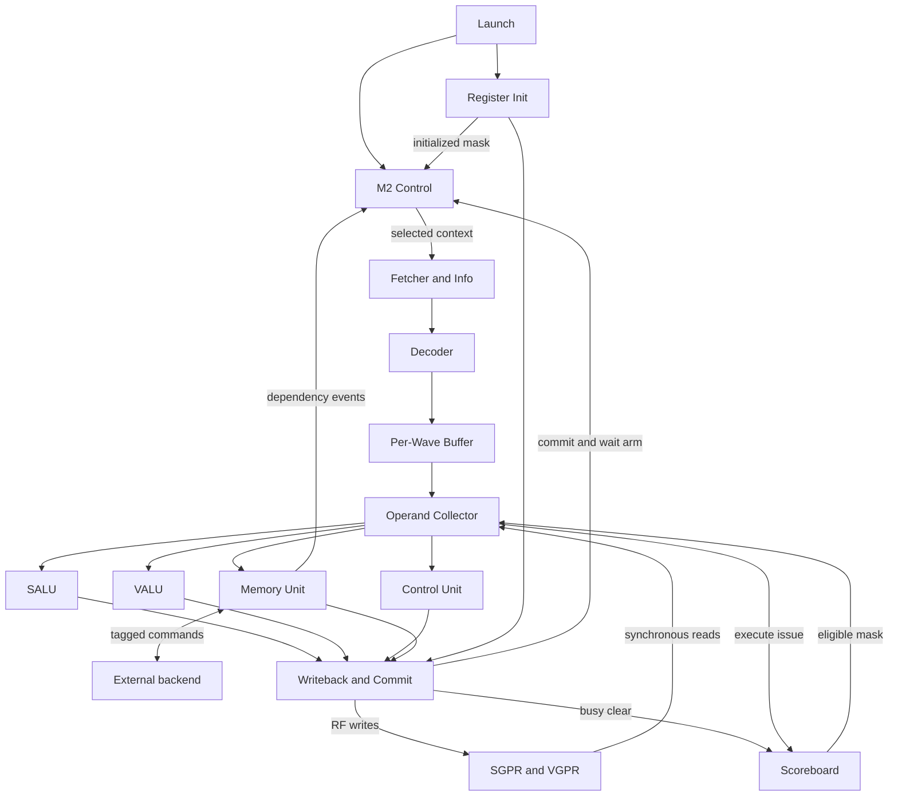
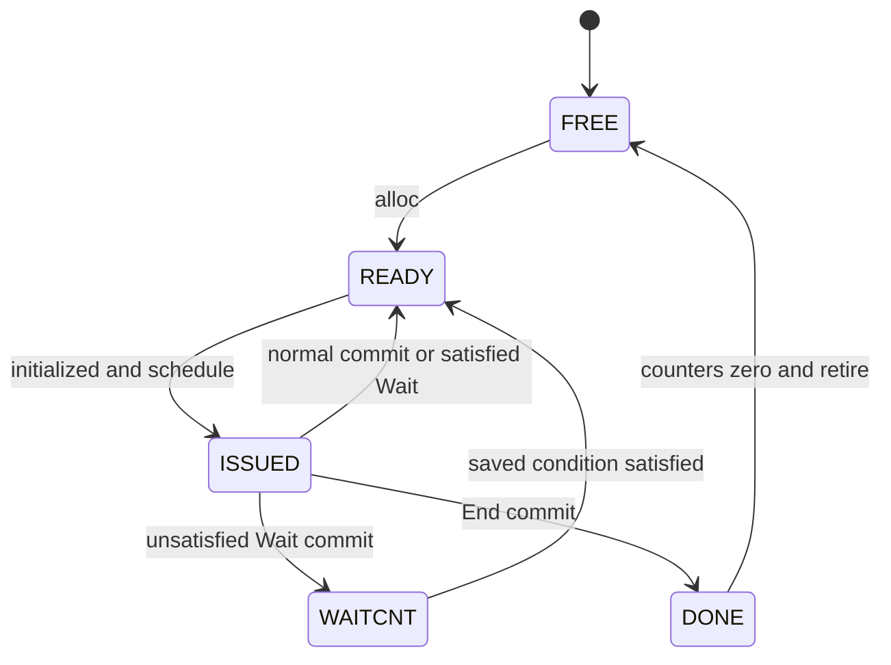
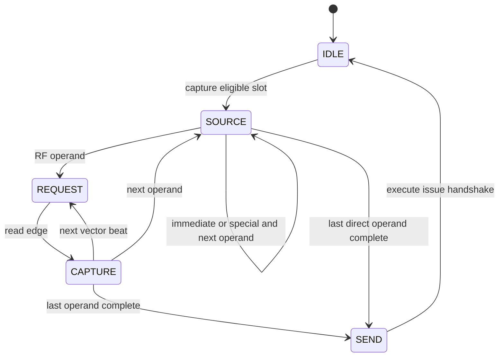

# TinyGPU M3：真实指令、多 Wave 执行数据通路规格

版本：M3 architecture freeze v1.1  
日期：2026-10-03  
状态：以首版 RTL 为实现参考，供后续逐模块重写与阶段验收使用  
前置里程碑：M1 Legacy 指令兼容桥；M2 多 Wave 控制平面  
最终验收平台：**VCS2016 + Verdi2016**  
实现参考：`TinyGPU_M3_RTL_2026-10-03.zip`  
配套文件：`M2_MULTI_WAVE_CONTROL_SPEC.md`、`M3_WAVE_EXECUTION_SPEC_AND_PLAN.md`、`M3_STAGE_REPORT.md`

本文件沿用 M2 规格的组织方式，把 M3 从实施计划展开为模块、存储、接口、事件和时序规格。它不改写已经交付的 RTL。文中的“必须”用于后续重写与验收；“首版实现”用于说明当前微架构及其边界。发现 RTL 与要求冲突时，应记录差异并修正实现，不能仅以某次回归通过改变要求。

## 1. M3 的一句话目标

M3 建立真实机器码驱动的多 Wave 执行闭环：由 M2 选择一个已经完成寄存器初始化的 Wave，取出并译码其 CDNA5 子集指令，检查寄存器相关性、收集操作数、执行、写回，再产生 M2 的架构提交、Wait arm 和依赖增减事件。

M2 保存“谁能运行以及何时结束”；M3 实现“这一条指令实际做什么，以及结果何时真正生效”。TB 不再替执行端制造正常 commit、Wait 或 dependency 事件。

### 1.1 架构要求与实现选择

| 层次 | 本规格约束 | 不能据此推断的内容 |
| --- | --- | --- |
| 真实 ISA 子集 | 已支持指令的机器码、操作数、运算、PC、标志位、寻址与 Wait 行为 | 完整 ISA 都已实现 |
| Kernel 启动 profile | 由调用方提供 User SGPR；初始化 Workgroup-local v0；提供 TTMP8/9 读取路径 | 已实现 AQL/ELF/驱动或所有启动模式 |
| 本项目微架构 | Wave32、SIMD4、常驻 Context、RF 端口、缓冲深度、互锁和仲裁 | AMD 实际芯片的内部结构、时延或吞吐 |
| 外部后端契约 | Tagged 命令、反压、一次响应、Store ack、共同 reset flush | 已实现 Cache、总线或物理事务合并 |

ISA 基准固定为 AMD CDNA5 ISA 2026-07-27 版；后续手册变化需要另立版本评审。User SGPR 参数布局参考 LLVM AMDGPU ABI，由启动端解析，本 RTL 不自行猜测。

## 2. M3 完成后的可观察能力

1. 输入真实 DWORD 机器码，完整通路自行产生指令执行结果。
2. 正确混排 1、2、3 DWORD 指令及 literal，不把第三 DWORD 当下一条指令。
3. 多 Wave 取指响应可以交错，指令始终归属于请求时保存的 Wave 和 PC。
4. 每个 Wave 的 SGPR、VGPR、特殊状态和 busy 位互相隔离。
5. RF 初始化完成前，READY Context 也不会被 Scheduler 选中。
6. 一个 Wave 的 decoded 指令因 Load 结果未返回而等待时，其他 Wave 可以执行。
7. Wave32 向量运算通过 SIMD4 的 8 个计算 beat 完成；inactive lane 不覆盖旧 VGPR 数据。
8. Scalar/Control 在 EXEC=0 时仍执行；Vector memory 在 EXEC=0 时不发实际命令。
9. 非阻塞 Load 请求被接受后，该 Wave 可以执行无关后续指令；相关指令由 Scoreboard 阻塞。
10. Load 返回可以乱序写 RF；规定需要排序的 counter 通知仍保持正确顺序。
11. Wait 使用提交时的计数查询决定 READY/WAITCNT，并使用保存条件完成后续唤醒。
12. 普通运算完成最后一次所需 RF 写后才释放本次前端指令；Load 返回不重复推进 PC。
13. End-program 可以先进入 DONE，再等待未完成请求排空后回收 Context。
14. 真实整数向量加法、标量分支循环、SMEM 与 Workgroup-local LDS 测试可端到端运行。
15. 未支持指令、RF 超容量和存储错误可定位到 Wave、原 PC、原指令及故障码。
16. M1 六个 Legacy 程序和 M2 参数回归继续通过。

## 3. M3 的边界

### 3.1 必须实现

- 45 条冻结的真实指令及其支持字段范围。
- Wave-tagged Fetch/Decode 和 per-Wave 指令槽。
- 同步读 SGPR/VGPR、逐 Wave 初始化。
- RAW/WAW Scoreboard、寄存器 pair 检查与 Operand Collector。
- SALU、SIMD4 VALU、Branch/NOP/Wait/End 控制执行。
- 带 Tag 的 Global/SMEM/DS 命令、返回写回和依赖通知。
- RF 结果包仲裁、架构 commit 仲裁及 `commit_next_state`。
- 启动快照、sticky fault、反压和共同复位契约。
- 真实机器码 TB、独立参考模型、协议 checker 和商业工具脚本。

### 3.2 本阶段不实现

| 内容 | 后续归属或说明 |
| --- | --- |
| Coalescer、Transaction Queue、Return Router、物理 LDS bank | M4 |
| Scalar/Global Cache、物理总线接入与存储层级 | M4，须另定容量与一致性规格 |
| Workgroup 资源准入、Barrier、Named/Cluster Barrier | M5 |
| Divergence/reconvergence 与完整 EXEC 路径管理 | M5；当前显式 EXEC 操作和条件分支不等于完整 divergence 引擎 |
| Matrix/WMMA/MFMA/Tensor/TDM | M6 |
| VOP3/DPP/VOPD、浮点/SFU、atomics、scratch | 未列入 M3 支持子集 |
| Trap handler、XNACK replay、异常恢复 | 当前只报告故障；不提供恢复协议 |
| 多 Kernel 并发、跨 CU/WGP 调度 | 当前单 Kernel 控制模型 |
| AQL、ELF、真实驱动、所有 Kernel Descriptor 模式 | 启动端提供已解析字段 |
| 综合、STA、PPA、形式证明 | 不作为当前辅助仿真已完成项目 |

M3 的 LDS 用例只检查单 Wave 数据流与 Workgroup 隔离。不能把它解释为已经支持跨 Wave Barrier；尤其不能依赖当前 Dispatcher 保证整个 Workgroup 同时常驻。

## 4. 默认硬件配置与容量

| 项目 | 默认值 | 约束与意义 |
| --- | ---: | --- |
| 数据 DWORD | 32 bit | B64 通过两个 DWORD 组织 |
| Logical Wave | 32 lanes | 当前 profile 固定 Wave32 |
| Physical SIMD | 4 lanes | 每条完整向量计算 8 beat |
| EXEC/VCC 容器 | 64 bit | 使用低 32 位，当前写入高半为 0 |
| PC 容器 | 64 bit | 有效 [56:0]，高 [63:57]=0，低 [1:0]=0 |
| 数据地址 | 64 bit | 字节地址；当前后端使用已映射地址 |
| `NUM_WAVE_CONTEXTS` | 4 | 参数回归为 1/3/4/8 |
| `NUM_SGPRS` | 32/Wave | 默认支持 s0..s31；容量不等于 ISA 编号上限 |
| `NUM_VGPRS` | 64/Wave | 默认支持 v0..v63；一个 VGPR 有 32 个 lane DWORD |
| SGPR RF | 2R1W | 同步读，1 cycle 读时序，无数据复位/旁路 |
| VGPR RF | 4 lane bank，各 2R1W | 每读口每拍返回同一 beat 的 4 lane 数据 |
| Frontend 未提交指令 | 1/Wave | 对应 M2 ISSUED 所有权 |
| Decoder slot | 1/Wave | 等数据时不占全局 FIFO 头 |
| Operand Collector | 1 个 | 一次保存一个完整指令包，三源依次收集 |
| SALU/Control 输出保持槽 | 各 1 个 | 下游未消费时保持结果/提交描述 |
| VALU 在执行指令 | 1 条 | 计算和结果归属不跨 Wave 混合 |
| 架构 commit | ≤1/上升沿 | 不限制同沿其他 Wave 的 wakeup/retire/RF 写 |
| 外部 memory request | ≤1/上升沿 | 一次传输是一条完整 Wave 命令 |
| `NUM_MEMORY_TAGS` | 16 | 首版合法范围 1..31；amount=1 |
| transaction ID | 8 bit | 当前 ID 编码槽号，未使用位为 0 |
| `RETURN_FIFO_DEPTH` | 4 | ≥1；满时反压 |
| dependency issue/complete | 各 ≤1/上升沿 | 两类事件可以同沿出现 |
| `THREADS_PER_WORKGROUP` | 64 | 1..1024，沿用 M2 一维派发 |
| `MAX_GROUP_SEGMENT_BYTES` | 4096 | 每 WG LDS 模型容量上限 |
| sequence ID | 8 bit | LOAD/STORE/DS 的每 Wave、每 kind 排序 |

统一使用 `WAVE_ID_BITS = (NUM_WAVE_CONTEXTS > 1) ? $clog2(NUM_WAVE_CONTEXTS) : 1`。非 2 的幂数量的剩余编码不是合法 Context。

默认 RF 有效数据容量：SGPR 为 `4×32×32=4096 bit`；VGPR 为 `4×64×32×32=262144 bit`。不计读输出寄存器、busy 和控制元数据。当前 RTL 描述同步数组，不承诺已经绑定真实 2R1W hard macro。

**8 beat 仅描述一次向量计算的展开宽度。** 操作数读取、执行和结果写回都有各自的周期；仲裁、反压和数据依赖还会增加时间。M3 不承诺每 8 个系统 cycle 提交一条向量指令。

## 5. 顶层微架构



`wave_execution_subsystem` 集成 M3 功能模块；`wave_compute_top` 集成 M2 Control 与 M3 Execution。两个 Top 仅连线和组合限定，不重复保存架构状态。

### 5.1 状态唯一所有者

| 状态 | 唯一所有者 | 清除/完成依据 |
| --- | --- | --- |
| Wave 生命周期、PC、EXEC、VCC、SCC、M0、派发元数据 | M2 `wave_context_table` | alloc/issue/commit/wakeup/release |
| 七类 counter 与保存的 Wait 条件 | M2 `wave_dependency_tracker` | dependency 事件与 arm/wakeup |
| Kernel 派发/完成进度 | M2 `wave_dispatcher` | launch/alloc/retire |
| SGPR/VGPR 数据 | 两类 RF | 真实 RF write，数据数组不清零 |
| 初始化进度、launch 保存字段、首故障 | `wave_register_init` | 最后初始化写/launch/reset |
| DWORD 组装与取指 pending | `wave_instruction_fetcher` | imem response/完整包消费 |
| decoded slot | `wave_instruction_buffer` | decode 接受/Collector pop |
| 寄存器 busy | `wave_scoreboard` | execute issue/最终结果写回消费 |
| Tag、访存顺序号和返回 FIFO | `wave_memory_unit` | 请求/响应/写回/complete |
| RF 写回 owner/beat、commit pointer | `wave_writeback_commit` | 实际物理写步骤/最终消费/commit |

各模块只向状态所有者发送事件，不直接改写其他模块的数组。

## 6. 新增模块与唯一职责

| 编号 | 模块 | 职责 | 不负责 |
| --- | --- | --- | --- |
| F01 | `cdna_instruction_info` | 首 DWORD 分类、字数与 literal 长度判定 | 完整运算译码 |
| F02 | `wave_instruction_fetcher` | 每 Wave 组装槽、快照、带标签请求/返回、完整包仲裁 | 推进架构 PC |
| F03 | `cdna_decoder` | 真实字段转 uop，支持范围/容量/对齐判定 | 执行或保存新的架构状态 |
| F04 | `wave_instruction_buffer` | 每 Wave 一个 decoded 槽，按 pop 释放 | 调度生命周期 |
| F05 | `wave_sgpr_file` | 同步 2R1W 标量数据存储 | busy、初始化策略 |
| F06 | `wave_vgpr_file` | 4 bank 同步数据存储、beat 地址与 masked write | EXEC 的架构保存 |
| F07 | `wave_register_init` | launch 快照、逐 Wave 初始化、initialized、首故障保存 | 分配 Context 或直接写 RF |
| F08 | `wave_scoreboard` | 源 RAW/目的 WAW，busy 置位/清位 | Wait counter |
| F09 | `wave_operand_collector` | 可执行槽 RR 选择、三源/pair 收集、单元路由 | 计算结果 |
| F10 | `wave_salu` | 标量结果、SCC、特殊状态提交数据 | 直接改 Context |
| F11 | `wave_valu` | SIMD4×8、masked VGPR 结果、VCC 汇总 | 物理 RF 写口仲裁 |
| F12 | `wave_control_unit` | Branch/NOP/Wait/End 描述 | 查询计数器或唤醒 Wave |
| F13 | `wave_memory_unit` | 地址/数据快照、Tag、请求、返回写包、通知排序 | 物理 coalescing/cache |
| F14 | `wave_writeback_commit` | 整包 RF 仲裁、commit 仲裁、busy clear、Wait arm | 重复执行运算或保存 PC |
| T01 | `wave_execution_subsystem` | F01..F14 结构连线 | 新架构寄存器 |
| T02 | `wave_compute_top` | M2+M3，launch、存储、fault 外部接口 | 第二套生命周期/计数器 |

## 7. 公共数据类型与标签

### 7.1 Wave ID 的定义

`wave_id` 是常驻 Context 槽号。`workgroup_id` 是逻辑 Workgroup 编号；`wave_index` 是 WG 内 Wave 编号。三者不能互换。Context 退休后，槽号可以复用；未完成 Tag 必须在此前排空。

所有参数化接口把 `wave_id` 作为 sideband，与 payload 同时保存、同时握手。package 中默认 `cdna_wave_id_t` 是默认四 Context 的宽度，通用 M3 payload 不直接内嵌它，避免 N8 配置截断。

### 7.2 Payload 规格

| 类型 | 关键字段 | 数据布局与含义 |
| --- | --- | --- |
| `m3_context_t` | pc、exec_mask、vcc、scc、m0、WG/wave 元数据、dispatch_index | schedule 时的架构快照 |
| `m3_fetch_payload_t` | context_data、instruction[95:0]、inst_dwords[2:0]、fault | DWORD0=[31:0]，DWORD1=[63:32]，DWORD2=[95:64] |
| `m3_decoded_payload_t` | context_data、instruction、uop、fault | 保留原始机器码，便于 commit/fault 定位 |
| `m3_operand_payload_t` | decoded、src0/src1/src2，各 2048 bit | 每源 32 个 64 bit lane 槽；lane i=[64i+:64] |
| `m3_commit_t` | origin_pc、next_pc、instruction0、format/opcode、is_wait/is_end、wait_spec、各特殊状态写标志/值 | 架构提交意图；不携带 Load 的第二次 PC 更新 |
| `m3_result_t` | commit_needed、commit_data、dst kind/index/count、write_mask[31:0]、data[2047:0]、clear_busy、suppress_write | 物理结果包；VGPR 用各 lane 槽低 DWORD；SGPR pair 用 data[63:0] |
| `m3_wait_spec_t` | mask[6:0]、六个 6 bit 阈值、KM 5 bit 阈值 | mask 选择实际参与比较的类别 |
| `m3_memory_request_t` | transaction_id、kind、space、operation、WG、active_mask、group_segment_bytes、addresses、store_data | addresses 为 32×64 bit；store_data 为 32×32 bit |
| `m3_memory_response_t` | transaction_id[7:0]、load_data[1023:0]、error | Load 每 lane 一个 DWORD；Store 数据无效但仍返回 ack |

### 7.3 `decoded_uop_t` 的规范化信息

必须保存：format/真实 opcode/function、指令字数、目的及三源的 kind/index/count、逐源 64 bit immediate、branch 条件、memory 分类与 offset、EXEC/特殊状态效果、Wait 配置和非法标志。

已有 `immediate` 字段继续供 Legacy/branch 使用；不能把多个源的不同立即数挤进同一字段。原 M1 enum 数值保持兼容，M3 追加 TTMP operand kind 与 bit/shift function。

## 8. Launch、初始化与 Context 生命周期

### 8.1 外部启动字段

| 端口 | 方向 | 位宽 | 含义 |
| --- | --- | ---: | --- |
| `clk/rst_n` | 输入 | 1/1 | 时钟、异步低有效控制复位 |
| `start` | 输入 | 1 | 空闲时申请启动 |
| `start_pc` | 输入 | 64 | 有效 57 bit、DWORD 对齐入口 |
| `thread_count` | 输入 | 32 | 一维总线程数，由 M2 拆分 |
| `launch_user_sgpr_count` | 输入 | 6 | 初始化连续 s0 起的数量，0..min(32,NUM_SGPRS) |
| `launch_user_sgpr_data` | 输入 | 1024 | 第 i 个 DWORD 为 [32i+:32]，写入 si |
| `launch_dispatch_index` | 输入 | 25 | TTMP8 的 dispatch 字段 |
| `launch_group_segment_bytes` | 输入 | 32 | 每 WG LDS 分配量，不超过模型容量 |
| `busy/done` | 输出 | 1/1 | Dispatcher 运行状态、单周期成功完成 |
| `fault_valid` | 输出 | 1 | sticky 首故障 |
| `fault_wave_id/code/pc/instruction` | 输出 | 参数宽/4/64/32 | 故障归属与诊断 |

首版 `launch_candidate = start && !control_busy && !control_done && !fault_valid`。只有配置合法时才送入 Dispatcher；非法候选产生 LAUNCH fault。`busy` 直接反映 Dispatcher，`done = control_done && !fault_valid`。

start 在 busy 或 done 周期不被接受。持续保持 start 可能在下一次空闲时再次启动；调用方应使用明确启动脉冲或自行管理重复启动。所有已接受 launch 字段保存一次，Kernel 运行期间改变 live 输入不能修改当前启动状态。

### 8.2 初始化值与调用方责任

| 对象 | 当前 profile |
| --- | --- |
| User SGPR | 调用方准备值，连续写 s0..s(count-1) |
| 常用 kernarg-only 配置 | s0/s1 是 kernarg 指针低/高 DWORD；是否使用由调用方决定 |
| v0 | `local_x = wave_index×32 + lane_id`，1D WG 内坐标 |
| TTMP8 | `{2'b00, wave_index[4:0], saved_dispatch_index[24:0]}` |
| TTMP9 | 1D、无 cluster profile 下的 workgroup_id |
| 其他 SGPR/VGPR | 不保证初值；使用前由程序定义 |
| LDS | 不保证初值；读前由程序或约定的初始化流程写入 |

首版 v0 初始化写满 32 lane，包括尾部 Wave 的 inactive lane；inactive lane 不因此取得执行资格。初始 EXEC 仍由 M2 的真实有效线程数决定。

TTMP8/9 由保存的 Context 快照构造，只提供当前 user-mode 读取路径。其他 TTMP、privileged 写、cluster、scratch、额外 ABI SGPR 启动模式不在范围内。

测试程序可由调用方把 WG 大小放入某个 User SGPR，但那是测试参数布局，不能说成硬件自动初始化该普通 SGPR。全局线程号由程序依据 WG 编号、WG 大小与 v0 计算。

### 8.3 初始化作业

alloc 时为该槽创建 pending job，清 initialized，保存 wave_index，cursor=0。每次通过统一 Writeback 完成一个 User SGPR 写后推进 cursor；全部 User SGPR 完成后生成 v0 整 Wave 结果包。**v0 第 7 beat 真正写完后**，才把该 Wave 的 initialized 置 1。

`schedule_enable_mask = rf_initialized_mask & {NUM_WAVE_CONTEXTS{!fault_valid}}`；M2 Scheduler 候选为 `ready_mask & schedule_enable_mask`。RF 数据本身不 reset、不 alloc 全量清零。

### 8.4 保持 M2 状态机

| 状态 | M3 含义 |
| --- | --- |
| FREE | 未分配；RF 旧数据不具备新 Wave 的定义性 |
| READY | 可以进入 Scheduler；还必须满足 initialized gating |
| ISSUED | 一条前端指令已取得该 Wave 所有权，可能取指/等 RF/执行/等 commit |
| WAITCNT | 已提交 Wait，保存条件尚未满足 |
| BARRIER | 保留 M2 状态；M3 不生成真实 Barrier 指令 |
| DONE | End 已提交，等待所有依赖排空和退休 |



不增加 REGISTER_WAIT 状态。等寄存器的 decoded 指令留在自己的槽，Context 仍为 ISSUED。**每拍最多一个 Wave schedule，不等于每拍最多一个 Wave 状态变化。** 不同 Wave 的 commit、wakeup、alloc、retire 可以同沿发生。

## 9. Instruction Info 与 Fetch 规格

### 9.1 F01 首字分类

| 格式 | DWORD0 前缀 | 默认字数 | 长度扩展 |
| --- | --- | ---: | --- |
| SOP1 | [31:23]=`101111101` | 1 | 检查 SSRC0 literal |
| SOPC | [31:23]=`101111110` | 1 | 检查两个 scalar 源 literal |
| SOPP | [31:23]=`101111111` | 1 | SIMM16 在本字 |
| SOP2 | [31:30]=`10` | 1 | 检查两个 scalar 源 literal；须在特殊 SOP 前缀之后判定 |
| VOP1 | [31:25]=`0111111` | 1 | 检查 SRC0 literal |
| VOPC | [31:25]=`0111110` | 1 | 检查 SRC0 literal |
| VOP2 | [31]=0，排除上述前缀 | 1 | 检查 SRC0 literal |
| SMEM | [31:26]=`111101` | 2 | 本 profile 固定 2 DWORD |
| VDS | [31:26]=`110110` | 2 | 本 profile 固定 2 DWORD |
| VGLOBAL | [31:24]=`0xee` | 3 | 本 profile 固定 3 DWORD |

短 ALU 源选择 255 表示共享 literal32，总长度 2；254 表示共享 literal64，总长度 3。literal64 低 DWORD 在字1、高 DWORD 在字2；同一指令混用 254/255 产生 ENCODING fault。不是每个源独立追加一段 literal。

F01 是纯组合模块：`instruction0` 输入，输出 `inst_format/inst_dwords/fault`。完整 opcode 和 modifier 支持性由 Decoder 检查。

### 9.2 F02 每 Wave 组装槽

每槽保存 context snapshot、96 bit instruction、inst_dwords、fault、next_word，以及三个控制位：

| 位 | 意义 |
| --- | --- |
| occupied | 本 Wave 有组装作业或待输出完整包 |
| pending | 一个 DWORD 请求已被 imem 接受，等待响应 |
| assembled | 指令完整或故障包已形成，等待 Decode |

`selected_valid && selected_ready` 保存快照；`selected_ready = !occupied[selected_wave_id]`。新作业先请求 word_index=0；字0返回后用 F01 判定剩余字数。

同 Wave 最多一个 pending DWORD，不同时发 word1/word2；不同 Wave 的响应允许乱序。请求地址为 `snapshot.pc + 4×word_index`。完整包被 Decode 消费后清 occupied/assembled，不代表已经架构提交；之后仍由 M2 ISSUED 阻止该 Wave 下一次 schedule。

请求仲裁与完整输出仲裁分别 RR，反压时锁定 owner。首版 `imem_rsp_ready=1`，响应直接按标签落入预留槽，因此后端必须遵守“一次接受请求对应一次合法响应”的协议，不能发送未请求或重复响应。

### 9.3 imem 接口

| 通道 | 字段 | 协议 |
| --- | --- | --- |
| request | valid/ready、wave_id、word_index[1:0]、address[63:0] | word_index 合法 0..2；stall 时全部保持 |
| response | valid/ready、wave_id、word_index、data[31:0]、error | 标签必须等于对应 pending 请求；请求 fire 后至少 1 cycle |
| assembled output | out_valid/ready、out_wave_id、m3_fetch_payload_t | 完整指令/快照/故障一起传输 |

Fetch error 形成带原 Wave/PC 的 FETCH fault 包；不生成正常 uop 效果或假 commit。

## 10. Decoder 与指令支持规格

### 10.1 F03 处理顺序

1. 传播 Fetch/header fault。
2. 提取 format 内的真实 opcode 和字段。
3. 规范化 src0/1/2、dst、immediate、memory 与 Wait 信息。
4. 检查 opcode/profile modifier 是否支持。
5. 检查 RF 容量、pair 对齐和 operand 类别。
6. 输出原机器码、原快照、uop 和具体 fault。

首版 Decoder 为透明组合握手级：`out_valid=in_valid`、`in_ready=out_ready`、Wave ID 透传；没有内部排队寄存器。上游 Fetch 必须负责被反压时保持完整包。

### 10.2 源选择与 pair

| source code/profile | 规范化内容 |
| --- | --- |
| 0..105 | SGPR 编号，实际必须落在配置容量内 |
| ≥256 的已支持编码 | VGPR 编号=code-256，实际容量检查 |
| 124 | NULL 源，值 0 |
| 128..192 | inline 整数 0..64 |
| 193..208 | inline 整数 -1..-16，64 bit 符号扩展 |
| 254/255 | literal64/literal32；literal32 在 B64 源中零扩展 |
| 106/125/126/253 | 当前路径的 VCC_LO/M0/EXEC_LO/SCC |
| 116/117 | TTMP8/TTMP9 |

两个 DWORD 的普通 SGPR/VGPR pair 必须偶数起始，且两个寄存器均在容量内。B64 特殊 mask 寄存器变体不支持；不能因容器有 64 bit 就默认支持。

合法 ISA 编号超出当前 RF 容量是 RF_RANGE；不是整个 ISA 的非法寄存器。合法但未实现的格式、opcode、modifier 是 UNSUPPORTED。

### 10.3 冻结子集

| 类别 | 指令 |
| --- | --- |
| Scalar move | S_MOV_B32、S_MOV_B64 |
| Scalar integer | S_ADD_CO_U32、S_SUB_CO_U32、S_MUL_I32 |
| Scalar bit/shift | S_AND_B32、S_OR_B32、S_XOR_B32、S_LSHL_B32、S_LSHR_B32 |
| Scalar compare | S_CMP_EQ_U32、S_CMP_LT_U32 |
| Vector move/integer | V_MOV_B32、V_ADD_NC_U32、V_SUB_NC_U32 |
| Vector bit/shift | V_AND_B32、V_OR_B32、V_XOR_B32、V_LSHLREV_B32、V_LSHRREV_B32 |
| Vector compare | V_CMP_EQ_U32、V_CMP_LT_U32，VOPC 形式 |
| Control | S_NOP（仅 SIMM16=0）、S_ENDPGM、S_BRANCH |
| Conditional branch | S_CBRANCH_SCC0/1、S_CBRANCH_VCCZ/NZ、S_CBRANCH_EXECZ/NZ |
| Single Wait | S_WAIT_LOADCNT、STORECNT、DSCNT、KMCNT、ASYNCCNT、TENSORCNT、XCNT |
| Combined Wait | S_WAIT_LOADCNT_DSCNT、S_WAIT_STORECNT_DSCNT |
| SMEM | S_LOAD_B32 |
| Global | GLOBAL_LOAD_B32、GLOBAL_STORE_B32 |
| LDS | DS_LOAD_B32、DS_STORE_B32 |

附录 A 列出全部 45 个真实 opcode 与格式。内部 function_code/format_id 是工程编码，不能替代真实机器码入口。

### 10.4 Modifier 接受范围

Global 只支持 GV/GVS、B32 和当前零 modifier profile；SMEM 只支持普通 SGPR base pair、SOFFSET=NULL、SCALE_OFFSET=0；DS 支持当前 B32 与无额外控制字段形式。逐位接受条件见附录 B 与 `cdna_decoder.sv`。

普通 scalar B32 可使用本 profile 的 EXEC_LO/VCC_LO/M0 目的。SMEM 普通 SGPR/NULL 目的可接受；异步 VCC/其他特殊目的明确不支持，避免没有 Context 异步写路径却静默丢失结果。

## 11. SGPR/VGPR 与同步读时序

### 11.1 F05 标量 RF

逻辑地址 `row = wave_id×NUM_SGPRS + reg_index`。两读口分别有 enable、wave、index，返回各一个 DWORD；一个写口有 enable、wave、index、data。

### 11.2 F06 向量 RF

| 映射 | 公式 |
| --- | --- |
| logical lane | `lane=4×beat+bank` |
| bank | `lane % 4` |
| beat | `lane / 4`，0..7 |
| row | `(wave_id×NUM_VGPRS+reg_index)×8+beat` |
| read_data/write_data | bank b 位于 [32b+:32] |
| write_mask[b] | 控制该 bank 对应 lane 是否写入 |

两读口共享本次 read_beat，分别读取两个 VGPR 的同一组四 lane，可一次取 pair 的低/高 DWORD。

### 11.3 读边界

| 上升沿/区间 | 发生内容 |
| --- | --- |
| 边沿 N 之前 | Collector 为 REQUEST，驱动 read_enable/address |
| 边沿 N | RF 采样地址；非阻塞更新 read_data，Collector 进入 CAPTURE |
| N 到 N+1 | RF read_data 已稳定，Collector 组合使用新 read_data |
| 边沿 N+1 | Collector 捕获数据；进入下一 beat/source 或 SEND |

不能在边沿 N 的 Collector 时序块中把 RF 同沿新值当成已经可捕获。RF 未读时输出保持；数据和输出寄存器不 reset，只有合法读后才能使用。

没有同址 write-to-read bypass；相同数组元素同沿读写的 RTL 仿真读取旧值。合法相关流量由 Scoreboard 保证不在新值尚未完成时发起依赖读取。未来 hard macro 绑定仍需明确 read-during-write 行为。

默认一个 VGPR 源要走 8 组 REQUEST/CAPTURE；两个独立 VGPR 源在当前 Collector 中依次处理，不能把 2R 误读为所有三源每拍并行。

## 12. Instruction Buffer 与 Scoreboard

### 12.1 F04 per-Wave 指令槽

接口为 decoded `in_valid/ready/in_wave_id/in_payload`，Collector `pop_mask`，输出 `slot_valid` 和 `slots[]`。`in_ready=!slot_valid[in_wave_id]`，当前不旁路同拍 pop 来接受替换，允许容量释放气泡。

Collector 把完整 slot 捕获到自己的 packet 后才能 pop。pop 不释放 M2 ISSUED；只有该指令 commit 才结束前端所有权。

### 12.2 F08 busy 粒度与 eligibility

| 对象 | 粒度 | 检查 |
| --- | --- | --- |
| SGPR busy | 每 Wave、每 DWORD | 每个源与目的范围内 DWORD |
| VGPR busy | 每 Wave、整条逻辑 VGPR | 任一 lane 未完成，相关整个 VGPR 阻塞 |
| pair | 两个 busy 位 | 任一个 busy 就不能通过 |
| EXEC/VCC/SCC/M0 | 不重复建 busy | 同 Wave 未提交指令由 ISSUED 串行化 |

RAW：源有未完成生产者。WAW：目的尚有未完成写。Store 的数据源也参与 RAW；地址 pair 两半都检查。

`eligible_mask` 是相关性判定结果，不独立代表 valid 指令。Collector 还必须与 slot_valid、目标单元 ready、halt 相与。

### 12.3 busy 生命周期

busy 在 **`execute_issue_fire`** 置位，不在 schedule、decode 或 Collector pop 时置位。普通运算在最终结果写回消费时清除；Load 在返回最后物理写回完成时清除。Store、Control、Init 不创建目的 busy。

EXEC=0 的 VGPR 目的不预留 busy；该指令仍必须正常提交 PC。首版 Scoreboard 仍保守检查 slot 的源/目的，因此 EXEC=0 不保证立刻绕过已有相关性等待。

同沿同一 busy 位 clear/issue 时首版 issue 置位优先，表示新生产者占有。合法流量通过旧 busy eligibility 一般不会在刚清除沿立即读取/覆盖该寄存器，不设置同沿旁路。release 清 busy 控制元数据；checker 必须先证明退休前已排空。

Scoreboard 保证结果互锁；Wait counter 保证显式等待语义。busy 清零不意味着对应 counter 已经通知，counter 阈值满足也不意味着任意具体寄存器可被读取。

## 13. Operand Collector 规格

### 13.1 F09 接口职责

| 输入/输出组 | 内容 |
| --- | --- |
| 输入 | slot_valid、slots、eligible_mask、unit_ready[3:0]、halt |
| 输出 pop | 一个槽被 Collector 完整捕获的事件 |
| RF 请求 | read_enable、wave、index0/index1、beat |
| RF 返回 | SGPR 两 DWORD；VGPR 两组四 lane DWORD |
| 单元输出 | out_valid/ready、wave_id、unit[1:0]、完整 operand packet |

unit 编码：0 SALU、1 VALU、2 Control、3 Memory。候选从 RR pointer 开始扫描，要求槽 valid、相关性通过且目标单元可接受。capture 后移动 pointer。

### 13.2 状态机



按 src0、src1、src2 顺序收集。NONE 为 0；immediate/特殊寄存器/TTMP 从保存快照取得并广播至 32 个 lane 槽；SGPR/pair 读出后广播；VGPR/pair 按 beat 放入对应 lane 槽。

SEND 时 out_valid、Wave、unit、所有操作数和 decoded 快照保持至真正握手；握手同时送目标单元与 Scoreboard。不能仅因单元曾经 ready 就在收集完后不检查 ready。

当前一个共享 Collector 在捕获后串行完成该 packet，其他 Wave 要等本次收集/SEND 结束；per-Wave Buffer 消除的是未被选中相关指令的全局 FIFO 头阻塞，不表示实现了多 Collector 并行或任意阶段无阻塞。

## 14. SALU 与 VALU 执行规格

### 14.1 F10 SALU

SALU 接受一份 operand packet，生成一个保持结果包，`issue_ready=!result_valid`。普通 SGPR 数据进入 RF 写回；特殊状态通过 commit descriptor 送 M2。

| 功能 | DWORD 结果 | SCC 效果 |
| --- | --- | --- |
| S_MOV_B32/B64 | 源低 32/64 bit | 保持 |
| S_ADD_CO_U32 | (a+b) 低32位 | 33 bit 加法 carry |
| S_SUB_CO_U32 | (a-b) 低32位 | 本冻结子集使用 borrow：b>a |
| S_MUL_I32 | 乘积低32位 | 保持 |
| AND/OR/XOR | 按位结果 | result != 0 |
| LSHL/LSHR | a 左/逻辑右移 b[4:0] | result != 0 |
| CMP EQ/LT U32 | 不写 GPR | 无符号比较布尔结果 |

NULL scalar 目的使本次 SALU 数据与 SCC 效果失效，只正常提交下一 PC。这是已经纳入首版的 2026-10-03 规格勘误；不能继续沿用旧计划中的相反描述。

EXEC_LO/VCC_LO 写入零扩展至当前 64 bit 容器；M0 写 32 bit。此类目的不写普通 SGPR。B64 普通 SGPR pair 的两 DWORD 物理写均完成后提交。

### 14.2 F11 VALU

issue 时保存整个 packet、Wave 和 EXEC；之后 beat0..7 每拍算四 lane。result_valid 只在全部八个计算 beat 完成后置 1；其后结果包保持至最终消费，未消费前不接受新指令。

| 功能 | 每 lane 结果/效果 |
| --- | --- |
| MOV | src0 低DWORD |
| ADD_NC/SUB_NC | 32 bit 模运算，不写 carry |
| AND/OR/XOR | 两源低DWORD按位运算 |
| LSHLREV/LSHRREV | src1 左/逻辑右移 src0[4:0]；注意 REV 顺序 |
| CMP EQ/LT U32 | active lane 比较结果置 VCC 对应位；inactive 位为0 |

普通 VGPR 写 mask 使用 issue 保存的 EXEC。inactive lane 即使内部计算出值也不能物理覆盖。VOPC 汇总后通过 commit 更新 VCC，不写 VGPR，也不更新 EXEC。

VCCZ/EXECZ 分支归约只使用当前 Wave32 低32位。Scalar/Control 不受 EXEC=0 禁止；向量计算的架构写受 saved EXEC 约束。

## 15. Control Unit、PC 与 Wait

### 15.1 F12 控制结果

Control 接收 operand packet，输出一个保持的 commit descriptor。它决定 branch target、NOP、Wait 描述和 End 标志；实际提交与 Wait 查询发生在 F14。

| 情况 | next PC |
| --- | --- |
| 顺序指令 | `origin_pc + 4×inst_dwords` |
| SOPP taken branch | `origin_pc + 4 + sign_extend(SIMM16)×4` |
| 条件分支不跳 | 顺序 PC |

写入保留 [56:2]，高7位和低2位为0。入口合法性集中在 launch；取指模型检查程序映射范围。当前不实现越界跳转的 Trap 恢复。同 Wave 不做后继 speculative fetch，因此没有同 Wave 分支误预测 flush。

### 15.2 Wait 配置

| 指令类型 | 被选类别 | 阈值位 |
| --- | --- | --- |
| 单 LOAD/STORE/DS/ASYNC/TENSOR/X | 一类 | SIMM16[5:0] |
| 单 KM | KM | SIMM16[4:0] |
| LOAD+DS | LOAD、DS | LOAD=[13:8]，DS=[5:0] |
| STORE+DS | STORE、DS | STORE=[13:8]，DS=[5:0] |

M3 实际产生 LOAD/STORE/DS/KM 工作；ASYNC/TENSOR/X 无生产者，当前 XNACK 关闭。保留 Wait 解码，不制造假的异步或翻译事件。

### 15.3 arm 查询与后续保存查询

`wait_arm_valid = commit_valid && commit_payload.is_wait`。M2 commit 没有 ready，合法 commit_valid 所在上升沿即为一次 commit；Wait arm 与其同沿、同 Wave，PC 只推进一次。

| 查询 | 配置来源 | 用途 |
| --- | --- | --- |
| wait_arm_satisfied | 本次输入 mask/threshold 与提交 Wave | 选择本次 commit_next_state |
| wait_satisfied_mask[w] | Wave w 保存的 mask/threshold，wait_active 有效 | 已进入 WAITCNT 后持续检查并唤醒 |

两者都读取当前寄存器 counter，不保存 counter 快照。选中类别的 count 全部 `<= threshold` 才满足。未选择类别不参与；不能由某个已满足类别把其他类别清零的整体结果重新置 1。

F14 的 commit 仲裁/fire 不依赖 satisfied；satisfied 只选择 next-state，避免形成“必须先 fire 才能查询、必须先查询才能 fire”的组合环。

Wait 已满足时也发送 arm；Tracker 使用 `wait_active <= !wait_arm_satisfied`。未满足时保存配置，后续 `wait_wakeup_mask = waitcnt_mask & wait_satisfied_mask`。Wait 配置保存时序延续已确认的 `reset > arm > wakeup > hold`，不新增 alloc/release 清配置分支。

### 15.4 completion 与 arm 同沿

假设沿 N 前 count=1，本沿 completion 将其减至0，Wait0 同沿提交：查询读旧 count=1，提交 WAITCNT；沿 N 后 count=0，保存条件满足；沿 N+1 接受 wakeup，恢复 READY。此时没有重复执行 Wait，也没有重复前进 PC。允许这个气泡，不能未加正式旁路就声称查询的是 next count。

## 16. Memory Unit：地址、Tag 与外部命令

### 16.1 F13 命令准备

Memory Unit 接受 Collector 的真实访存 packet 后，把地址、Store data、active mask、Wave、WG、目的、原 PC/指令全部保存；后续改变 EXEC/源寄存器不能改变已保存请求。

| 路径 | 地址公式 | active mask |
| --- | --- | --- |
| Global GV | lane VGPR64 pair + sign_extend(IOFFSET24) | saved EXEC[31:0] |
| Global GVS | SGPR64 base + sign_extend(lane VGPR32 offset) + sign_extend(IOFFSET24) | saved EXEC[31:0] |
| SMEM | SGPR64 base + sign_extend(IOFFSET24) | 仅 bit0=1；不受 EXEC 影响 |
| LDS | VGPR32 byte offset + unsigned IOFFSET16，当前形成32 bit局部地址 | saved EXEC；WG ID 指定共享空间 |

B32 基础程序使用自然对齐地址。当前请求不携带可变 mem_size，后端依据 M3 固定 B32 profile 处理；扩大数据宽度需升级协议。

### 16.2 Tag 生命周期

| 阶段 | 进入依据 | counter/PC |
| --- | --- | --- |
| FREE | 未分配槽 | 无归属 |
| RESERVED | execute issue 捕获并选空 Tag | 不加 counter，不推进 PC |
| SENT | 外部 mem request fire | dependency issue +1；生成请求接受 commit 描述 |
| RESPONSE BUFFERED | 外部 response fire 入 FIFO | 尚不直接减 counter |
| RF DONE / STORE ACK DONE | Load 最终写回消费，或 Store ack 从 FIFO 消费 | 具备本地完成条件 |
| NOTIFIED | 顺序条件通过，complete 输出生效 | counter -1，Tag 同沿释放 |

这张表是逻辑阶段，不要求实现一个六态 enum。首版 Tag 用 allocated/sent/rf_done/is_load 等字段、FIFO 和结果握手组合表达。

Tag 元数据至少包含 Wave、kind、destination kind/index/count、保存 mask、sequence、origin_pc、instruction0。8 bit transaction_id 当前等于槽号；Tag 必须保留至通知沿，不能响应一到就复用。

首版只保持一个待发送 command 和一个待提交 acceptance descriptor：`issue_ready = !command_valid && !memory_commit_valid && free_valid`。Tag 多并不意味着同时保持多个未被后端接受的 request。

### 16.3 EXEC=0

Vector memory 的 active mask=0 时，不分配 Tag、不发命令、不加 counter，生成顺序 commit 描述。SMEM 强制 lane0 有效，所以仍发命令。

首版 issue_ready 对零 EXEC 路径仍检查 free_valid；Tag 全满时零 EXEC 指令也会保守等待空槽。语义正确但不是吞吐优化，后续若绕过必须确保不创建 Tag/counter。

### 16.4 外部数据接口

| 通道 | 字段 | 约束 |
| --- | --- | --- |
| mem request | valid/ready、wave_id sideband、m3_memory_request_t | stall 时所有字段与 Tag 保持；完整 Wave 指令命令 |
| mem response | valid/ready、m3_memory_response_t | 由 Tag 找回 Wave；不使用当前 Scheduler ID |
| Store ack | response 的 Tag/error，load_data 无意义 | ack 表示所承诺写操作已完成 |

每个请求 fire 只能收到一次响应，响应至少晚1 cycle；不能发送未 allocated/sent、越界或重复 Tag。首版依赖外部协议与 checker，没有把非法 response 变成完整硬件恢复路径。

M4 可以把一个 Wave 命令拆成多个 transaction，但必须在回到该接口前汇总所需 lane 结果/ack。M2 counter 在这里仍按指令 amount=1，不按 lane、缓存行、bank 或物理 transaction 数量增加。

## 17. 返回 FIFO、乱序写回与依赖通知

### 17.1 返回接收

`mem_rsp_ready = fifo_count < RETURN_FIFO_DEPTH`。response fire 入 FIFO；FIFO head 是 Load 时生成 result packet 并保持到最后物理写完成；Store head 消费其 ack。Load result 使用 Tag 保存 mask/destination，不用当前 EXEC。

首版 FIFO 按响应到达顺序处理；不对 FIFO 内多个返回再排序。后端允许 B 先返回，B 可以先写 RF；不是保证任意后到响应都能绕过被反压的 FIFO head。

FIFO full 即使本沿 pop 也不旁路产生 ready，因此满后消费可能出现一个反压气泡。push/pop 同沿 count 保持，读写指针分别推进；Depth=1 也必须正确。

### 17.2 真实 counter 类别

| kind/编码 | 宽度 | M3 生产者 | complete 排序 |
| --- | ---: | --- | --- |
| LOAD/0 | 6 | GLOBAL_LOAD_B32 | 每 Wave、每 kind 按请求顺序 |
| STORE/1 | 6 | GLOBAL_STORE_B32 | 每 Wave、每 kind 按请求顺序 |
| DS/2 | 6 | DS_LOAD/STORE_B32 | 两类 DS 操作共用该顺序链 |
| KM/3 | 5 | S_LOAD_B32 | 当前允许乱序通知 |
| ASYNC/4 | 6 | 无 | 保留接口 |
| TENSOR/5 | 6 | 无 | 保留接口 |
| X/6 | 6 | 无，XNACK关闭 | 保留接口 |

issue 唯一来源是外部 request fire；complete 唯一来源是 Memory Unit 通知仲裁。两者均 amount=1，可同沿命中相同/不同 Wave 与 kind，由 M2 按净变化更新。

### 17.3 排序状态

每 Wave/kind 保存 next_sequence、head_sequence。有效命令预留 Tag 时保存 sequence 并递增 next；同 Wave 同 kind 通过当前单 command 按序送出。通知资格为：

`allocated && sent && rf_done && (kind==KM || sequence_id==head_sequence[wave][kind])`

从符合条件 Tag 中 RR 选择最多一个。非 KM 通知后递增 head；所有类别在通知沿释放 Tag。8 bit sequence 允许回绕；活动未通知窗口最大31，小于编号空间，不能在扩大窗口后未经评审沿用。

Tag 槽只在 reset 清空；顺序号不必在每次 Context alloc 清零，上一 Wave 排空后 next/head 对齐即可安全延续。未完成旧 Tag 不允许带入新 Wave。

### 17.4 B 先返回示例

| 事件 | v10/v11 | LOADCNT | Wait LOAD<=1 |
| --- | --- | ---: | --- |
| A→v10 请求接受 | v10 busy | 1 | — |
| B→v11 请求接受 | v11 busy | 2 | — |
| B 返回并写完 v11 | v11 busy清，A仍busy | 2 | 不满足 |
| Wait1 提交 | 保存阈值1 | 2 | WAITCNT |
| A 返回并写完 v10 | 两目的均ready | 2 | 仍等通知 |
| A 按序 complete | — | 1 | 条件满足，可后续wake |
| B complete | — | 0 | — |

不得在 B 写完时直接把 LOAD减为1，否则阈值1会在 A 尚未完成时放行。通知排序与物理 RF 写顺序是不同机制。

### 17.5 credit 与容量

每条有效命令占一个 Tag，到通知才释放；因此任一 Wave/kind 未通知工作不超过总 Tag 数。限制1..31保证 KM5bit容量，其他类别更宽。扩大 Tag、改变 amount、增加 SMEM 大尺寸或新生产者时必须重新定义 admission credit，不能仅扩大数组。

## 18. Writeback 与架构 Commit

### 18.1 F14 两组仲裁

| 仲裁 | 候选 | 单次消费粒度 |
| --- | --- | --- |
| RF result RR | SALU、VALU、Memory Load、Init | 完整 result packet，跨所有 beat 锁 owner |
| commit RR | 普通 result 最后一拍、Control、Memory acceptance | 一条 commit descriptor |

结果包生产者保持 result_valid/payload 至最终 result_ready。中间 RF beat 的物理写不是 result 整包握手；result_ready 只在最后一步置位。Init 用这个最终确认推进初始化，Memory 用它确定返回写回完成。

### 18.2 写回步骤

| 目的 | 步骤 |
| --- | --- |
| SGPR B32 | 1 个 DWORD write |
| SGPR B64 pair | 2 个 DWORD write，index=base+beat |
| VGPR B32 | 8 个四 lane beat；write mask 来自 packet |
| 无普通 RF 目的 | 不写 RF；仍可消费 packet/提交特殊状态 |

普通运算 `commit_needed=1`。其最后 write step 只有获得 commit 仲裁时才发生；最后 RF write、busy clear、result 消费与自己的架构 commit 同沿。没有 commit 资格就暂停最后一拍，不能先 READY 再补写数据。

异步 Load 与 Init `commit_needed=0`：最后写回不占该包的架构 commit，不更新 PC，可以与另一个 Wave 的 Control/memory commit 同沿发生。

result lock 期间另一个来源不能插入替换 beat。RF 与 commit pointer 在各自实际完成事件推进；不能随每拍有效候选无条件推进。

### 18.3 三个“完成”的区别

| 名称 | 含义 | 不自动代表 |
| --- | --- | --- |
| 架构 commit | 本次前端指令更新PC/特殊状态与生命周期 | 非阻塞 Load 已经返回 |
| RF writeback finish | 结果所有物理写步骤完成，相关busy可清 | 已按序发送 counter complete |
| dependency complete | 工作本地完成且通知排序通过 | 又执行了一次该指令或又前进PC |

访存 acceptance commit 由 request fire 生成，之后参与 commit 仲裁；所以请求被接受沿与其架构提交沿可以不同。Load 数据可能在提交等待期间返回；归属和守恒仍由 Tag/busy/counter 独立保存。

### 18.4 commit_next_state

| descriptor | 下一状态 |
| --- | --- |
| is_end | DONE |
| is_wait 且查询不满足 | WAITCNT |
| 其他，含已满足Wait | READY |

优先级 End 高于 Wait，合法指令不会同时标记二者。架构 PC 写在每次合法 commit 开启；其他特殊状态只在对应 write 标志为1时更新。

## 19. 跨模块事件协议

`valid/ready` 是持续电平；每个上升沿两者为1传输一次。无 ready 的合法事件端口在每个有效沿消费一次；相邻两个有效沿可以是两次不同事件。

| 事件 | 唯一产生者 | 消费者 | 生效条件 |
| --- | --- | --- | --- |
| launch candidate/合法启动 | Top限定+Init配置判定 | Init、M2 Dispatcher | 空闲且配置合法 |
| alloc_fire | M2 alloc handshake | Context/Tracker/Init | 建新Wave |
| schedule_fire | M2 selected handshake | Context、Fetcher | 保存快照，READY→ISSUED |
| fetch output fire | Fetch+Decode | Decode/Buffer或fault路径 | 完整包消费 |
| slot pop | Collector | Buffer | 完整捕获slot |
| execute_issue_fire | Collector+单元ready | 单元、Scoreboard | 操作数真正消费，预留目的busy |
| memory request fire | Memory+外部ready | 后端、Memory、Tracker | 发真实命令，issue+1 |
| memory response fire | 后端+FIFOready | Memory FIFO/fault路径 | 一次返回进入本地 |
| physical RF write | Writeback | SGPR/VGPR | 当前step真实写入 |
| result final fire | Writeback+结果源 | 单元/Memory/Init/Scoreboard | 最终消费/清busy/推进init |
| commit | Writeback | M2 Context | 单沿最多一个 |
| wait_arm | Writeback Wait commit | M2 Tracker | 同commit沿和Wave |
| wait_wakeup_mask | M2 Tracker与WAITCNT mask | M2 Context/Tracker | 保存条件满足 |
| dependency_complete | Memory通知仲裁 | M2 Tracker | 本地完成+排序通过 |
| retire/release | M2 Retire | Context/Tracker/Dispatcher/Init/Scoreboard | DONE且全部counter为0 |

所有延迟数据都以保存的 Wave/Tag 归属，不得读“当前 Scheduler 选中的 Wave”来决定写回或completion目标。

## 20. 同周期规则与允许的气泡

| 同拍情况 | 要求/首版行为 |
| --- | --- |
| 不同Wave的schedule/commit/wakeup/retire | 独立生效，不使用一个全表事件if链阻塞其他Entry |
| Context同Entry冲突 | 沿用reset > release > alloc > commit > wakeup > issue > hold |
| counter同类inc/dec | 按净变化，不能靠后一个非阻塞赋值覆盖前一个事件 |
| Wait arm+counter complete | arm查询当前旧值，允许WAITCNT后下一沿wake |
| busy clear+issue | 首版新issue置位优先；不设clear旁路eligibility |
| FIFO push+pop | count不变，分别移动指针 |
| FIFO full+pop | 首版ready仍为0，允许气泡 |
| Context满+release | alloc仅看原FREE集合，不同拍重用刚释放Entry |
| Tag满+complete | 新issue仅看原空槽，允许下一拍接受 |
| Buffer occupied+pop | input ready看旧valid，不接受同拍替换 |
| 普通最终RF写+commit未中选 | 最终写暂停，owner/beat/payload保持 |
| Load最终RF写+另一条commit | 两者可同沿；Load不写PC |
| Memory request fire+旧Tag通知 | 新issue与旧complete独立，request字段不能被空槽变化替换 |

这些气泡是首版接口时序的一部分，不是错误。后续做旁路优化时，应独立证明稳定性和单次消费，不能只为减少周期删除owner/valid保持。

## 21. End-program、退休与 Context 重用

S_ENDPGM 通过真实 Control/commit 路径令 Wave ISSUED→DONE；不要求软件先手动把每个 counter清零。M2 退休集合继续是 `done_mask & all_counters_zero_mask`，每沿最低编号选择一个。

checker 在retire时额外要求该Wave：无Tag、无目的busy、无Fetch/Buffer/Collector/单元残留前端所有权、初始化作业已结束。当前retire硬件条件未把所有这些位重复相与；这些不变量必须由事件时序保证并被验证。

最后一次complete沿只更新counter/释放Tag；retire组合逻辑随后才看到全零，退休在后续沿发生。不能在counter旧值仍非零时强制同沿回收。

release清 initialized与busy控制元数据，RF数组保留旧数据；再次alloc必须重新建立User SGPR/v0定义性。所有Wave退休后M2才给Kernel done一次脉冲；sticky fault抑制成功done。

## 22. Fault、Reset 与非法输入

### 22.1 故障输出与编码

| 编码 | 名称 | 含义 |
| ---: | --- | --- |
| 0 | NONE | 无故障 |
| 1 | UNSUPPORTED | opcode、format、modifier或模式不在子集 |
| 2 | OPERAND | 当前检测的operand/pair不合规定 |
| 3 | RF_RANGE | 编号或pair超过配置容量 |
| 4 | FETCH | 指令返回error |
| 5 | MEMORY | 数据返回error |
| 6 | LAUNCH | PC、User SGPR数量、LDS分配等启动配置错误 |
| 7 | ENCODING | 当前检测的编码冲突，如literal32/64混用 |

首故障保存在Init至reset；同沿首版优先级为非法launch > Decode/Fetch fault > Memory fault。记录Wave、origin PC、DWORD0。遇到unsupported不能静默变NOP，也不能产生成功done。

### 22.2 故障停发边界

fault后禁止新的Scheduler候选和Collector IDLE捕获；已捕获packet、已发imem工作、已接受/保持的合法memory request及返回仍可按原握手推进、排空。当前halt不是全管线撤销：Collector SOURCE/REQUEST/CAPTURE/SEND内已经拥有的工作可能继续送单元。

错误Load抑制实际RF数据写，仍完成结果消费、busy清除与依赖排空；该Kernel处于故障状态，不保证错误后架构数据结果可使用。完整精确异常、回滚、取消和恢复由后续规格定义。

### 22.3 Reset契约

控制状态采用 `always_ff @(posedge clk or negedge rst_n)`；组合逻辑不判断rst_n。reset清valid/owner/pending/busy/Tag/FIFO/counter/Wait/launch/fault，RF数据及其read_data不reset。

计算与指令/数据后端必须共同flush已接受旧事务。reset后不得返回旧Wave/Tag响应；当前无epoch或generation字段，单独reset计算端而不flush后端不受支持。

### 22.4 checker承担的外部合法性

Wave ID和Tag在范围内、response对应已接受请求、标签无重复、store ack满足写完成语义、stall payload稳定、没有未定义寄存器读取。这些系统协议由TB/checker约束并检查；首版不是对任意恶意或非法响应有恢复能力的IP。

## 23. 完整数据流例子

### 23.1 向量加法的一条普通指令

假设Wave0的v1/v2已定义且不busy，机器码对应 `V_ADD_NC_U32 v3, v1, v2`：

| 阶段 | 事件与状态 |
| --- | --- |
| schedule | Wave0 READY→ISSUED；保存PC/EXEC和Wave归属 |
| fetch/decode | 取完整机器码，形成VALU uop，保存v3目的与两源 |
| slot等待 | Scoreboard允许；否则只阻塞此slot |
| Collector capture | pop该slot，M2仍ISSUED |
| 源读取 | v1八个REQUEST/CAPTURE，再v2八个，形成完整32lane操作数 |
| execute issue | VALU接受packet，v3 busy置位 |
| VALU | beat0..7算lane0..31并生成完整结果 |
| RF writeback | owner锁定，v3八组masked write |
| 最终沿 | 最后一组写、v3 busy清、result消费、PC+4与READY同沿 |

这不是一个固定8cycle总延迟例子；展示的是必须遵守的数据依赖和所有权边界。

### 23.2 非阻塞Load→Wait→Add→Store→End

1. Wave0发Global Load A，外部接受：LOAD+1，生成接受commit；commit后READY，vA仍busy。
2. 发Load B：LOAD+1；可以与其他Wave的执行交错。
3. Wait LOAD0提交：未满足则WAITCNT，其他Wave继续。
4. 每个返回先通过保存mask写RF，再按通知排序减LOAD。
5. 全部所选count满足后wakeup→READY，不重取Wait。
6. Add读取已完成vA/vB，最后写与提交同沿。
7. Store接受：STORE+1，PC提交；保存Store data不受后续源寄存器变化影响。
8. End提交DONE；Store ack后通知STORE-1，counter全零才退休。

### 23.3 四个Wave同沿不同事件

| Wave | 本沿事件 | 下一状态/结果 |
| --- | --- | --- |
| Wave0 | 普通运算commit | ISSUED→READY，RF最终写完成 |
| Wave1 | Wait条件此前已满足 | WAITCNT→READY |
| Wave2 | schedule fire | READY→ISSUED，保存取指快照 |
| Wave3 | retire | DONE→FREE，完成数+1 |

Scheduler仍只有一个发射端口。Context表是各Entry独立更新，允许多Wave同沿变化。

## 24. M1/M2共存与修改范围

| 文件/通路 | M3处理 |
| --- | --- |
| 旧gpu_top/core/decode/wave_lsu | 保留M1可执行回归通路 |
| gpu_pkg | 保留Legacy enum值，增加M3类型、逐源immediate、Wait和fault |
| wave_control_subsystem | 增加schedule_enable_mask、alloc WG/wave元数据输出 |
| M2 Dispatcher/Context/Tracker/Retire | 保持已有生命周期与事件算法 |
| M2独立TB | schedule_enable_mask接全1，仍按原synthetic执行环境验证 |
| wave_compute_top | 新M3真实执行入口，不直接覆盖旧gpu_top |
| filelist/Makefile/scripts | 独立M3编译、矩阵、FSDB与参考检查入口 |

M2的synthetic事件验证与M3真实指令验证承担不同职责。M3 TB只提供外部launch与存储响应；不得靠手动commit把缺失执行逻辑绕过。

## 25. 后续逐模块重写顺序与分工

| 顺序 | 内容 | 本步必须讲清 |
| --- | --- | --- |
| 1 | package增量、F01 Info | payload、sideband、前缀优先级、literal字数 |
| 2 | F02 Fetcher | occupied/pending/assembled、RR+lock、响应归属 |
| 3 | F03 Decoder | 分格式译码、opcode、capacity/pair/unsupported |
| 4 | F05/F06 RF、F07 Init | 同步读边界、bank/row、最后初始化写 |
| 5 | F04 Buffer、F08 Scoreboard | per-Wave slot、RAW/WAW、busy事件 |
| 6 | F09 Collector | 三源、多beat、快照广播、实际issue |
| 7 | F10 SALU | 结果与SCC、特殊目的、NULL |
| 8 | F11 VALU | SIMD4×8、saved EXEC、VCC |
| 9 | F12 Control、F14基础commit | PC、Wait query/fire、最终写同沿 |
| 10 | F13 request | 地址/数据保存、Tag reserve与request accept |
| 11 | F13 response/complete | FIFO、RF完成、通知顺序和Tag释放 |
| 12 | F14完整仲裁、T01/T02 | 整包锁定、commit RR、纯连线 |
| 13 | 整体回归与最终平台 | 真实HEX、独立ISS、M1/M2及FSDB |

教学沿用约定：助手提供接口前完整注释、参数、所有声明、微架构与本步任务；用户写主要RTL；助手补重复bank/端口/展开逻辑、package、结构Top、TB/checker/验证。组合块不加reset判断。

不增加逐模块功能仿真要求。编写中做必要语法/端口检查，全部模块齐备后统一整体回归。首版参考工程用于对照；期望值仍由独立模型生成，不能由新RTL反向生成。

## 26. M3阶段验收矩阵

沿用原计划V01..V32编号，便于与交付报告对照。

| 编号 | 场景 | 必须观察到的结果 |
| --- | --- | --- |
| V01 | 真实HEX与独立译码 | opcode/字段/长度一致，45条子集实际commit覆盖 |
| V02 | 1/2/3DWORD与literal混排 | PC准确，第三字不丢失，literal32/64正确 |
| V03 | 多Wave取指乱序响应 | wave/word/原PC一致，无串包 |
| V04 | 各握手随机反压 | payload保持，每fire仅一次消费 |
| V05 | User SGPR/v0/TTMP8/9 | 初始化前不schedule，真实profile值一致 |
| V06 | 未定义值、Wave隔离、重alloc | 不依赖RF清零，定义状态重建 |
| V07 | SALU与NULL | 结果/SCC逐条正确，NULL不更新GPR/SCC |
| V08 | VGPR bank/beat/partial EXEC | 32lane无漏重，inactive保留 |
| V09 | VOPC与VCC/EXEC分支 | mask/归约正确，EXEC0仍执行Scalar/Control |
| V10 | 正负branch与循环 | target、次数、origin PC与参考一致 |
| V11 | SGPR/VGPR RAW/WAW/pair | pending目的不能提前读取/覆盖 |
| V12 | 一个Wave等操作数 | 其他就绪Wave继续执行 |
| V13 | GV/GVS/SMEM/DS地址 | signed offset、64bit高地址、WG key正确 |
| V14 | 请求stall时其他Tag释放 | 请求所有字段不变，无重复issue |
| V15 | Tag与返回FIFO满 | admission/ready正确，不溢出或丢返回 |
| V16 | B早于A完成、Wait1 | B可先写，LOAD通知不越序，Wait不早放 |
| V17 | LOAD/STORE/DS/KM同时pending | issue/complete守恒，同沿增减正确 |
| V18 | SMEM乱序、Wait KM0 | 所需数据写完再继续 |
| V19 | 七单Wait与两组合Wait | 字段和mask正确，未生产类不伪造事件 |
| V20 | arm/complete同沿与已满足Wait | 旧count规则、单次PC推进、正确wakeup |
| V21 | 请求后改变EXEC/Store源 | 返回mask和Store data使用保存值 |
| V22 | 同Wave同址Store→Load | 后端保证承诺顺序，读新值 |
| V23 | RF/commit多源竞争 | 不串beat，最终普通write与commit同沿，有进展 |
| V24 | End仍有pending | DONE等待排空，无Tag/busy残留退休 |
| V25 | 整数向量加法Kernel | 每有效元素/地址与独立模型一致 |
| V26 | LDS读写与WG隔离 | Store/Wait/Load正确，不声称跨WaveBarrier |
| V27 | threads=1/31/32/33/70/129/257 | tail EXEC、跨WG、Context重用正确 |
| V28 | N=1/3/4/8、WG=33/64/97 | 非2幂、ID宽度、地址与槽使用正确 |
| V29 | 连续launch | 保存参数重建，不误用live输入或旧归属 |
| V30 | Fetch/RF/request/Wait中reset | 共同flush，无旧事务写入新Wave |
| V31 | unsupported/operand/range/存储/launch故障 | 诊断正确，无静默NOP/成功done |
| V32 | M2与M1回归 | 八组M2与六个M1程序继续通过 |

额外审查项：sequence回绕、Tag/FIFO小配置、首故障保持、生产配置无锁存/多驱动/组合环、外部请求响应合法性。代码风格或lint通过不能替代功能验收。

## 27. 验证环境与已知证据

独立Python模型执行真实指令字；比对commit PC/flags、已定义GPR、memory地址/数据、Tag/counter/Wait事件。编码fixture不能与RTL共用同一译码函数。TB的存储模型提供延迟、乱序、反压、ack与error，不能产生假正常commit。

当前交付报告记录：Verilator5.020下M3 69/69集成运行、45/45指令覆盖；M2 8/8配置；M1 6/6程序。它们是已有报告的证据，本次写spec没有重新运行仿真。

矩阵包括N1/N3/N4/N8，WG33/64/97，16Tag/4FIFO及2Tag/1FIFO。已有定向记录覆盖16Tag满、4FIFO满、B先于A、KM乱序、arm/complete同沿、四类同时pending、260次Load序号回绕、连续launch与中途reset。

限制：Verilator两态仿真；未在本次环境执行VCS四态/X验收；未做综合/STA/PPA/形式签核；未使用确认CDNA5 target的官方assembler。完整覆盖明细和种子以`M3_STAGE_REPORT.md`与logs为准。

## 28. VCS2016/Verdi2016与RTL风格

保持logic、always_ff、always_comb、固定数组、packed struct、普通参数与参数宽度sideband。避免引入新版专有语法、参数化package、class/UVM要求。实际兼容性由VCS2016编译确认，不能仅凭其他工具接受便宣称商业工具通过。

工程根目录入口：

```bash
make m3
make m3_matrix
make m2_vcs_matrix
make sim
make m3_verdi
```

需将VCS2016/Verdi2016加入PATH，并按现有脚本设置NOVAS_HOME或VERDI_HOME及FSDB PLI。独立配置入口为`sim/filelist_m3_rtl.f`、`sim/filelist_m3_tb.f`及scripts中的compile/run/open脚本。

FSDB至少查看：Wave状态、alloc/schedule/execute/commit、origin PC/机器码、RF地址/beat/write mask、busy、Tag/sent/rf_done/sequence、七counter、Wait arm/wakeup、memory request/response。

重点波形场景为ordered、mixed、reset。命令退出码、独立trace检查和FSDB生成都要确认。当前尚无VCS2016/Verdi2016实际验收证据。

## 29. M3完成条件

1. 本规格的45条指令、启动profile、RF/Scoreboard、各执行模块、Tag和写回提交完整实现。
2. wave_compute_top从真实机器码生成正常commit/Wait/dependency事件。
3. V01..V32整体验收及相关不变量通过，工具/参数/种子/结果可复现。
4. M1/M2回归通过，没有Legacy编码或参数化Wave ID回退。
5. 用户环境VCS2016编译仿真和Verdi2016 FSDB查看完成。
6. 未支持范围、后端契约及后续接口明确。

当前状态为“首版RTL和辅助工具阶段验证已交付，最终平台待验收”。后续逐模块重写以本规格为行为要求，不把实现参考误当成新增ISA保证。

## 30. 参考与版本说明

- [E1] `M2_MULTI_WAVE_CONTROL_SPEC.md`：控制面组织、生命周期和事件协议。
- [E2] `M3_WAVE_EXECUTION_SPEC_AND_PLAN.md`：原M3计划、子集与V01..V32。
- [E3] `TinyGPU_M3_RTL_2026-10-03.zip`中的14个功能模块、2个Top、gpu_pkg、opcode manifest、README及重写路线。
- [E4] `M3_STAGE_REPORT.md`：首版结果与商业工具待办；本文件不新增仿真通过声明。
- [S1] AMD，CDNA5 ISA Reference Guide，2026-07-27版：[官方手册](https://www.amd.com/content/dam/amd/en/documents/instinct-tech-docs/instruction-set-architectures/amd-instinct-cdna5-instruction-set-architecture.pdf)。原计划引用3.4/3.5、4.1、5.7、14/15等章节。
- [S2] LLVM：[AMDGPU Backend User Guide](https://llvm.org/docs/AMDGPUUsage.html)，用于ABI背景；不据旧代规则推断本代未确认启动模式。

v1.1把原计划展开为当前模块时序规格；保留NULL目的勘误，并明确Collector串行、FIFO头处理、零EXEC容量门控、保守气泡、fault停止边界和reset无epoch契约。这些实现选择不宣称为AMD内部设计。

## 附录 A. 真实opcode清单

下表来自交付工程`docs/M3_OPCODE_MANIFEST.json`，按格式内的opcode记数；不同格式的同数值不等于同一指令。表格由已核对manifest生成。

| 序号 | 指令 | 格式 | 格式内opcode（十进制 / 十六进制） |
| ---: | --- | --- | --- |
| 1 | `S_MOV_B32` | SOP1 | 0 / `0x00` |
| 2 | `S_MOV_B64` | SOP1 | 1 / `0x01` |
| 3 | `S_ADD_CO_U32` | SOP2 | 0 / `0x00` |
| 4 | `S_SUB_CO_U32` | SOP2 | 1 / `0x01` |
| 5 | `S_LSHL_B32` | SOP2 | 8 / `0x08` |
| 6 | `S_LSHR_B32` | SOP2 | 10 / `0x0a` |
| 7 | `S_AND_B32` | SOP2 | 22 / `0x16` |
| 8 | `S_OR_B32` | SOP2 | 24 / `0x18` |
| 9 | `S_XOR_B32` | SOP2 | 26 / `0x1a` |
| 10 | `S_MUL_I32` | SOP2 | 44 / `0x2c` |
| 11 | `S_CMP_EQ_U32` | SOPC | 6 / `0x06` |
| 12 | `S_CMP_LT_U32` | SOPC | 10 / `0x0a` |
| 13 | `S_NOP` | SOPP | 0 / `0x00` |
| 14 | `S_BRANCH` | SOPP | 32 / `0x20` |
| 15 | `S_CBRANCH_SCC0` | SOPP | 33 / `0x21` |
| 16 | `S_CBRANCH_SCC1` | SOPP | 34 / `0x22` |
| 17 | `S_CBRANCH_VCCZ` | SOPP | 35 / `0x23` |
| 18 | `S_CBRANCH_VCCNZ` | SOPP | 36 / `0x24` |
| 19 | `S_CBRANCH_EXECZ` | SOPP | 37 / `0x25` |
| 20 | `S_CBRANCH_EXECNZ` | SOPP | 38 / `0x26` |
| 21 | `S_ENDPGM` | SOPP | 48 / `0x30` |
| 22 | `S_WAIT_LOADCNT` | SOPP | 64 / `0x40` |
| 23 | `S_WAIT_STORECNT` | SOPP | 65 / `0x41` |
| 24 | `S_WAIT_XCNT` | SOPP | 69 / `0x45` |
| 25 | `S_WAIT_DSCNT` | SOPP | 70 / `0x46` |
| 26 | `S_WAIT_KMCNT` | SOPP | 71 / `0x47` |
| 27 | `S_WAIT_LOADCNT_DSCNT` | SOPP | 72 / `0x48` |
| 28 | `S_WAIT_STORECNT_DSCNT` | SOPP | 73 / `0x49` |
| 29 | `S_WAIT_ASYNCCNT` | SOPP | 74 / `0x4a` |
| 30 | `S_WAIT_TENSORCNT` | SOPP | 75 / `0x4b` |
| 31 | `V_MOV_B32` | VOP1 | 1 / `0x01` |
| 32 | `V_LSHLREV_B32` | VOP2 | 24 / `0x18` |
| 33 | `V_LSHRREV_B32` | VOP2 | 25 / `0x19` |
| 34 | `V_AND_B32` | VOP2 | 27 / `0x1b` |
| 35 | `V_OR_B32` | VOP2 | 28 / `0x1c` |
| 36 | `V_XOR_B32` | VOP2 | 29 / `0x1d` |
| 37 | `V_ADD_NC_U32` | VOP2 | 37 / `0x25` |
| 38 | `V_SUB_NC_U32` | VOP2 | 38 / `0x26` |
| 39 | `V_CMP_LT_U32` | VOPC | 73 / `0x49` |
| 40 | `V_CMP_EQ_U32` | VOPC | 74 / `0x4a` |
| 41 | `S_LOAD_B32` | SMEM | 0 / `0x00` |
| 42 | `GLOBAL_LOAD_B32` | VGLOBAL | 20 / `0x14` |
| 43 | `GLOBAL_STORE_B32` | VGLOBAL | 26 / `0x1a` |
| 44 | `DS_STORE_B32` | VDS | 13 / `0x0d` |
| 45 | `DS_LOAD_B32` | VDS | 54 / `0x36` |

## 附录 B. 关键编码字段与首版接受限制

下表是本工程Decoder实现索引，便于重写核对；不是完整ISA编码表。W0/W1/W2分别指三个DWORD，连续packed位号另行注明。

| 格式 | opcode/主要字段 | 本profile限制 |
| --- | --- | --- |
| SOP1 | OP=W0[15:8]；SDST=[22:16]；SSRC0=[7:0] | OP0/1；B64普通pair/立即数 |
| SOP2 | OP=[29:23]；SDST=[22:16]；SSRC1=[15:8]；SSRC0=[7:0] | 只接受附录A所列OP |
| SOPC | OP=[22:16]；SSRC1=[15:8]；SSRC0=[7:0] | U32 EQ/LT |
| SOPP | OP=[22:16]；SIMM16=[15:0] | NOP仅0；branch/Wait按正文 |
| VOP1 | OP=[15:9]；VDST=[24:17]；SRC0=[8:0] | MOV；W0[16]=0 |
| VOP2 | OP=[30:25]；VDST=[24:17]；VSRC1=[16:9]；SRC0=[8:0] | 附录A整数子集 |
| VOPC | OP=[24:17]；VSRC1=[16:9]；SRC0=[8:0] | U32 LT/EQ；目的VCC |
| SMEM | OP=W0[18:13]；SDATA=[12:6]；SBASE pair起点=2×[5:0]；IOFFSET=W1[23:0] | W0[25:19]=0；W1[24]=0；W1[31:25]=124；普通SGPR/NULL目的 |
| VGLOBAL | OP=W0[20:13]；SADDR=[6:0]；VDST=W1[7:0]；VDATA=W1[30:23]；VADDR=W2[7:0]；IOFFSET=W2[31:8] | SADDR124/127选GV；其他支持SGPR pair选GVS；W0[12:7]/[23:21]与W1[22:8]/[31]为0 |
| VDS | OP=W0[25:18]；OFFSET=[15:0]；ADDR=W1[7:0]；DATA0=W1[15:8]；VDST=W1[31:24] | W0[17:16]=0；Load未用data字段为0；Store未用高字段为0 |

VGLOBAL Load要求VDATA=0；Store要求VDST=0。VDS Load要求W1[23:8]=0；Store要求W1[31:16]=0。这些拒绝规则是冻结profile的一部分，不能删掉后仍声称支持额外modifier效果。

## 附录 C. 重写时必须保持的核心不变量

1. 每个Context只被一条未提交前端指令拥有；延迟Load可独立于前端继续存在。
2. initialized在最后物理初始化写完成之前为0。
3. 任一pending数据包的Wave/PC/Tag/EXEC与数据同时保存、同时保持。
4. busy只在实际execute issue置位，最终结果消费清位。
5. 外部request未被接受，不加counter，也不允许该访存正常PC提交。
6. 每个未被reset丢弃的请求有且仅有一次响应和一次依赖通知。
7. Load所需RF写、Store ack未完成前不通知complete。
8. LOAD/STORE/DS通知符合每Wave/kind顺序；RF返回写回可以乱序。
9. 最后一拍普通结果写与自身commit同沿；Load/Init写回不推进PC。
10. Wait查询不决定commit fire；arm和commit同沿，保存条件用于后续wake。
11. End进入DONE后必须等排空，不让迟到返回污染复用Context。
12. reset共同flush后端；旧Tag响应不得跨reset继续返回。
13. fault抑制成功done，未支持指令不静默执行。
14. M3验证从机器码驱动，参考模型不由RTL结果生成。
