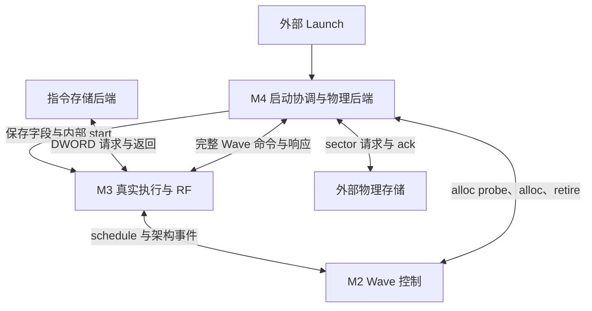
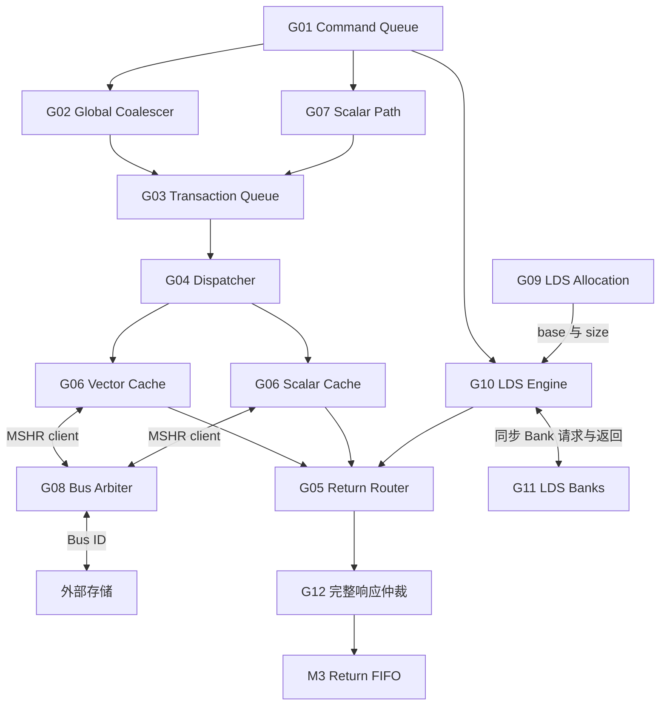
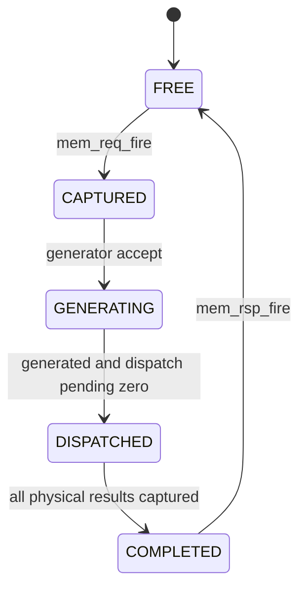

# TinyGPU M4：真实存储后端规格

版本：M4 architecture freeze v1.1（首版实现归档）  
日期：2026-10-03（北京时间）  
前置里程碑：M1 Legacy Baseline 与 UOP 兼容桥；M2 多 Wave 控制平面；M3 真实指令、多 Wave 执行通路  
实现参考：`TinyGPU_M4_RTL_2026-10-03.zip`，工程根目录 `TinyGPU_M4/`  
状态：12 个功能模块与 2 个结构 Top 已交付；本地整机验证完成；商业工具最终验收待执行  
最终验收平台：**VCS2016 + Verdi2016**

本文件沿用 `M2_MULTI_WAVE_CONTROL_SPEC.md` 的 22 章组织方式，将 M4 当前规格展开为配置、状态所有权、逐模块职责、接口、时序、事件、验收矩阵和后续升级说明。它同时对照用户提供的 M1/M3 规格，保持 Wave、Tag、Counter、Commit 与 Reset 的已有语义。

本文是当前 M4 的详细规格，供后续逐模块重写和验收使用，不是另一次 RTL 生成或仿真记录。原 `M4_MEMORY_SUBSYSTEM_SPEC_AND_PLAN.md` 保留为冻结设计输入；其“待实现”状态由本文件第 22 章和阶段报告更新。本文没有修改 RTL，也没有新增仿真通过声明。

“必须”表示接口或行为要求；“首版实现”表示当前 RTL 的具体实现选择；“本地通过”仅表示已有 Verilator 证据。Cache 容量、Queue 深度、调度周期等是 TinyGPU 的设计，不代表 AMD 芯片内部实现。发现实现与要求不符时，应记录差异并修正，而不能仅凭回归通过扩大支持范围。

## 1. M4 的一句话目标

M4 把 M3 产生的完整 Wave 访存命令变成真实物理存储工作：保存请求，合并 Global lane 地址，排队并控制顺序，访问两条独立 Cache/外部内存路径或 Workgroup-local LDS Bank，收集全部子事务，最后返回一次完整 Load 数据或 Store ack。

M2 管理 Wave 生命周期和依赖等待；M3 管理机器码、RF、指令 Tag、PC Commit 与依赖通知；M4 管理物理存储资源和完成。TB 只提供指令存储与物理 sector 存储服务，正常命令拆分、Cache/LDS 访问和完整响应由 RTL 完成。

## 2. M4 完成后的可观察能力

1. 原 M3 的 45 条真实指令继续从机器码执行，五条访存指令进入真实 M4 后端。
2. Wave32 连续 B32 Global Load 可以合并成四个 32-byte sector；跨界起点、广播、离散地址和 partial EXEC 正确处理。
3. 完整 64-bit 地址参与 sector、Cache tag 和冲突比较，高地址不会因低 32 位相同而别名。
4. Store 正确组装数据和 byte enable，未使能字节保持原值。
5. 事务队列使用同步 payload 读；被旧命令阻塞的事务可由其他 eligible 项绕过。
6. 每个 physical ID、Cache MSHR 和 Bus ID 独立预留、发送、返回、释放，反压期间归属稳定。
7. Vector/Scalar Cache 独立维护 direct-map 行、MSHR、set lock 和同步返回 FIFO。
8. Global Store 实际完成外部写后才 ack；hit 在 ack 后更新，miss 不分配 Cache 行。
9. 同 Wave Global Load 可有在途重叠和乱序返回；规定的同类和跨类别冲突顺序保持。
10. Scalar 在 EXEC=0 时仍访问，返回正确 SGPR 数据，KM0 等待真实完成。
11. LDS 有实际 16 KiB 数据阵列和默认 64 Bank，同 Bank 冲突真实分轮，同字 Load 可以广播。
12. WG 首次分配连续 2 KiB 块；后续 Wave 共享同一 base/size，不同 WG 空间隔离。
13. Wave 分配同时受 FREE Context 和 LDS 资源准入控制，只有一个原子 alloc_fire。
14. 大 WG 分批复用 Context 时，即使 resident 数暂为零，LDS 映射仍保留到全部 expected Wave 退休。
15. 全部子响应到齐后只返回一次原 M3 Tag；拆分数量不改变一次指令 dependency issue/complete。
16. 子错误汇总并排空已接受工作；首故障定位保留原 Wave、PC 和指令；已发生的 Store 不回滚。
17. 每次 launch 保存字段并在计算启动前失效两个 Cache；忙时 start 不破坏当前 Kernel。
18. Reset 共同 flush 各层控制归属，存储数据不全量清零；M1/M2/M3 独立回归入口继续保留。

## 3. M4 的边界

### 3.1 M4 必须实现

- 完整命令捕获、Global Coalescer、Scalar adapter、可选择同步事务队列。
- 同 Wave 物理执行顺序、稳定 physical reservation、sector 返回重组。
- Vector/Scalar 两个独立 Cache、MSHR、set lock、同步响应 FIFO 和 Bus 重标记。
- Write-through / no-write-allocate Store、真实外部 ack 和 byte enable。
- LDS WG 分配、原子准入、Bank 访问、冲突分轮、广播与完整 DS 返回。
- Launch 快照、Cache 启动失效、完整 error 响应和共同 reset flush。
- 整体机器码集成验证、独立架构/物理模型、M1/M2/M3 回归及正式工具入口。

### 3.2 M4 明确不实现

| 内容 | 后续归属或支持边界 |
| --- | --- |
| 新 ISA opcode、可变访存宽度 | 本阶段保持 M3 的 45 条子集；访存固定 B32 |
| MMU/TLB、页错误重放、XNACK、MMIO | 当前使用已映射普通内存地址 |
| Atomics、scratch、FLAT、cache-maintenance 指令 | 未列入当前 profile |
| AXI/AHB 控制器或外部 DDR 控制器 | 当前对外是自定义 tagged sector 协议，需要独立 bridge 扩展 |
| 两 Cache 在 Kernel 内自动一致 | Scalar 访问区域必须在该 Kernel 内保持不可变 |
| 全系统 acquire/release、全部 scope/hint | 未实现完整系统一致性协议 |
| Barrier、Named/Cluster Barrier、完整 WG 驻留准入 | M5；M4 只做 LDS 资源准入 |
| Divergence/reconvergence 路径栈 | M5；保留 M3 当前 EXEC 与分支支持 |
| Matrix/Tensor/TDM、async Global–LDS | M6；七 counter 的未生产类别不伪造事件 |
| Trap handler、精确异常回滚、取消/恢复 | 当前 sticky fault + 排空 + 系统 reset |
| 多 Kernel 并发、多 CU/WGP 互连 | 当前一个 Kernel 控制模型 |
| 真实 SRAM macro 绑定、综合/STA/PPA/形式签核 | 当前验证结果不包含这些项目 |

### 3.3 支持的存储与一致性 profile

| 路径 | 支持范围 | 软件/系统条件 |
| --- | --- | --- |
| Global | `GLOBAL_LOAD_B32`、`GLOBAL_STORE_B32`；完整 64 bit 已映射普通内存地址 | 自然对齐；地址区间按 sector 映射；无 MMIO、volatile、atomic 或未支持 hint/scope |
| Scalar | `S_LOAD_B32`；lane0 表示一个标量访问；独立只读 Cache | 同一 Kernel 内所读内存保持不变，如 kernarg/只读表；使用 KM0 等待结果 |
| LDS | `DS_LOAD_B32`、`DS_STORE_B32`；WG-local 32 bit byte offset | 自然对齐且处于本 WG 的有效分配范围；共享生产/消费的跨 Wave 同步留给 M5 |

Global 的 Cache 为 write-through、no-write-allocate，Store ack 表示外部存储写已完成。它不等同于实现系统级 acquire/release 或所有 scope。不同 Wave 的数据竞争没有软件可依赖的执行顺序。

Scalar 与 VMEM Cache 分别维护 tag/data/valid；Global Store 不自动使 Scalar Cache 失效。本阶段未实现 `S_DCACHE_INV` 等指令，所以需要在同一次 Kernel 内经两条路径修改并重读同一地址的程序，不属于本 profile。关闭 Cache 的验证配置可能观察到更强的可见性，但不能据此改变开启 Cache 时的软件契约。

每次合法启动在计算工作开始前统一 invalidate 两个 Cache，保证调用方在两次 Kernel 之间改写的输入可重新读取。只有计算与存储完全 idle 后允许启动该失效过程，不得因 busy 期间的 start 改动当前 Kernel。

外部内存的可访问窗口必须覆盖完整 32-byte sector。v1 miss 填充整个 sector，可能读取未激活 lane 所在 word 附近的数据；不能将仅映射一个 DWORD 的设备寄存器区作为该后端的普通内存。

对非自然对齐或越界访问，保持 M3 的简化 sticky fault/排空/复位协议。它是本项目的支持边界，不能把这些情况统称为 ISA 非法编码，也不宣称复现 LDS 原生对齐、越界返回零/部分 Store 和完整 MEMVIOL Trap 的所有细节。

## 4. M4 默认配置

| 参数 | 默认值 | 合法范围 / 意义 |
| --- | --- | --- |
| `NUM_WAVE_CONTEXTS` | 4 | 沿用 M3；验证 1、3、4、8 |
| `THREADS_PER_WORKGROUP` | 64 | 沿用 1D 派发；1..1024，尾部 WG 使用实际 Wave 数 |
| `NUM_MEMORY_TAGS` | 16 | 沿用 M3；1..31，KM admission 约束不变 |
| `RETURN_FIFO_DEPTH` | 4 | M3 返回 FIFO；至少 1 |
| `COMMAND_SLOTS` | 16 | M4 完整命令记录；1..31；可小于 M3 Tag 数，通过 ready 反压 |
| `TRANSACTION_QUEUE_DEPTH` | 32 | 等待 dispatch 的 sector 描述符槽；至少 1，必须支持非 2 的幂 |
| `PHYSICAL_TAGS` | 32 | Cache 请求的物理 ID 槽；1..256；包含已预留及已送出状态 |
| 固定 sector 大小（非 Top 参数） | 32 | M4 v1 固定值；一个 sector 含 8 个 B32 word，对外数据为 256 bits |
| `VMEM_CACHE_ENABLE` | 1 | 0 为 bypass 对照配置，仍使用同一请求/ack/credit 协议 |
| `VMEM_CACHE_SETS` | 128 | 直接映射，默认 4 KiB；正的 2 的幂 |
| `SCALAR_CACHE_ENABLE` | 1 | 可关闭；独立只读 Cache |
| `SCALAR_CACHE_SETS` | 32 | 直接映射，默认 1 KiB；正的 2 的幂 |
| `CACHE_MSHRS` | 4 | 每个 Cache 独立；1..256，验证包含 1 和 3 |
| `CACHE_RESPONSE_DEPTH` | 4 | 每个 Cache 的返回队列；至少 1，允许非 2 的幂 |
| `BUS_TAGS` | 8 | 外部总线 ID 槽；1..256；和 M3 指令 Tag 独立 |
| `LDS_TOTAL_BYTES` | 16384 | 正的 2048 倍数；本配置为 8 个分配块 |
| 固定 LDS 分配粒度（非 Top 参数） | 2048 | v1 固定，遵循本代粒度 |
| `MAX_GROUP_SEGMENT_BYTES` | 4096 | 延续 M3 每 WG 默认上限；正的 2048 倍数，且不超过物理池；32轮冲突专项配置为8192 |
| `LDS_BANKS` | 64 | 默认符合本代 Bank 数；首版实际回归含 8/64；其他缩小配置须单独验证 |
| G09 `GROUP_SLOTS` | `NUM_WAVE_CONTEXTS` | 每个活动 WG 一项；顺序 Dispatcher 下此容量足够，见第 7.9 节证明条件 |

Cache 的 MSHR 与数据返回队列均为独立 credit。命令槽、事务槽、物理 Tag、MSHR、Bus Tag 不能用同一个计数器替代。

所有存储地址为字节地址。Wave32、SIMD4、SGPR/VGPR 容量和 8 beat RF 写回维持 M3。64 个 LDS Bank 不意味着 VALU 或 VGPR RF 也改成 64 lane。

ID 容器保持 8 bits，局部索引宽度按参数计算：`INDEX_BITS = (N > 1) ? $clog2(N) : 1`；数量宽度为 `$clog2(N+1)`。非 2 的幂队列用末项比较回绕，不能用位截断代替回绕。参数合法性用 elaboration/checker 检查，不在所有组合数据路径重复保护。

继承 M3 的默认 Wave32、SIMD4、SGPR 32/Wave、VGPR 64/Wave、64-bit EXEC/VCC 容器和 64-bit byte PC。`NUM_SGPRS`、`NUM_VGPRS` 在 T42 作为参数传给 M3；没有改变 RF 读写时序。

默认 LDS 每 Bank 深度 `16384/(64×4)=64` 个 DWORD，row 宽 6 bit。默认 Vector Cache 数据容量 `128×32=4096` bytes，Scalar Cache `32×32=1024` bytes。容量不含 tag、valid、MSHR 或控制信息。

当前 package 新增的是八种 packed 类型；sector=32、allocation=2048 是固定协议约定，没有新增可任意修改的 Top 参数。G09 的 GROUP_SLOTS 在 T41 使用默认 NUM_WAVE_CONTEXTS，T42 没有单独的 GROUP_SLOTS 端口参数。

上表是规格范围，不表示每个合法组合均有回归证据。实际配置见第 22 章。Cache sets 必须为正的 2 的幂；LDS Bank 数/总容量必须形成整数 row 深度。脚本的简单数值检查不能代替完整的参数合法性评审。

## 5. M4 顶层微架构

### 5.1 计算与存储的边界



完整入口是 `wave_memory_compute_top`（T42）；它实例化原 `wave_compute_top` 与 `wave_memory_subsystem`（T41）。两层 Top 均只连线和组合限定，启动 FSM 寄存器放在 G01，fault 寄存器继续放在 M3 F07。

### 5.2 M4 物理数据路径



G01 向 G04/G12 提供保存的生命周期信息；G04 向 G03 提供 eligible mask；G05 在全部物理结果到齐时通知 G01 backend_done。图只突出数据通路，这些控制线的精确连接见第 12 章。

### 5.3 T42 外部接口

| 端口组 | 方向与宽度 | 最终连接与含义 |
| --- | --- | --- |
| `clk/rst_n` | 输入 1/1 | 各层共用时钟与异步低有效控制复位 |
| `start` | 输入 1 | G01 在空闲且无 fault/done 时捕获一次启动 |
| `start_pc/thread_count` | 输入 64/32 | 保存后送 M3；一维派发由 M2 完成 |
| `launch_user_sgpr_count/data` | 输入 6/1024 | 保存后送 M3 RF Init；DWORD i 位于 [32i+:32] |
| `launch_dispatch_index` | 输入 25 | 保存后送 M3，沿用 TTMP8 profile |
| `launch_group_segment_bytes` | 输入 32 | 原请求；G01 舍入到 2 KiB 粒度，见第 9 章 |
| `busy/done` | 输出 1/1 | busy=compute_busy 或 launch_pending；done 来自 M3，已有 fault 抑制 |
| `fault_valid/wave_id/code/pc/instruction` | 输出 1/WAVE_ID_BITS/4/64/32 | M3 保存的 sticky 首故障 |
| `imem_req_valid/ready/wave_id/word_index/address` | 输出/输入；1/1/WAVE_ID_BITS/2/64 | M3 Fetcher ↔ 指令存储，语义沿用 M3 |
| `imem_rsp_valid/ready/wave_id/word_index/data/error` | 输入/输出；1/1/WAVE_ID_BITS/2/32/1 | 对应已接受 DWORD 请求，允许不同 Wave 乱序 |
| `dmem_req_valid/ready/payload` | 输出/输入；1/1/m4_external_request_t | G08 ↔ 外部存储，完整 32-byte sector 请求 |
| `dmem_rsp_valid/ready/payload` | 输入/输出；1/1/m4_external_response_t | 外部存储 ↔ G08，按 Bus ID 路由 |

T42 没有外部 Wave memory 口；原 `mem_req/mem_rsp` 已成为 M3↔T41 内部连线。当前 T41/T42 也没有另行公开 command/queue/MSHR/bitmap 的 debug 端口；TB 通过结构中的既有内部线与数组观察，不在 Top 复制状态。完整声明见附录 B。

## 6. 逻辑命令、资源与状态的拆分

一个访存操作有多个独立生命周期。它们用显式标签连接，不能因为 ID 数值碰巧相同而互换。

| 标识 | 位宽/定义 | 唯一所有者 | 释放点 |
| --- | --- | --- | --- |
| Wave ID | WAVE_ID_BITS；常驻 Context 槽号 | M2 Context | DONE 且全部依赖排空后 retire |
| workgroup_id / wave_index | 32/5；逻辑 WG 与 WG 内 Wave | M2 Dispatcher/Context | 逻辑描述符和 Context 生命周期 |
| M3 transaction_id | 8；指令 Tag | M3 F13 | 本地完成且 dependency complete 允许通知 |
| M4 command_slot | 8 容器；有效值 < COMMAND_SLOTS | G01 | 完整 mem_rsp_fire |
| physical_id | 8；有效值 < PHYSICAL_TAGS | G05 | 对应 Cache 响应被 G05 接受 |
| Cache client_id / MSHR ID | 8；每个 Cache 独立编号 | 各 G06 | 更新/错误处理与 Cache 响应 push 完成 |
| Bus ID | 8；全局外部事务槽号 | G08 | 外部响应交给原 Cache |
| WG group_slot | 参数宽；LDS 分配记录槽号 | G09 | 全部 expected Wave 已 alloc 且已 retire |

| 状态 | 唯一拥有者 | 释放点 |
| --- | --- | --- |
| 指令 Tag/目的 busy/counter 通知 | M3 F13/F08/M2 Tracker | M3 最后 RF 写与有序 complete |
| M4 command slot | G01 | 完整 response 被 M3 接受 |
| 命令 Load data/服务 mask/error | G05 | 同一 command response fire |
| queued sector slot | G03 | 描述符与 physical reservation 一同转交 G04 |
| physical Tag | G05 | Cache sector 响应被 G05 接收 |
| Cache MSHR/set lock | 对应 G06 实例 | 下层返回、Cache 更新与上层响应入队均已完成 |
| Bus Tag | G08 | 外部响应已交给对应 Cache；仅外部 rsp_valid 不释放 |
| WG LDS allocation | G09 | 该 WG 全部预期 Wave 已 alloc 且已 retire |
| Bank 数据 | G11 | reset/alloc/retire 均不清零，内容由 Store 定义 |

G01 的 `dispatch_pending` 统计已入队、尚未被 Cache 接受的子工作；G05 的 `pending_count` 统计已入队、尚未返回 Router 的子工作。M2 counter 统计未完成指令。三者虽然都会加减，但增减事件和归零含义不同。

每种数据只由其所有者更新，其他模块发送事件或查询已有状态。M4 不重新保存 PC、目的 busy、七 counter 或 Wait 条件。

## 7. M4 新增模块与唯一职责

M4 新增 **12 个功能模块 + 2 个结构 Top**。G06 只有一份源文件但有两个独立实例，G11 内部 generate 默认64个 Bank。

### 7.1 G01：`wave_memory_command_queue.sv`

**最终连接：** M3 F13 → G01；G01 → G02/G07/G10；G03/G04/G05/G12 → G01 进度事件。外部启动字段 → G01 → M3 F07/两个 G06。

每槽保存原 `m3_memory_request_t`、Wave ID、8 bit 接受序号、allocated、generation_started、generation_done、dispatch_pending[5:0]、dispatch_done、backend_done。G01的dispatch_pending在sector入队时增加、Cache request实际接受时减少；generation_done且dispatch_pending=0后置dispatch_done。LDS进入Engine时视为生成与派发完成。G05另保存等待返回的pending数量，在返回接收时减少；这两种数量的含义和归还事件不同，不能互相替代。

入口 ready 由可用 command slot 决定。一次接受无需同时预留最多 32 个事务/MSHR/Bus Tag；它已经拥有 command 数据与结果组装空间，后续可逐项等待下游资源。新接受命令最早下一周期参与生成。

生成选择在 Global、Scalar、LDS 各路径自身可接受且满足必要顺序时进行 RR，每沿最多启动一个新command。各路径已启动工作可以并行继续。一个command只启动一次生成；不会因为同一valid连续保持而重复生成。Global/Scalar的generation_done随最后一个sector入队事件发生；LDS接受事件单独处理，同沿可与sector事件并存。

Global/Scalar 先生成并排队；Global 生成还受下述前进条件限制，物理执行顺序由 G04 再核对。LDS 直接进入 Engine，因此在 engine 接受前就检查同 Wave 的旧 DS 命令是否 backend_done。G01 不直接查看 counter；后端生命周期用自身的保存记录判定。

每 Wave 的接受序号在 mem_req_fire 时递增，独立于 M3 的 complete sequence。8 bit 环形比较采用 `delta = younger - older`，1..127 为严格旧项；活动命令规格上限为31；半环比较还要求被比较的有效序号跨度小于128，不能仅由槽数推导。Context 复用时旧命令必须已清空，可以延续序号，无需加入冗余 alloc 清零逻辑。

#### 当前生成顺序与接受序号

同 Wave Global 的生成选择还必须等待全部更旧 Global 的 generation_done。否则年轻命令可把有限队列填成等待旧命令的事务，而旧命令尚未生成，单 Coalescer 无法前进。此修正属于已验证首版实现；它只约束生成，不要求旧 Load 全部返回。

generator_valid[0/1/2] 分别表示 Global/Scalar/LDS。首版 G01 只从相应 generator_ready=1 的候选中选择，一沿最多启动一个命令；该内部接受动作不会形成 valid=1、ready=0 的悬挂输出。各生成器接受后独立保持自己的数据。

command_accept 就是 mem_req_fire。非 LDS 命令的任一 active 地址未自然对齐时，G01 保存命令但标记 profile_error、started/generation_done/dispatch_done=1；不会进入正常生成器，G05 后续返回一次 error。inactive 地址不参与该检查。

8-bit 接受序号按每 Wave、所有 memory space 共用一条序列递增，与 M3 每 Wave/kind 的完成通知序号不同。当前比较使用 delta=younger-older，delta 非零且 bit7=0 才视为旧项；适用条件见附录 C，不把活动槽数自动等同于序号跨度证明。

### 7.2 G02：`wave_global_coalescer.sv`

**最终连接：** G01 generator[0] → G02；G02 sector → G03 input[0]；最后 sector fire → G01/G05 的 generation_done。

Coalescer 保存完整命令、command_slot 与 `remaining_mask`。每轮按最低有效 lane 找 seed，计算：

```text
sector_base = address & 64'hFFFF_FFFF_FFFF_FFE0
word_index  = address[4:2]
```

随后扫描 remaining 的 active lane，将 sector_base 相同的 lane 归入同一描述符。保存 lane_mask 与每 lane 的 word_index，用于返回散射。地址比较必须包含全部高位；只比较低 32 bit 会产生错误别名。

Load 对相同 word 的多个 lane 只产生一个被使用 word，但 lane_mask 保留所有 lane，返回时广播。Store 组装 word/byte_enable；同一指令多个 lane 写同一地址的最终值不提供软件顺序保证，合法确定性测试应使用不同地址。实现可固定按 lane 序号处理，不能把内部遍历次序升级成 ISA 承诺。

只有 `sector_valid && sector_ready` 才清除该描述符对应的 remaining bits。stall 时保存 sector address、lane mask、word index、Store data 和 byte enable，不能重新挑 seed。最后一次入队 fire 后产生 generation_done；描述符 still valid 时不得提前释放命令捕获寄存器。

默认先采用每轮生成一个 sector 的结构，不强求单周期合并 32 个离散地址。for 循环为固定次数组合展开，不表示硬件自动跑 32 个时钟周期；寄存器之间的轮次由 remaining 状态决定。

| 地址分布，全部自然对齐 | 描述符数量 |
| --- | ---: |
| 32 lanes，`base + lane*4`，base 对齐 32 bytes | 4 |
| 同上，base 位于 sector 的第 1 个 word | 5 |
| 32 lanes，全部读同一 word | 1 |
| 32 lanes，`base + lane*32` | 32 |
| 仅低 4 lanes active，连续 B32 | 1，若不跨 sector |

这些数是合并描述符数量；Cache hit 不产生外部读，miss 数量可能更少或更多受替换影响。不得把合并数直接当外部存储请求数。

#### 首版寄存与吞吐

saved/slot/remaining 保存整命令；packet/held 保存一个生成好的描述符。occupied 且 !held 的沿捕获 prepared；held 描述符入队后清 held，下次沿再准备下一项。因此首版持续 ready 下也有 prepare→enqueue 轮次，不能把“一项描述符”误解为固定每 cycle 一项。

Store 按 lane 递增遍历，同 word 后遍历数据覆盖先遍历数据；这只是实现的确定行为，重复地址写仍不作为软件顺序保证。Load word map 保留所有 lane，包括同 word 广播。

### 7.3 G03：`memory_transaction_queue.sv`

**最终连接：** G02/G07 → G03；G04 eligible_mask → G03；同步完整描述符 → G04；enqueue_fire → G01/G05。

G03 是可选择事务槽队列，采用 occupied 与 eligible mask；不要求严格 FIFO 出队。这样，一个被旧同 Wave 操作阻塞的描述符不必阻塞其他 Wave 的合法工作。

metadata 存于小型控制寄存器，宽 payload 可采用同步读 RAM。选择 occupied & eligible 后，先进入 READ_PENDING，再在返回数据已锁存后置 output_valid。READ_PENDING 和 output-held 项仍 occupied，不能被新入队覆盖；只在描述符转交 G04 的 fire 时释放。

不得用组合 `assign out_data = ram[read_pointer]` 模拟同步 SRAM；不得在发读地址那一沿就将尚未返回的 payload 当作有效数据。若通过前取隐藏读延迟，须把读在途数量计入 credit，保持同样外部 fire 契约。

默认每沿最多入队一项、出队一项，可同沿发生。满队列可以采用保守 ready（本沿 pop 后下一沿才重用）；不要求零气泡 bypass，优先保证槽所有权正确。

#### 接口与占用说明

in_valid/ready 为两路，in_payload[0] 来自 Global、[1] 来自 Scalar。source_pointer 在真正 enqueue 时移到另一源；各源自己保持被反压的 packet。metadata 仅保存 command_slot、space、operation、sector_address，用于先判断 eligibility；它不承担返回 lane map。

输出选择指针只在 out_fire 后推进，owner 在同步读开始时保存。free 只看旧 occupied，不旁路同沿出队。即使 RAM 数据已到 read_data 或 held_data，该 owner 槽仍 occupied，直到 G04 同沿预留 physical ID 并消费输出。

### 7.4 G04：`memory_transaction_dispatcher.sv`

**最终连接：** G01 命令状态与 G03 metadata → G04；G04 ↔ G05 physical reserve；held 请求 → G06 Vector[0]/Scalar[1]。

G04 出队时与 G05 做一次原子的 physical reserve。reserve 成功才消费描述符，保存固定 physical_id、Cache 选择及请求。下一周期开始输出 cache_req_valid；下游反压时这些值不变。

physical 表至少记录 allocated、sent、command_slot、space、operation、lane_mask、lane_word_index。Cache req_fire 使 sent 置位；Cache 响应被接收后才释放。不能在 Cache ready 为 0 时不断重算 free ID，也不能在返回 valid 但 ready=0 时释放 ID。

G04 每沿最多送出一项 Cache 请求；两个 Cache 可以各自保有多个 MSHR 并乱序完成。一项等待接受的锁定请求可能短期阻挡另一条路径，这是 v1 的带宽选择；在公平下层返回条件下必须能继续前进，不承诺 AMD 的周期级并发能力。

#### 物理执行顺序

顺序依据 M4 保存的接受序号和地址，不能仅依赖 M3 最后有序减 counter。

| 同一 Wave 的先后命令 | v1 顺序规则 |
| --- | --- |
| Global Load A→Global Load B | A dispatch_done后B才开始dispatch；允许在途重叠与乱序返回；同set访问由Cache锁保持真实访问次序 |
| Global Store A→Global Store B | A 的全部外部写 ack/Cache update 完成后 B 才开始 dispatch |
| Global Store A→Global Load B，有相同 sector | A backend_done 后 B 才 dispatch；保证同地址新值可见 |
| Global Load A→Global Store B，有相同 sector | A 已取回全部结果后 B 才 dispatch，避免旧 Load 读到未来 Store |
| Global Load/Store 跨类别、sector 不相交 | 允许交错；不必等整个旧命令 |
| Scalar Load→Scalar Load | 不要求发射/返回顺序；KM0 为受支持软件等待方式 |
| Scalar 与 Global | 不添加隐式一致性保证，遵守本阶段 Scalar 只读条件 |
| DS Load/Store 任意组合 | 同 Wave 的旧 DS backend_done 后新 DS 才进入 Engine |
| 不同 Wave | 不建立软件顺序；各路径及共享资源公平仲裁 |

sector相交检测为保守冲突：一个待发sector与所有更旧、尚未backend_done的同Wave Global命令中active lane的sector地址比较；相交且至少一方为Store时阻塞。即便不同word也可等待。Load→Load不通过整个旧命令完成来阻塞，由指令派发次序与Cache同set锁维护访问关系。inactive lane地址不得参与冲突。

某命令的后续 sector 不与自身产生阻塞。不同 Wave 的同 sector 请求由 Cache set lock 串行化，结果遵守实际执行次序，但不保证按软件 Wave 编号排序。

Load同类派发顺序由dispatch_done解除，允许B先于A返回，M3仍按LOAD sequence通知；不能为简化M4而删除已有的同Wave Load乱序返回验收。需要等待Store等物理效果的冲突由G05的backend_done_mask解除，G01保存状态后下一周期生效。两种条件都不等待完整response被M3接收或RF写完成；后端执行顺序和前端依赖等待分别负责各自条件。

#### physical reserve 的原子性

transaction_ready = !held && reserve_ready；reserve_valid = transaction_valid && !held。只有两个条件同时满足的沿才消费队列并预留 physical ID。G04 把 reserve_id 与描述符的数据一起捕获为 packet，下一周期才置 cache_req_valid。

held 为一个共享 Cache 请求槽，scalar bit 选择路径。若该请求在某 Cache 前等待，另一条路径不能替换它；这是首版带宽/气泡选择，不是多路径吞吐承诺。已接受的响应由保存的 ID 路由，不受此 held 槽影响。

### 7.5 G05：`wave_load_return_router.sv`

**最终连接：** G04 reserve/send、两个 G06 Cache response、G10 LDS response → G05；结果与完成 → G01/G12。

G05 在 command accept 同沿为该 slot 初始化 result state：原 transaction_id、active_mask、pending count、served_mask=0、error=0、load_data=0。G01 拥有原请求，G05 拥有结果进度。

Global/Scalar每次sector入队fire增pending；Cache response被G05接收时减pending，并按physical表中的lane_mask/word_index将sector word散射回原lane。Store响应也累计serviced mask，只是不写Load数据。physical表在这个fire释放。两个Cache和LDS的完成输入在G05内做RR接受仲裁，每沿最多接收一个数据响应；generation_done等控制事件可同时处理。

LDS 没有 sector FIFO：Engine 接受完整命令时记一个内部子工作；lds_rsp_fire 消耗它并一次提供保存 active mask 的结果。对同一命令，sector 和 LDS 两种路径不会同时存在。

生成结束与子响应可能同沿发生，pending_next 在同一组合 next 计算中加减，不能靠两次 `<=` 更新。计数使用至少 6 bits，最大 32 个 Global sector；LDS 为 1 个内部工作。checker 验证不下溢、每个描述符非空且 lane 归属不重叠。

完整条件采用更新后/保存的统一状态：generation_done、pending=0、served_mask 覆盖 active_mask。新命令不会在接受沿直接完成。可保守多等一个周期，不能提前返回。

#### 后端完成与 M3 交接

当全部物理工作完成，G05在backend_done_mask对应bit产生一次事件，G01记录完成并解除后端顺序阻塞。每slot只通知一次，但同沿不同slot可以置多bit，避免生成结束与另一返回重叠时丢事件。G12从已完成槽中RR选择；stall时锁定slot，完整M3 response不变。

response_fire 同沿释放 G01 slot 和 G05 对应结果状态。M3 此后可以因自己的 Return FIFO/RF 反压继续保存 Tag，但不妨碍 M4 为其他命令工作。

M4 不直接写 SGPR/VGPR，不直接清 Scoreboard，不产生 wait_wakeup_mask，不直接修改 PC。Load 仍由 M3 F14 分八 beat 写 RF，并由 F13 按真实写完成及通知顺序降低 counter。

#### 错误聚合

任一子事务 error 将 command error 置位并保留。已发出的其他子事务继续收集，已排队的工作仍按正常 credit 流程完成；不能直接释放 slot/ID、丢弃旧响应或用一个早期错误响应代替所有 drain。

所有子事务结束后返回一次 `error=1` 的完整响应。M3 依据原 Tag 报告 sticky memory fault，Load RF 写被抑制，已有其他合法请求继续排空，Kernel 不产生成功 done。错误 Store 可能已修改一部分内存，复位不提供回滚。

若错误在 LDS Engine 开始前由边界检查确定，该命令没有 Bank 子工作，仍在后续沿返回一次 error，并按正常 command 生命周期释放。无效外部 ID、重复响应、向未发送项返回是接口违约，由 checker 立即报告，不能依靠 RTL 静默丢弃掩盖问题。

#### 当前计数与完成判定

command_accept 清本槽 pending/served/load_data/error，保存 original_tag 和 active_mask。每次 sector enqueue 或 LDS Engine accept 加 pending；三路返回仲裁接受一项时减 pending。更新在一次净变化计算中完成。

physical_map 保存完整 sector 描述符；Cache response 到达后用 physical_id 取 command_slot、lane_mask、lane_word_index。space/operation 同时保留。physical_sent 为观测/协议状态，合法性由 checker 保证，不为非法或重复 ID 建恢复状态机。

backend_done_mask 使用当前寄存状态：allocated && generation_done && pending_count==0 && served_mask==active_mask && !reported。reported 保证每槽只通知一次；不同槽可同沿置多个 bit。最后子响应更新后，下一周期才满足，随后 G01 在沿上保存 backend_done，再进入 G12 候选，允许这些完成气泡。

G05 每沿最多接受 Vector、Scalar、LDS 中一路，pointer 只在实际 intake 后推进；未选来源自行保持。LDS 一次提供全 active mask。profile_error 命令预先置 served_mask=active_mask、error=1，没有 fabricated physical transaction。

### 7.6 G06：`memory_sector_cache.sv`

**最终连接：** G04 → G06 request；G06 response → G05；G06 lower request/response ↔ G08；G01 invalidate → 两个实例。

#### 组织与同步 lookup

两个 Cache 实例共用 G06，Scalar 实例配置 READ_ONLY=1。32-byte sector 作为一个直接映射 Cache 项，不另划 128-byte line。

```text
sector_number = byte_address >> 5
index = sector_number 的低 INDEX_BITS 位
tag   = sector_number 的其余高位
```

tag 必须覆盖完整 64 bit 地址去掉 offset/index 后的位。valid 与 data 是独立存储；命中要求 valid && tag_match。data 阵列无 reset，valid 为可复位控制。

lookup 使用同步读边界，先捕获请求和 index，下一周期才依据 tag/data 产生 hit/miss。命中仍以 valid/ready 返回 physical_id，不能作为组合旁路跳过协议。

同一 set 在 miss、write-through Store 或填充更新时锁定；不合并多个独立命令的相同 sector miss，后续请求等待锁释放。不同 set 最多有 CACHE_MSHRS 个并行下层工作。v1 不做 miss merge、预取或 dirty replacement。

#### Load miss 与 MSHR

每个 MSHR 保存原 physical_id、operation、完整地址、index/tag、Store mask/data、客户端 ID、lower accepted/returned、data/error 和上层 response 入队进度。

Load miss 分配 MSHR 并锁 set，发一个完整 sector 读。下层响应可乱序，按 client_id 找回 MSHR。成功返回写 Cache tag/data/valid，再给上层返回 sector data；失败不置 valid，只返回 error。

MSHR 自己保有 256 bit 返回数据与 returned 状态，能在 Cache 上层 response 队列满时保持。外部完成不能依赖 M3 RF ready，否则容易把上层反压形成总线资源环。

填充写与 lookup 共享阵列端口时，采用明确的 fill 优先或锁存 lookup 重试，不能依赖 SRAM 的未指定 read-during-write 结果。同 set 锁保证旧查询不会在 tag 替换中读到混合状态。具体 SRAM macro 替换时保持一 cycle 同步读契约。

#### Store 策略与可见性

Global Store 使用 write-through、no-write-allocate：

1. 无论 hit/miss，都向下层发送带 byte_enable 的 sector 写。
2. hit 时保存命中关系并锁 set；在外部成功 ack 后合并更新该 Cache 项的使能字节。
3. miss 时不因 Store 单独分配新的有效 Cache 项。
4. 只有外部 ack 和必要 Cache update 都完成后，才返回 physical Store ack。
5. error 时使对应 set 失效，返回 error；不能把 ready、请求入队或总线接受当成完成。

有两个不同 wave 写同一 sector 时，由 set lock 确定真实服务次序；G04 另外保证同 Wave 的指令顺序。没有 dirty 数据，启动 invalidate 不需要 writeback 阶段。

#### Scalar 与 bypass

Scalar 实例只接受 Load，不维护 dirty、Store data update 或 Global invalidation。合法程序中的 Scalar 源为 dispatch 内不可变数据，MSHR 仍允许乱序完成。

Cache 关闭时，lookup 不命中也不填充有效项，每条请求经 MSHR/下层完成后返回。Store 完成边界、返回握手和 ID 生命周期保持一致。bypass 是验证和配置选择，不是 TB 绕过物理 RTL。

#### 同步响应 FIFO

返回 FIFO 为同步读实现或等价的带输出保持寄存器结构。有效输出必须对应已返回的数据；read_pending/output-held 计入占用。为已到达下层响应预留空间的是 MSHR，不要求一次命令预留所有上层 FIFO 项。

push/pop 可同沿；满时不丢数据。M3 返回反压最终可能使 M4 command 表和各 Queue 填满，但已在途 Cache/Bus 工作仍可把结果存入自身预留位置，待上游恢复后排空。

#### 当前控制条件与 RAM 端口

req_ready = !lookup_busy && !set_lock[input_index] && !apply_complete。请求接受沿同步读 data/tag，并保存 lookup_valid；下一周期才根据保存 valid/tag/data 判断 hit。一个 lookup 槽可以先捕获请求，之后因无 MSHR 或返回 FIFO 空间不足继续保持，不要求 req_ready 同时预留 MSHR。

apply_complete 选择已 returned 的 MSHR且 FIFO 有空位，优先于 Load hit 的 response push，并禁止同沿接收新 RAM lookup。Load miss/Store 的既有 lookup 元数据可在不冲突时转入空 MSHR。Store hit snapshot 保存在 mshr_line，用 byte_enable 合并，在 apply 时写数据。

lower_rsp_ready 固定为 1，因为每个合法在途 MSHR 已拥有自己的 data/error 存储。收到下层响应只置 returned；FIFO 满时不释放 MSHR 或 set_lock。apply 完成 Cache 更新/错误失效并 push 上层 response 后，才释放这两种资源，physical ID 还要等 G05 接受 FIFO 输出。

response_count 包括 RAM、read_pending 和 output-held 项，pop 前不归还 credit。读出需要 response_pending→response_hold 两级控制；FIFO 满且同沿 pop 时不旁路 response_space，允许下一拍 push。hit 也经过这条同步 FIFO，没有组合数据旁路。

READ_ONLY=1 用于 Scalar 实例的配置标识；当前只读流量由 M3 Decoder/G07 保证，G06 没有另一套非法 Store 拒绝 FSM。ENABLE=0 仍经 lookup/MSHR/Bus/response credit，禁止命中与填充有效行。

### 7.7 G07：`wave_scalar_memory_path.sv`

**最终连接：** G01 generator[1] → G07；lane0 描述符 → G03 input[1]；最终走 G06 Scalar。

Scalar path 使用 lane0 的地址，active_mask 应为 1、operation 应为 Load、kind 应为 KM。向 G03 产生一个 sector 描述符，lane_mask=1，lane0 word index 为 address[4:2]，生成成功后结束。EXEC=0 不影响 SMEM。

Scalar 与 Global 的描述符入队仲裁采用 RR，各产生者保持自身 stalled packet，每沿最多入队一项。Scalar 没有 Store、32 lane 扫描或向量 EXEC 跳过逻辑。合法性由 Decoder/系统 checker 保证，adapter 不重复完整 ISA 校验。

#### 一个 Scalar 描述符的布局

packet.command_slot 为原 M4 槽，space=SCALAR，operation=LOAD，sector_address=lane0 address 清低5位，lane_mask=1，word_index[2:0]=address[4:2]；对应四个 byte enable 置1。packet 占有至 sector_fire，生成完成与该 fire 同沿。它不重新读当前 SGPR/EXEC。

### 7.8 G08：`memory_bus_arbiter.sv`

**最终连接：** 两个 G06 lower channels ↔ G08；G08 dmem channels ↔ 外部物理存储。

两个 Cache 的 lower request 用 RR 选择；只有客户端请求被 arbiter 接受时才推进指针。接受时同时预留 Bus Tag、捕获 cache_select/client_id 和完整物理请求；对外 valid 从下一周期开始，stall 保持。

Bus Tag 状态为 FREE→RESERVED→SENT→FREE。SENT 在 dmem_req_fire 设置；只有外部 rsp 与目标 Cache 握手成功才释放。多个请求可以在途，响应以 bus_id 查所有者。

返回通道不需要再次 RR，因为外部每沿只有一个 rsp；按保存的 cache_select 路由 ready/data/client_id。不能使用“最近发出的 Cache”或当前仲裁结果决定返回目的。

若一个 Cache 停止接收自己的完成，外部接口可以被该 response 阻塞；下层遵守持有与公平契约时结果不会丢失。v1 不要求外部多个 response port。

#### 当前路由契约

client_req_payload/rsp_payload 使用 packed m4_lower_* 类型，不是旧计划中的扁平端口。client_id 为对应 Cache 的本地 MSHR 编号，client_req[0] 为 Vector、[1] 为 Scalar。

G08 接受客户端请求时预留最低空 Bus ID，保存 cache_owner 与 clients[]，同时捕获完整 dmem packet。只有下一周期才对外有效；held 请求未被接受前不能再 capture。pointer 在客户端 capture 时推进，而不是在外部 ready 电平出现时无条件推进。

响应根据 bus_id 查保存的 owner/client，外部 ready 来自原 Cache；有效合法返回的所有权必须为 allocated且 sent，由 checker 核对。当前 Cache lower_rsp_ready=1，所以合法 dmem 返回通常可直接转交，但 G08 接口仍保留返回握手。

### 7.9 G09：`lds_allocation_tracker.sv`

**最终连接：** M2 Dispatcher probe/alloc、M2 Retire → G09；resource_ready → M2；G10 WG lookup ↔ G09。

#### 物理池与映射

默认 LDS 为 16 KiB，拆成 8 个 2 KiB 块。每 WG 占用归一化大小对应的连续块，首次 alloc 用 first-fit；同一 WG 的后续 Wave 查已有映射并复用 base。两个活动 WG 的块范围不得重叠。

每条 WG 记录包含 valid、workgroup_id、base_byte、effective_size、expected_waves[5:0]、allocated_waves[5:0]、retired_waves[5:0] 和占用块范围。每个 resident Context 另保存其 group_slot。expected_waves 来自 Dispatcher 的实际 `alloc_waves_in_workgroup`，不是固定 ceil(THREADS_PER_WORKGROUP/32)，因此最后部分 WG 能正确结束。

请求 0 bytes 的 WG 不占 LDS 块，但仍保存必要生命周期映射。DS 命令没有合法分配时进入 M3 简化 memory fault，不允许偷偷使用物理 offset0。

资源不足时 `alloc_resource_ready=0`，保持 Dispatcher descriptor。已有 WG 追加 Wave 时，只需找到映射，不再检查新块空间；否则在大 WG 轮换 Context 时会产生无意义的阻塞。

#### 原子准入

当前 M2 的 alloc 只考虑 FREE Context。M4 增加资源查询，不建立第二次独立接受：

```systemverilog
table_alloc_valid      = dispatcher_alloc_valid && alloc_resource_ready;
dispatcher_alloc_ready = table_alloc_ready      && alloc_resource_ready;
alloc_fire             = dispatcher_alloc_valid &&
                         table_alloc_ready && alloc_resource_ready;
```

同一个 alloc_fire 更新 Dispatcher 游标、Context Table、Dependency Tracker、RF Init 和 G09。不能让 Context 已分配但 G09 未分配，或 G09 提前为 stalled descriptor 占块。

资源查询输入为未被屏蔽的 Dispatcher descriptor：valid、workgroup_id、wave_index、waves_in_workgroup。它独立于 alloc_fire，避免 ready/valid 组合环。stall 时这些元数据随原 Dispatcher 保持。

M2 `wave_control_subsystem` 增加 `lds_alloc_resource_ready` 输入，并向上层导出 `alloc_probe_valid`、现有 WG/index、新增 expected Wave 数。M3 回归配置把 resource_ready 接 1；新 Top 连到 G09。这是接口增量，不修改已有生命周期优先级或 counter 算法。

#### WG 回收

只有以下条件同时满足才释放 WG 映射和物理块：

```text
allocated_waves == expected_waves
retired_waves   == expected_waves
```

不能用 `resident_refcount == 0` 单独回收。一个 WG 可能有 32 个 Wave，但系统只有 4 个 Context；前一批已 retire、后一批尚未 alloc 时，resident 数可以暂时为 0，这时 LDS 内容仍属于同一个 WG。

每个 retire_fire 用保存的 Context→group_slot 映射累计一次。M2 已保证该 Wave DONE 且全部依赖为 0；因此它的 M4 请求和 LDS Bank 访问应已排空，checker 再检查这个不变量。G09 不重新建立七类 counter。

alloc/retire 可同沿，累加值使用一次 next-state 计算；不通过多个非阻塞赋值让某个增减覆盖另一个。最后 retire 释放的槽/块默认下一周期才可分配，不要求同沿 bypass。

#### 容量与 Barrier 边界

顺序 Dispatcher 完成当前 WG 的全部 descriptor 后才进入下一个 WG。任意一个未完全派发但曾 alloc 的 WG 至少占据一个 WG 槽；它暂时无 resident Wave 时，Dispatcher 仍停留于该 WG，不能同时引入任意多个同类孤立记录。已完全派发但未结束的其他 WG 每个至少有一个 resident Context。因此 `LDS_GROUP_SLOTS = NUM_WAVE_CONTEXTS` 可覆盖该派发规则下的活动 WG。

这一容量结论依赖上述顺序派发规则；如果后续改成跨 WG 调度 descriptor，就必须重新设计容量/准入，不能直接复用证明。

M4 没有 Barrier，所以 WG Wave 数大于 Context 数时可分批执行。M5 若实现需要全 WG resident 的 Barrier，必须添加整体 WG 资源准入/驻留约束或正式的支持策略，防止尚未 resident 的 Wave 与正在 Barrier 的 Wave 互相等待；不能只接一个 barrier_release_mask 就宣称支持。

#### 当前端口命名与查询

M2/M3 输入名为 lds_alloc_resource_ready；导出 alloc_probe_valid_out、alloc_fire_out、alloc_wave_id_out、alloc_workgroup_id_out、alloc_wave_index_out、alloc_waves_in_workgroup_out、retire_fire_out、retire_wave_id_out。T42 内部把 resource_ready 连到该输入，实际声明见附录 B。

G09 resource_ready 是独立资源查询，不以 probe_valid 或 alloc_fire 为门控；probe_valid 只表示当前 Dispatcher descriptor 有效。probe_wave_index 保留作接口元数据，首版分配算法不以它重新计算 expected。实际资源只在 alloc_fire 占用。

group_allocate_event 与 group_release_event 为真实修改沿的组合事件；group_valid/block_bitmap 在沿后更新。新 WG alloc 与另一 WG 最后 retire 可以同沿，next-state 保留两者；同沿释放的槽/块不进入本拍 first-fit 候选。0-byte WG 占 group slot但不占 block。

### 7.10 G10：`lds_wave_engine.sv`

**最终连接：** G01 generator[2] → G10；G09 base/size → G10；G10 ↔ G11 Bank；完整 DS response → G05。

#### 地址与有效性

G10 按保存的 workgroup_id 查询 G09，得到 base/size。对每个 active lane：

```text
local_byte   = addresses[lane][31:0]
physical_byte = group_base + local_byte
word_address  = physical_byte >> 2
bank          = word_address % LDS_BANKS
row           = word_address / LDS_BANKS
```

默认 LDS_BANKS=64，bank 为物理字节地址[7:2]，row 为去掉低 8 bit 的索引。2 KiB base 自然对齐且覆盖完整 Bank 轮次，同一 local offset 在不同 WG 使用不同 row。

所有 active lane 必须在其 WG size 内且 B32 自然对齐。inactive lane 无论地址/数据内容都不访问、不参与越界故障、不占 Bank。v1 在开始访问前检查整个 LDS 命令，异常时返回一个 error，不发正常 Bank 工作；保持 M3 简化故障协议。

#### Bank 分组与冲突轮次

Engine 保存一个 LDS 命令和 remaining mask，每轮为每个 Bank 选择最多一个服务 word：

- Load：同 Bank、同 word 的多个 lane 可以合并并广播同一个返回值；同 Bank 的不同 word 延后到后续轮。
- Store：每个 Bank 本轮只服务一个 lane 的 word；同 Bank 多 lane 串行。重复地址最终值属于数据竞争，不提供软件顺序保证。
- 不同 Bank 可同沿接受，默认一个自然分散的 Wave32 最多使用 32 个 Bank。

Bank 请求被接受才从 remaining 清除；返回映射 mask 在 Engine 内按 Bank 保存一个 cycle，不能用当前正在扫描的 lane index 分配返回。

| Wave32 地址模式，默认 64 Bank | 最少服务轮数，不含命令/返回固定开销 |
| --- | ---: |
| lane*4 连续 word | 1 |
| lane*256，同 Bank 的 32 个不同 word，WG分配至少8192bytes | 32 |
| 全部 lane Load 同一个 word，启用广播 | 1 |
| 全部 lane Store 同一个 word | 32；最终值不作为软件保证 |

默认每WG4096bytes最多容纳同Bank的16个不同word。因此32轮不同word的测试必须将MAX_GROUP_SEGMENT_BYTES设为8192，并实际launch分配8192，不能在默认4096范围外访问却声称完成了冲突验证。

#### 当前 Engine 状态与返回映射

IDLE 捕获整命令；CHECK 查询保存 WG 并检查全部 active 地址；合法时保存 base 转 RUN，非法时置 error 直接转 RETURN。RUN 每 Bank 选择最低 remaining lane，对 Load 扩展同 row lane map，Store 仅一个 lane；没有 Bank ready，非零 req_mask 在该沿全数接受。

service_mask 记录本轮 lane；return_mask 与 pending 按同沿 Bank 请求寄存，下一沿配合 bank_rsp_mask 把返回写回对应 lane。当前 remaining、pending、bank_rsp_mask 全为0才转 RETURN；最后请求发出时不提前产生 rsp_valid。RETURN 保持 slot/原 Tag/data/error，直至 G05 接受。

phase_event 表示本沿至少发一个 Bank 请求，不是命令总 cycle；broadcast_event 表示本轮合并了同字多个 Load lane。fault 的 CHECK 不执行任何正常 Bank 请求。

### 7.11 G11：`lds_bank_array.sv`

**最终连接：** G10 req_mask/write/row/data → G11；固定一 cycle 的 rsp_mask/data → G10。

每 Bank 一个同步 1RW 端口：一沿接受一个读或写，读数据/写 ack 在一个 cycle 后通过 bank_rsp_mask 返回。读写没有同 Bank 同沿双发；不同 Bank 独立。

bank_rsp 是内部固定延迟事件，不增加 ready。Engine 预留整 Wave 的组装缓冲和每 Bank 在途映射，保证总能捕获下一 cycle 的响应；如果 Engine 将来不能保证，则必须先增加返回寄存器/握手，再修改 Bank 协议。

最后一次 Bank 请求接受不表示整个命令完成。全部 Bank 在途响应已返回后，Load/Store 才产生完整 lds_rsp。Engine 在 lds_rsp stall 时保持 slot、Tag/data/error，不接新命令覆盖。

数据阵列不 reset，不 alloc 清零，不 retire 清零；只有返回 valid/Engine 控制复位。Kernel 读取 LDS 前必须由合法写入定义其内容。不同 WG 复用物理块时旧内容不成为新 WG 的初始零保证。

G10 按 G01 的旧 DS backend_done 做同 Wave 顺序控制。不同 Wave 访问同一 WG 的物理共享数据是可行的，但需要软件正确同步；M4 集成测试采用同 Wave Store→Wait→Load 或无竞争访问，跨 Wave Barrier 的证明留给 M5。

#### 端口时序的边沿含义

沿 N 前 req_mask/row/data 稳定；沿 N 每 Bank 读出旧 memory 或执行写，rsp_mask 在 N 后寄存为 req_mask。G10 在沿 N+1 捕获该 rsp_mask/data，因此 checker 把 Bank response 记为请求后一 cycle。Store 的 rsp_data 无意义并可保持旧值，Engine 仅使用对应 ack bit。

默认生成64个独立 memory[0:63]，每个元素32bit；总数据容量16KiB。不同 Bank 同沿读写互不冲突。同一个 Bank 每沿只有一个共用 read/write 请求，未请求时读输出保持。宏替换必须保持此同步时序；当前未证明硬宏面积或时钟频率。

### 7.12 G12：`wave_memory_response_arbiter.sv`

**最终连接：** G01 completed 槽与 G05 responses → G12；完整响应 → M3 F13；response_fire → G01/G05。

G12 从 `completed_mask = command_occupied & backend_done` 中 RR 选择完整响应。输出原 M3 transaction_id、按 lane 排列的 1024-bit Load data 和聚合 error，不携带新的 Wave ID；M3 用原 Tag 查回 Wave 与目的。

无锁定时从 pointer 开始扫描，选择首个 completed 槽；首次 `out_valid && !out_ready` 时保存 owner 并置 locked。locked 期间读取同一槽的已完成数据，G01/G05 在 response_fire 前保持该槽，因此整包稳定。

`response_fire = out_valid && out_ready` 单独产生；同一沿清 locked、把 pointer 移到被消费槽之后，并通知 G01/G05 释放 command/result。pointer 必须使用实际 response_slot，不能用旧 pointer 推断下一项。非 2 的幂槽数在最后一项显式回绕。

G12 不新增完整数据 RAM，也不清 M3 Tag 或 counter。源槽的 backend_done 一旦置位即保持到 fire；若 M3 Return FIFO 满，已经完成的 M4 槽继续占有并逐步向入口传播反压。


### 7.13 T41：`wave_memory_subsystem.sv`

T41 连接 G01..G12，G06 实例为 u_vmem_cache/u_scalar_cache；不重复创建 command 状态或数据阵列。把两个 sector generation_done 与 lds_accept 汇成 per-slot generation_finished，把 Router backend_done_mask 送 G01，completed_mask=command_occupied & backend_done 送 G12。

LDS alloc/retire 来自同一个 M2 fire，G09 使用保存的 saved_group_bytes。G01 caches_idle 输入接两个 G06 idle 的 AND；其他层已空是 launch 时的系统不变量，由 checker验证，不在 Top 额外建立第二套 idle FSM。

command_occupied、transaction_occupied、physical_allocated、bus_allocated/sent、vmem/scalar MSHR、valid/lock、lds_blocks/groups/wave_mapped、phase/事件为内部连线或子模块状态，供 TB 观察。接口前注释、参数及声明见附录 B。

### 7.14 T42：`wave_memory_compute_top.sv`

T42 连接 M3 u_compute 与 T41 u_memory。u_compute 配置 EXTERNAL_LDS_ADMISSION=1；外部 launch 先进入 G01，保存的字段和单周期 compute_start 再进入 M3。原 M3 的完整 Wave mem_req/mem_rsp 成为内部线，对外 dmem 改为物理 sector 包。

busy 只组合 compute_busy 与 launch_pending；done/fault 不在 M4 重新保存。imem request/response 直接连接 M3 Fetcher 与外部。所有状态由功能模块拥有，T41/T42 均没有新的 always_ff。

## 8. 命令与资源生命周期状态机

### 8.1 三个后端进度位与两个前端完成

| 名称 | 准确含义 | 不能替代 |
| --- | --- | --- |
| generation_done | Global/Scalar 最后描述符已经入队；LDS Engine 已接受整命令 | 物理请求全部发出 |
| dispatch_done | generation_done且未派发数量为0；Global/Scalar 所有子请求已被 Cache 接受 | 所有数据返回/Store写完成 |
| backend_done | G05 已收到全部结果/ack、覆盖全部 active lane且生成结束 | 完整响应已被M3接受，或RF已写完 |
| mem_rsp_fire | G12 完整响应进入 M3 Return FIFO | M3 Tag/counter立即释放 |
| M3 dependency_complete | Load最终RF写完或Store ack本地消费，且原通知排序通过 | 又进行一次PC提交 |

LDS 的 generation_done/dispatch_done 在 Engine 接受后成立，backend_done仍要等全部Bank返回。profile_error 的前两个位用于无物理请求的错误路径，后端仍按正常完整响应生命周期结束。

### 8.2 command slot 逻辑阶段



这是一张逻辑阶段图，不要求把并行进度位改成互斥 enum；子结果可以在 generation 未结束时返回。任何阶段的共同 reset 都清控制所有权。错误检查可以跳过正常生成/派发，但不能提前返回在途命令。

### 8.3 Physical 与 Bus ID

| 阶段 | physical_id | Bus ID |
| --- | --- | --- |
| FREE | physical_allocated=0 | allocated=0 |
| RESERVED | G04/G05 reserve fire；已保存 lane map，尚未送 Cache | G08 client capture；已保存 owner/client，尚未送外部 |
| SENT | Cache req fire | dmem req fire |
| RELEASE | Cache rsp 被 G05 接受 | dmem rsp 被原 Cache 接受 |

两个 RESERVED 请求都由实际捕获槽保持，不能因空槽优先级变化而换 ID。SENT不代表数据已完成。当前没有epoch编号，reset后旧响应不得再进入。

### 8.4 G10 LDS Engine

| 编码 | 状态 | 转换 |
| --- | --- | --- |
| 0 | IDLE | command fire保存整包，进入CHECK |
| 1 | CHECK | 合法lookup/范围/对齐→RUN；非法→error RETURN |
| 2 | RUN | 请求分轮、保存返回map；remaining/pending/rsp全空→RETURN |
| 3 | RETURN | 完整响应保持到rsp fire，再IDLE |

Cache/TQ 的 lookup_busy、read_pending、held、MSHR sent/returned 同样是并行控制位，不强制重写为一个全局 FSM。

## 9. Launch、Dispatch 与 LDS 准入规格

### 9.1 Launch 快照与 Cache 失效

G01 的 launch_state=0/1/2 分别为 IDLE、INVALIDATE、START_COMPUTE，独立于 command slot。

| 边沿/条件 | 首版行为 |
| --- | --- |
| state0且external_start且!compute_busy且!compute_done且!compute_fault | 保存所有 launch 字段，进入state1 |
| state1且两个Cache idle | invalidate=1，本沿同步清Cache valid，进入state2 |
| state2 | compute_start=1；M3在该沿检查保存配置并接受合法启动或记录launch fault；G01返回state0 |

G06 没有单独 invalidate_ack；idle时的invalidate沿就是失效接受边界。调用方不能在忙时通过start提前失效当前Kernel。start持续为高可能在以后再次空闲时被接受，应由调用方管理启动请求。

launch_pending=(state!=0)，外部busy=compute_busy||launch_pending；原M3 done是单周期成功完成且受fault抑制。busy不能单独当作所有物理资源idle的证明，启动时完整后端为空是系统不变量。

### 9.2 LDS 大小归一化

先检查原值是否超过 MAX_GROUP_SEGMENT_BYTES，再使用33bit扩展求和：

```text
rounded = ({1'b0, requested_bytes} + 2047) & 33'h1fffff800
effective = requested_bytes > MAX ? requested_bytes : rounded[31:0]
```

requested=0得到0；1/128/2048得到2048；2049得到4096。大于MAX的原值原样交给M3，必须产生LAUNCH fault，不得因32bit溢出被静默接受。合法effective由M3 F07/F13和G09共用，是LDS实际可访问分配范围。

### 9.3 Wave Descriptor 与资源原子性

M2 保持一维派发：按THREADS_PER_WORKGROUP和Wave32生成实际workgroup_id、wave_index、waves_in_workgroup、global_thread_base和partial EXEC。G09查询未屏蔽的Dispatcher descriptor，只在原alloc_fire占资源。

```systemverilog
table_alloc_valid      = dispatcher_alloc_valid && resource_ready;
dispatcher_alloc_ready = table_alloc_ready      && resource_ready;
alloc_fire             = dispatcher_alloc_valid &&
                         table_alloc_ready && resource_ready;
```

同一个alloc_fire建立Context、计数器定义、RF初始化和WG映射，同时推进Dispatcher。stall时descriptor保持。已有WG后续Wave复用映射；第一次WG alloc无连续块或无group slot时反压。M2满表同沿release不旁路FREE集合，G09也不使用同沿释放块。

### 9.4 大WG生命周期例子

配置 4 Context、WG97，某完整 WG 有 4 个 Wave；最后一个 Wave 只含 1 lane。第一次 alloc 建立该 WG 的一份 LDS base/size，expected=4。后续 3 次 alloc 复用同一块。

如果配置 WG1024、1 Context，该 WG 有 32 个 Wave：第一个 Wave Store 后 retire，resident 数变0，但 allocated=1、retired=1、expected=32，映射与数据保留。Dispatcher 继续 alloc Wave1，复用相同 base。直到第32个 Wave retire，才释放块。整个过程没有 Barrier，允许逐 Wave 执行。

下一 WG 可复用该物理块，但未写区域内容仍未定义。组装返回始终按原 command WG 和 lane mask，不能因为 Context ID 已变化而查错空间；M2/M3 的 drain 条件保证带未完成请求的 Context 不会被复用。

## 10. 物理派发、顺序与完整数据流规格

### 10.1 三层顺序职责

| 位置 | 约束 | 目的 |
| --- | --- | --- |
| G01生成选择 | 同Wave年轻Global等旧Global生成完；DS等旧DS后端完 | 有限Queue/单生成器前进，DS实际顺序 |
| G04 eligible | Load同类等旧dispatch_done；Store同类或跨类别同sector等旧backend_done | 实际读写执行与可见性 |
| M3 F13通知 | LOAD/STORE/DS每Wave/kind按原sequence；KM可乱序 | 显式Wait阈值与指令依赖语义 |

G01的generation_done不要求等旧Load返回；G04的dispatch_done不要求等旧Load RF写回；M3 counter通知不替代实际Store→Load顺序。具体矩阵见7.4。

### 10.2 一次 Global Load 的完整生命周期

Wave0 以全部 lane 执行 `GLOBAL_LOAD_B32`，地址 `base+lane*4`，base 对齐 32 bytes。

1. M3 F13 预留 Tag7，保存 v10、原 EXEC 和指令；M4 尚未接受时不增加 LOAD，不提前提交 PC。
2. mem_req_fire：LOAD 加1、产生接受 commit 资格，G01 分配 command_slot3 并保存整条命令。
3. G02 分四轮生成 sector0..3 描述符，均进入 G03；最后入队才 generation_done。
4. G04 为每个描述符预留不同 physical ID 并送 Vector Cache。命中直接返回，miss 建立 MSHR，再经 G08 分配独立 Bus ID。
5. 外部可以按 sector3、1、0、2 顺序完成。G08 恢复 Cache client_id，Cache 恢复 physical_id，G05 根据表里的 lane map 写回对应逻辑 lane。
6. 最后一个子响应到达，pending=0、served_mask 全覆盖，G01 backend_done。G12 返回 Tag7 的 32-lane 数据；M3 ready 为 0 时保持整包。
7. mem_rsp_fire 释放 command_slot3；M3 将数据放入自己的 Return FIFO，随后八 beat 写 v10，使用 Tag7 保存的 EXEC。
8. 最后 RF 写完成后，M3 按 LOAD sequence 发 complete，LOAD 减1并释放 Tag7。此后 Retire 才可能在 End/全依赖0条件下回收该 Wave。

这个例子只发生一次指令 issue、一次完整后端响应、一次 dependency complete；4 个 sector 和若干 Cache miss 不增加架构 counter。

### 10.3 Store→Load 与错误副作用

同Wave Store A 与 Load B 的sector相交时，B等A backend_done；A的全部外部ack、必要Cache更新和Router接收已结束后才解除。A command槽可能还在等M3 mem_rsp_ready，但B不必因此继续等待。

同Wave旧Load与年轻Store同sector时，Store等旧数据取回，不能把未来写值读进旧Load。不同sector允许交错，Cache同set锁可能另加等待；这种等待是资源冲突，不把不同sector升级成架构上必须串行。

Store任一子事务error使整命令error；其他成功sector的真实写保留，所有已接受工作正常drain后返回一次error。不提供跨sector原子性或故障回滚。

## 11. 非阻塞访存、七 Counter 与 Wait 语义

| 事件 | 唯一产生者 | 作用 |
| --- | --- | --- |
| 指令 Tag 预留 | M3 Memory Unit | Collector issue 被接受时保存目的与指令信息 |
| 指令 dependency issue | M3 Memory Unit | M3→M4 `mem_req_fire` 时 amount=1 |
| 访存指令 PC commit 资格 | M3 Memory Unit | 同一次 `mem_req_fire` 后，交给 M3 Commit 仲裁 |
| M4 command slot 分配 | M4 Command Queue | 同一次 `mem_req_fire` 捕获整个 Wave 命令 |
| sector 描述符入队 | M4 Coalescer/Scalar Path | 只消耗 M4 队列资源，不修改 M2 counter |
| physical ID/MSHR/Bus ID 分配 | M4 相应资源所有者 | 只跟踪物理工作，不修改 M2 counter |
| 完整 M4 response | M4 返回仲裁器 | 全部子事务完成后返回一次 |
| 指令 dependency complete | M3 Memory Unit | Load 完成 RF 写后、Store ack 后，按原顺序规则通知并释放 M3 Tag |

例如一条 Global Load 合并成 4 个 sector miss，LOAD 仍只加 1。四个子响应全部组装完成，M4 返回一次；M3 完成八个 RF beat 后才减 1。LDS 发生 32 轮 Bank 冲突，DS 也只加 1。

后端返回允许乱序；每个已接受指令恰好一次完整响应。返回不能与自身命令接受发生在同一沿，最早为下一沿。M3 的 Tag 继续保留到 counter complete；M4 command slot 在自身 `mem_rsp_fire` 时释放，两者是不同生命周期。

### 11.1 当前实际生产类别

| kind | 编码/宽度 | 真正生产者 | 本地完成条件与通知顺序 |
| --- | --- | --- | --- |
| LOAD | 0/6bit | GLOBAL_LOAD_B32的M3 request fire | M3最终RF写；每Wave/kind按序通知 |
| STORE | 1/6bit | GLOBAL_STORE_B32的M3 request fire | M3消费完整ack；每Wave/kind按序通知 |
| DS | 2/6bit | DS_LOAD/STORE_B32的M3 request fire | Load RF写或Store ack；同一DS序列 |
| KM | 3/5bit | S_LOAD_B32的M3 request fire | Scalar结果写完；当前允许乱序通知 |
| ASYNC | 4/6bit | 当前无生产者 | 保留Wait解码；M6扩展需正式事件 |
| TENSOR | 5/6bit | 当前无生产者 | 保留接口 |
| X | 6/6bit | 当前无生产者，XNACK关闭 | 保留接口 |

M4没有dependency_issue/complete输出，也没有wait_arm/wakeup输出。G12 response接收早于Load最后RF写，不能在Cache、Bus或完整响应到达时自行减M2 counter。

### 11.2 B先于A返回与非零阈值

| 事件 | LOADCNT | 结果与Wait LOAD<=1 |
| --- | ---: | --- |
| A→v10接受 | 1 | v10 busy |
| B→v11接受 | 2 | v11 busy；可以与A物理重叠 |
| B先返回并写完 | 2 | v11 busy清；通知等A，Wait仍不满足 |
| A返回并写完并被通知 | 1 | A结果安全；Wait可满足 |
| B之后获得有序通知 | 0 | 后续全部LOAD0也满足 |

busy回答某个目的寄存器是否可读取，Wait counter回答所选类别阈值。两者独立，不能凭count<=1推断任意一个请求已经写完。KM乱序不使用此LOAD通知规则，受支持Scalar等待方式为KM0。

Wait提交读取当前counter旧值；arm/complete同沿允许先WAITCNT下一沿wakeup。M4保持M3的commit_next_state与一次PC推进，不重新执行Wait。End先进入DONE，再由M2全counter0安全退休。

## 12. M4 事件协议与最终接口连接

### 12.1 电平与事件

valid/ready是电平，每个上升沿两者同时为1传一次；连续fire是连续不同传输。无ready的内部事件每个有效沿消费一次，系统保证其合法性，不重复增加ready或组合reset判断。所有延迟归属来自保存的Wave/slot/ID，不能用当前Scheduler选择替代。

### 12.2 M3 ↔ M4 完整命令

| 信号 | 方向 | 宽度 | 最终连接与含义 |
| --- | --- | --- | --- |
| `mem_req_valid` | M3→M4 | 1 | `wave_memory_unit` → M4 Command Queue；完整命令有效 |
| `mem_req_ready` | M4→M3 | 1 | Command Queue → `wave_memory_unit`；能够捕获完整命令 |
| `mem_req_wave_id` | M3→M4 | `WAVE_ID_BITS` | Context 槽号；随请求一同保存，不是 WG-local Wave index |
| `mem_req_payload` | M3→M4 | packed struct | 现有 `m3_memory_request_t`，布局不改变 |
| `mem_rsp_valid` | M4→M3 | 1 | 完整命令返回仲裁器 → M3 Return FIFO |
| `mem_rsp_ready` | M3→M4 | 1 | M3 Return FIFO → M4 返回仲裁器 |
| `mem_rsp_payload` | M4→M3 | packed struct | 现有 `m3_memory_response_t`，布局不改变 |

`mem_req_fire = mem_req_valid && mem_req_ready`。每个上升沿的 fire 表示接受一条完整访存指令；连续 fire 表示连续接受不同命令。stall 时 Wave ID 和整个 payload 必须稳定。

M4 在 fire 沿保存全部地址、Store data、active mask、WG、space、operation、kind 和原 transaction ID；后续只使用保存值。不能在物理请求发出时再读取当前 EXEC、VGPR、SGPR 或 live launch 输入。

| `m3_memory_request_t` 字段 | bits | 用途 |
| --- | ---: | --- |
| `transaction_id` | 8 | M3 指令 Tag，返回时原样带回 |
| `kind` | 3 | LOAD/STORE/DS/KM；M4 不生成第二份 dependency 事件 |
| `space` | 3 | Scalar=1、Global=2、LDS=3；其他 space 不在 v1 支持范围 |
| `operation` | 3 | Load=1、Store=2；Scalar 仅 Load |
| `workgroup_id` | 32 | LDS 空间所有者 |
| `active_mask` | 32 | Global/LDS 为保存的 EXEC；Scalar 固定 bit0=1 |
| `group_segment_bytes` | 32 | 本次启动归一化后的 WG LDS 分配大小 |
| `addresses` | 2048 | lane i 的完整地址为 `[i*64 +: 64]` |
| `store_data` | 1024 | lane i 的 B32 数据为 `[i*32 +: 32]` |

响应仅含 `transaction_id[7:0]`、`load_data[1023:0]`、`error`。Load data 按原 lane 排列；Store 的 load_data 输出 0。无需添加 destination 字段：M3 原 Tag 表已经保存目的寄存器、mask、原 PC 与指令；通过 Tag 查回，不能从当前 Wave 状态推断。

### 12.3 外部物理存储协议

| 信号 | 方向 | 最终连接 |
| --- | --- | --- |
| `dmem_req_valid` | M4→外部存储 | Bus Arbiter 的已锁定请求 |
| `dmem_req_ready` | 外部存储→M4 | 当前沿可接受一个 sector 读/带字节掩码写 |
| `dmem_req_payload` | M4→外部存储 | `m4_external_request_t` |
| `dmem_rsp_valid` | 外部存储→M4 | 一个 bus_id 的完成响应 |
| `dmem_rsp_ready` | M4→外部存储 | 对应 Cache MSHR 能捕获该响应 |
| `dmem_rsp_payload` | 外部存储→M4 | `m4_external_response_t` |

一条被接受的读请求返回完整 256 bit 数据；一条写请求在所有使能字节写完成后返回 ack。每个请求只能返回一次，读写都必须至少延迟一沿；允许跨 ID 乱序；stall 时保持 valid、ID、数据、error。

成功写响应前，后端的写操作必须已实际可被后续内存读观察。ready 只表示接受请求，不能当作 Store 完成。error 可以表示映射/控制器错误；写错误可能已有部分副作用，本系统不回滚。

该协议不是 AXI。若后续接 AXI，必须新增独立 bridge，并冻结 burst、byte strobe、read/write ID、response 和错误映射；不能仅改信号名就宣称支持 AXI。

v1 的 TB 外部存储模型使用固定容量字节/word 阵列加有限请求槽、接受延迟、真实读/写执行点和返回队列。随机延迟仅决定物理事务服务与返回，不能直接产生 M3 response、counter、commit 或 RF 写。

### 12.4 内部接口最终来源

| 接口组 | 最终来源→目的 | 精确定义 |
| --- | --- | --- |
| `generator_valid/ready[2:0]、generator_slot/payload` | G01→G02 或 G07 或 G10 | 某命令的生成阶段只启动一次；slot 是 M4 内部命令槽号 |
| `sector_valid/ready/payload` | G02/G07→G03 | 一条 sector 描述符；入队 fire 增加该命令 pending 子事务 |
| `sector_done[]/sector_done_slot[]、lds_accept` | G02/G07/G10→T41→G01/G05 | 最后一条描述符已入队；不能在最后一条还 stalled 时提前结束 |
| `eligible_mask` | G04 的顺序判定→G03 | 依赖 G01 保存的旧状态/地址；不依赖自己的 ready/fire |
| `transaction_valid/ready/payload` | G03→G04 | 已完成同步读取、稳定的描述符；不能读到 RAM 前就拉高 valid |
| `reserve_valid/ready/id/payload` | G04↔G05 | 出队捕获时原子预留一个 physical ID 和归属，下一周期才能送 Cache |
| `cache_req_valid/ready/payload` | G04→选中 G06 实例 | 一个 physical_id 的完整 Cache 请求 |
| `dispatch_fire/id/slot` | G04→G05/G01 | Cache request fire；物理表 RESERVED→SENT，G01减少该命令未dispatch数量 |
| `cache_rsp_valid/ready/payload` | 两个 G06→G05 | 带 physical_id 的 sector data/Store ack；统一仲裁每沿最多收一个 |
| `lower_req_valid/ready/payload[0:1]` | 两个 G06→G08 | MSHR client_id、sector address、读/写/数据/byte enable |
| `lower_rsp_valid/ready/payload[0:1]` | G08→对应 G06 | 原 client_id 与 data/error，匹配已接受下层工作 |
| `lds_rsp_valid/ready/slot/payload` | G10→G05 | 全 Wave 的 DS data/ack；M4 原 command slot 用于归属 |
| `backend_done_mask` | G05→G01 | 每command slot一bit的新完成事件；生成结束且全部子响应已接收；支持同沿多个命令变为完成 |
| `command_occupied & backend_done、responses[]` | G01+G05→G12 | G01 的完成标志和 G05 的完整数据；仅消费有效槽 |
| `response_fire/slot` | G12→G01/G05 | 原命令已交给 M3，释放两个模块对应状态 |
| `alloc_probe_* / alloc_resource_ready` | M2 Dispatcher↔G09 | 在真实 alloc_fire 之前查询 LDS/WG 资源；只查询不提前占资源 |
| `alloc_fire/alloc_wave_id` | M2 控制握手→G09 | 同一沿建立 Context→WG 映射和 WG 分配，不能另起独立握手 |
| `retire_fire/retire_wave_id` | M2 Retire→G09 | 从保存映射确定 WG，累计真实 retirement |
| `lookup_workgroup_id/valid/base/size` | G10↔G09 | 当前 DS 命令 WG 的物理分配；不查当前 scheduler-selected Wave |
| `bank_req_mask、bank_write、bank_req_row/data[]` | G10→G11 | 每 Bank 一条 1RW 请求；单沿每 Bank 最多一次 |
| `bank_rsp_mask/data` | G11→G10 | 固定一 cycle 后返回，engine 为其预留组装容量，内部不加 ready |

所有 valid/ready 通道的数据只在 fire 被消费。generation_done、backend_done、response_fire、alloc_fire、retire_fire 为内部单沿事件，系统保证合法，因此不额外建立第二套 ready。

Cache→G08的当前payload为m4_lower_request_t/response_t；G04→Cache为m4_cache_request_t；两类接口的client_id和physical_id不同。generator[0]=Global、[1]=Scalar、[2]=LDS；Cache/lower channel[0]=Vector、[1]=Scalar。附录A/B给出精确类型和声明，避免将计划中的概念名称当成实际端口名。

### 12.5 资源 credit 事件

每种资源在以下事件消耗/归还：

| 资源 | 消耗 | 归还 |
| --- | --- | --- |
| command slot/result slot | mem_req_fire | mem_rsp_fire |
| sector Queue slot | sector_enqueue_fire | G04 捕获描述符并完成 physical reserve |
| physical Tag | physical_reserve_fire | cache_rsp_fire 到 G05 |
| MSHR | Cache miss/Store 建立 | Cache 更新/上层 response 入队结束 |
| Cache response FIFO 项 | 完整 Cache response push | G05 接收该项 |
| Bus Tag | Cache lower request 被 G08 接受 | 外部 response 交给对应 Cache |
| LDS blocks/group slot | 某 WG 首次 alloc_fire | 全部 expected Wave retire |


已接受工作拥有结果存储：command有整Wave结果槽，physical有映射，MSHR有下层返回数据，LDS Engine有全Wave组装缓冲。上游反压不要求外部再为已到达结果等待新的M3 RF空间。

## 13. 同周期并发规则

### 13.1 允许的并行事件

| 同沿情况 | 首版行为 |
| --- | --- |
| 不同Wave schedule/commit/wakeup/retire | 保持M2 per-entry更新，不新增全表串行FSM |
| 新完整command接受与旧command响应 | 不同槽独立；新槽只从旧空集合选择 |
| Global/Scalar描述符入队与LDS接受 | 两类生成事件可同时改变不同command进度 |
| 同command enqueue与dispatch | G01 dispatch_pending按净变化 |
| 同command enqueue与Cache return | G05 pending_count按净变化；served独立更新 |
| 两Cache与LDS同时有返回 | G05 RR接收最多一路，其余保持 |
| 多command同拍满足完成 | backend_done_mask多bit事件，不只保留最后一槽 |
| TQ enqueue与output fire | 可同沿；不同旧空/占用槽，owner不覆盖 |
| FIFO push与pop | count不变，两指针独立推进 |
| Cache apply与新lookup | apply优先，req_ready=0，避免同端口读写 |
| Cache下层rsp与旧MSHR apply | 不同项独立；新rsp最早下一周期进入apply候选 |
| Bus发请求与旧ID响应 | SENT/释放独立，capture只使用旧空ID |
| LDS alloc与retire | 一次next-state保留增加/退休与块释放；用旧wave_group归属 |

### 13.2 允许的容量释放气泡

command满且response_fire、TQ满且output_fire、physical满且Cache return、MSHR满且apply、Bus满且response、Cache FIFO满且pop：首版新接受只看本拍旧资源，释放后下一拍才可使用。G04/G08 held请求发送同沿不补新packet，Coalescer描述符也有prepare间隔。

这些气泡不改变单次消费语义。优化同沿旁路或多发射时，必须重新证明payload稳定、数据RAM读延迟、ID预留和计数守恒，不能仅删除held/pending状态。

### 13.3 Reset与同资源非法事件

异步reset清控制优先。正常相同槽不能同时释放旧归属并接受新归属，因为空槽选择没有同沿复用。重复响应、未发送ID返回、pending下溢等是系统违约，由checker报告；M4未增加面向任意错误输入的恢复状态机。

## 14. 同步存储、读写与检查时序

### 14.1 G03 Transaction Queue

| 时刻 | 动作 |
| --- | --- |
| 沿N前 | 根据occupied & eligible选owner，当前无read_pending/held |
| 沿N | payload RAM同步读到read_data；owner/read_pending保存 |
| N→N+1 | read_data已由NBA更新，但out_valid仍未置1 |
| 沿N+1 | held_data捕获read_data，held=1，read_pending=0 |
| 沿N+2或以后 | G04 ready且out_valid，消费payload并预留physical ID，才清occupied |

metadata组合查询不代表宽payload组合读。RAM/read_data不reset，无有效所有权时不消费。

### 14.2 G06 Cache Lookup与响应FIFO

请求接受沿N读tag/data并保存原valid、request；沿N后新的lookup寄存输出可用于hit判断，沿N+1才产生hit response push或建立MSHR。miss返回先保存MSHR result/returned，再在后续apply沿写Cache/错误失效并push FIFO。

FIFO条目push后count占用；读取头条目需要同步response_read，再由response_pending捕获response_hold；仅response_held使rsp_valid=1。output持有时不重读/覆盖，pop才移动read_index并减count。Depth1/3使用显式末项回绕。

Store成功apply写已保存hit行的使能字节；miss成功Store不写新tag/valid。error使相关set失效。req_ready排除apply，当前不依赖hard macro未定义的同址read-during-write。

### 14.3 G11 Bank

沿N接收req_mask对应的读/写；N后寄存rsp_mask和读数据；沿N+1由Engine用保存return_mask接收。Store写沿就是LDS副作用执行点，ack仍通过同样一cycle返回。Engine最后请求发出后还要等返回和保守drain条件，完整DS response不是同沿完成。

### 14.4 物理完成与架构生效

外部dmem ready仅表示接收；后端service点执行读写，Store成功ack必须晚于其使能字节全部写完。Cache apply、G05重组、G12完整响应、M3 RF最后写、dependency通知分别有各自边界。

检查器在fire记录消费值，并区分NBA前/后观察。inactive lane字段可以未定义但不能参与地址、存储或架构写；trace可将这些don't-care规范为0，不能改DUT数据来掩盖未定义active访问。

## 15. Reset、Fault、数据初值与稳定性要求

控制状态统一 `always_ff @(posedge clk or negedge rst_n)` 异步低有效复位。组合逻辑不添加 `if (!rst_n)`、`valid && rst_n` 或同类复位门控。

复位清 command/transaction/physical/MSHR/Bus allocated、Cache valid、LDS allocation bitmap、输出 valid 和 pending 控制；RF、Cache data、LDS data、外部内存内容不要求全量清零。

计算 Top、M4、指令存储与外部数据存储的在途协议必须共同 flush。复位废弃旧请求的完成义务；复位后不得将旧响应送进已复用 ID。v1 无 epoch 恢复，不能只复位核心而让旧后端响应继续到达。

复位不回滚复位前已发生的外部 Store 或 LDS 写。验证参考模型以实际写执行点记录副作用，不能将所有内存都暗中恢复后声称证明了 reset 中断行为。

系统保证的合法 ID、resident 所有权、通知唯一性、资源计数、无旧响应等放在 checker。RTL 只保留数据正确性必需的顺序/credit/地址检查和现有 M2 counter 上下界保护，不在每层复制相同不变量判断。

### 15.1 错误路径

| 错误 | M4行为 | M3效果 |
| --- | --- | --- |
| Global/Scalar active地址不对齐 | G01 profile_error；无Cache子请求；后续一次整体error | 原Tag定位MEMORY fault |
| LDS无分配、0byte或active越界/不对齐 | G10 CHECK error，无正常Bank请求 | 原Tag定位MEMORY fault |
| 外部Load/Store返回error | Cache保留结果/error、相关set失效；G05聚合并drain | 错误Load抑制RF写，完成busy/依赖排空 |
| Launch PC/SGPR数/LDS原请求非法 | 保存字段送M3统一配置检查 | sticky LAUNCH fault，无正常成功done |
| 非法ID、重复/未发送响应 | 接口违约，由checker报告 | 无硬件恢复保证 |

sticky首故障、优先级、停发边界沿用M3。M4没有新增fault寄存器或精确异常回滚。故障后已捕获/已接受工作继续按原归属推进；正常retire/done不可伪造。故障Kernel的WG记录不保证走正常最终释放流程，系统reset清除控制归属。

### 15.2 数据定义与四态

RF/Cache/LDS数据阵列和同步数据输出没有bulk reset；Cache tag RAM同样由valid屏蔽。reset清valid/pending/owner而不要求数据值归零。合法Load必须读取已定义数据；新WG复用旧物理块没有自动零初始化承诺。

valid=1时实际消费header、ID、active lane地址、Store数据及Load有效返回必须已定义。未使用lane/Store ack数据不要求软件可见值。TB用case equality检查整包stall保持，并准备有效字段$isunknown检查；现有两态运行不能证明VCS四态无X。

## 16. M1、M2、M3 与 M4 如何共存

| 文件 | 改动 |
| --- | --- |
| `gpu_pkg.sv` | 增加 m4 类型/常量，保留全部原类型和编码 |
| `wave_control_subsystem.sv` | LDS 资源 ready 门控同一个 alloc；导出 probe 和 expected Wave 数 |
| `wave_compute_top.sv` | 导出必要生命周期线、资源准入参数/连线；执行和 Commit 规则不变 |
| M3 的 TB/脚本 | 对新接口 tie-off，维持原 M3 69 场景与证据独立可复现 |
| 新 12 模块、T41/T42 | 按本规格实现物理后端 |
| 新 TB/reference/checker/filelist/脚本 | 集成验证；只向 RTL 提供机器码、launch 和物理存储事件 |
| 旧 M1 Top/RTL/HEX | 保持回归入口，避免与新存储通路混用 |

不修改 M3 counter amount，不将 complete 改为 Cache response 到达，不把 M3 的目的寄存器状态搬到 M4，也不在 M4 收到 End 时直接释放 LDS。

### 16.1 接口兼容开关

wave_control_subsystem与wave_compute_top新增EXTERNAL_LDS_ADMISSION，默认0。旧M2/M3入口把lds_alloc_resource_ready明确接1，关闭扩展时算法使用内部资源ready=1；新增输出被声明或明确连接，不能遗漏input形成X。

T42启用该参数为1，把G09查询结果加入唯一alloc握手。M2生命周期、Counter净增减和Wait保存规则保持；M3执行、RF、Scoreboard、F13 Tag/接受commit/完成通知不搬到M4。

### 16.2 验证职责

M1仍以旧gpu_top和六个Legacy程序回归；M2仍独立synthetic控制面；M3保留原Wave命令后端入口和69场景；M4整机TB提供真实机器码和物理sector服务，LDS/Cache均在DUT内。不同入口不混用旧wave_lsu或TB Wave级存储捷径。

M3 TB/checker在M4工程内有接口tie-off、观察值规范化和错误归属检查补充，属于验证改动；不表示新增M3 ISA行为。原M1 enum/function编码保持，gpu_pkg仅追加M4类型。

## 17. M4 验收矩阵

沿用冻结计划的V401..V440，保留要求与已有证据的对应。每行“本地通过”仅指辅助仿真，V440仍部分完成。额外的零线程运行已计入128；七个VCD重放不重复计入场景数量。

| 编号 | 场景与必须结果 | 当前状态 | 已有实际证据 |
| --- | --- | --- | --- |
| V401 | **指令入口/返回握手**：接受数与完整返回一一对应；至少一 cycle；连续 fire 不重复 | 本地通过 | 完整命令/响应/七 counter shadow；小 command slot 配置产生真实 M3 请求 stall |
| V402 | **连续32-lane Load合并**：sector对齐地址恰好4描述符，逐lane数据正确 | 本地通过 | m4_aligned：32 lane → 4 descriptors / 4 外部请求 |
| V403 | **跨sector起点**：base+4 的连续访问恰好5描述符，无遗漏/重复 | 本地通过 | m4_offset：base+4 → 5 descriptors / 5 外部请求 |
| V404 | **同word Load广播**：一描述符；所有active lane取同一正确word | 本地通过 | m4_broadcast：32 lane 同字 → 1 descriptor / 1 外部请求 |
| V405 | **离散32地址**：最坏32描述符；Tag/counter仍只一次 | 本地通过 | m4_scatter：32 离散地址 → 32 descriptors；每条指令一次依赖 issue |
| V406 | **partial EXEC/无效inactive地址**：inactive无请求、无错误、无写回；保存mask不受后续EXEC修改影响 | 本地通过 | m4_partial、m4_inactive、saved；逐 active lane/RF mask 比对 |
| V407 | **Store packing/byte enable**：每word字节位置正确，只修改使能字节；合法测试地址互异 | 本地通过 | m4_partial_store；packing/byte enable 与禁用字节逐字比对 |
| V408 | **64-bit地址/tag**：高32位不同的地址不别名；跨高地址窗口正确 | 本地通过 | m4_high_address；高 32 位不同的 Global/Scalar 地址不别名 |
| V409 | **Coalescer反压**：remaining只在入队fire变化；整描述符stall稳定 | 本地通过 | 描述符 stall 269229 cycles；held payload 与剩余 lane 归属检查 |
| V410 | **Transaction Queue满/同步读**：深度1/3/32、read_pending、push/pop同沿均无空数据或覆盖 | 本地通过 | queue depth 1/3/32、read_pending、同步输出；push/pop 同沿 85 次（单 run 最大） |
| V411 | **子响应乱序**：同command各sector倒序/随机完成，返回完整数据且不提前done | 本地通过 | 子事务返回逆序证据 1104 次；完整数据重新组装 |
| V412 | **多Wave进度**：旧命令等待时其他Wave合法事务能被选择；公平环境下最终完成 | 本地通过 | 其他 Wave 在未完成 Load 时执行 1962 次 |
| V413 | **Store→同地址Load**：同Wave Load观察已完成Store的新值，无需人为额外Store Wait | 本地通过 | store_load、cache_store_miss；无需额外 Store Wait 的同地址 Load 新值 |
| V414 | **Load/Store顺序矩阵**：同类顺序、跨类别冲突、不同sector允许交错；实际内存执行点符合规则 | 本地通过 | LOAD dispatch overlap 705 次；不同 sector 跨类别 overlap 7 次；load_store_order |
| V415 | **SMEM/EXEC0/KM**：Scalar仍有一个访问、KM+1；lane0返回SGPR正确 | 本地通过 | scalar_exec0：EXEC0 时一次 Scalar/KM；SGPR 写回正确 |
| V416 | **Scalar乱序**：不同set miss随机返回，KM0正确等待，SGPR目的无误 | 本地通过 | Scalar 不同 Cache set 专项；同 Wave KM 乱序返回 2 次 |
| V417 | **Cache同步hit/miss**：命中必须经过同步读取；miss/fill后命中；返回至少一cycle | 本地通过 | 独立 Cache 模型验证同步 lookup、hit、miss、fill 及返回至少 1 cycle |
| V418 | **Cache direct-map替换**：同index不同tag替换，包括高地址tag，无混合/旧数据 | 本地通过 | direct-map tag 替换 1915 次，包含高地址 tag |
| V419 | **MSHR/set lock**：容量1/3/4及相同set冲突，满时反压；已在途结果有存储位置 | 本地通过 | MSHR 容量 1/3/4；ownership、set lock 与 full 后返回保存 |
| V420 | **Store hit/miss策略**：write-through真实写；hit ack后更新；miss不分配；无dirty遗留 | 本地通过 | Store hit 16 / miss 757；WT ack 后 hit 更新，miss 不分配 |
| V421 | **Fill/lookup/Store端口冲突**：RAM读写冲突被仲裁/重试，结果不依赖macro未指定行为 | 本地通过 | Cache RAM fill/Store 与 lookup 端口冲突 2968 次；无同沿读写接受 |
| V422 | **Scalar独立Cache/启动失效**：readonly数据命中；host在两次launch间改写后读取新值；busy start不失效 | 本地通过 | cache_launch：两次启动各失效；host 修改后读新值；busy start 忽略 |
| V423 | **Cache bypass对照**：Cache关闭仍走RTL物理请求；合法程序架构结果与开启一致 | 本地通过 | 7 个 Cache bypass 对照场景；仍通过真实 M4 物理请求 |
| V424 | **Cache返回FIFO/上游stall**：FIFO满、RF长反压、两路径返回同时pending；不丢/重复 | 本地通过 | Cache FIFO peak 4/4；满后 MSHR 保存返回 98 次；M3 FIFO peak 4/4 |
| V425 | **Bus ID/RR/反压**：标签分配释放正确；请求stall稳定；乱序返回路由到原Cache/MSHR | 本地通过 | Bus 乱序 1256 次；请求 stall 稳定与 Cache/MSHR 路由 |
| V426 | **Store ack可见性**：外部模型实际写结束后才能ack；M4之后才backend_done/M3完成 | 本地通过 | 764 次实际外部写服务；所有 ack 晚于执行点 |
| V427 | **LDS无冲突与冲突**：连续word一轮；MAX_GROUP_SEGMENT_BYTES=8192专项中256-byte stride32轮；固定同步返回延迟 | 本地通过 | 64 Bank 连续无冲突为 1 轮；MAX/LDS=8192、stride256 的 Store/Load 各 32 轮 |
| V428 | **LDS Load广播**：同word重复Load一Bank服务广播，多lane正确 | 本地通过 | lds_broadcast：一 Bank / 一 word 服务所有 active lane |
| V429 | **WG LDS隔离**：两个WG同offset写不同数据，读回互不污染 | 本地通过 | lds_isolation；两个以上 WG 的同 local offset 数据不同且无污染 |
| V430 | **LDS admission/capacity**：首次分配、同WG复用、池满stall、first-fit/碎片，不抢旧块 | 本地通过 | first-fit / 复用 / 回收间隙逐区间检查；admission stall 最大 66490 cycles |
| V431 | **大WG与临时resident0**：WG1024/N1逐Wave轮换，expected32前不释放；无Barrier声称 | 本地通过 | WG1024/N1：32 次 resident-zero 仍保留映射，最后实际 expected 完成才释放 |
| V432 | **尾WG与0 LDS**：WG33/97、70threads等用实际expected数；0bytes不占块；非法DS报fault | 本地通过 | WG33/97 尾 WG、0 LDS 不占块、0 LDS 上非法 DS fault；另测 0 threads |
| V433 | **alloc/retire同沿**：WG计数正确，旧Context归属来自保存映射，无同沿误复用 | 本地通过 | 真实 alloc/retire 同沿 125 次，旧 Wave 归属与 block bitmap 比对 |
| V434 | **End带pending工作**：Store/Load/DS未完成时不能retire；最终所有Tag/队列/WG块清空 | 本地通过 | End 仍有 pending dependency 171 次；正常 done 必须全部归属清空 |
| V435 | **错误聚合/drain**：Global子错误、Store错误、LDS越界；完整一次error响应，其他已接受工作排空 | 本地通过 | Global 子错误、Store 错误、部分 Store 已写、Store hit 错误失效、LDS 越界；原 Wave/PC/instruction 保留 |
| V436 | **中途复位**：command/queue读在途/Cache miss/Bus stall/返回stall/LDS至少六类点共同flush，无旧ID返回 | 本地通过 | 9 个点：fetch、RF beat、Bus request stall、Wait、queue 同步读在途、MSHR、整体返回 stall、Bank response 在途、command 捕获 |
| V437 | **序号/ID多次复用**：单Wave至少260命令，8bit接受序号wrap，ID多次循环无错误归属 | 本地通过 | sequence_wrap：单 Wave 260 次真实命令；8-bit 接受序号 255→0，ID 重复利用 |
| V438 | **硬件参数矩阵**：N1/3/4/8，WG33/64/97/1024，command/physical/Bus小容量、FIFO1/3 | 本地通过 | N1/3/4/8；WG33/64/97/1024；queue1/3/32、MSHR1/3/4、Bus1/3/8、FIFO1/3/4、Bank8/64 |
| V439 | **独立架构/七counter回归**：保留M3全部69配置场景/45opcode，真实commit与整数counter shadow一致 | 本地通过 | 保留 45 次原默认 M3 场景 + 24 次原矩阵场景 = 69；再增 M4 专项；45/45 opcode；独立七 counter shadow |
| V440 | **M1/M2与最终工具**：M2八配置、M1六程序回归；VCS2016日志、Verdi2016 FSDB及无X/协议错误 | 部分；商业工具待验收 | 本地 M1 6/6、M2 8/8；VCS2016、Verdi2016、FSDB 与四态实际验收未执行 |


原ordered程序的Load只差4bytes，Cache可能使完整命令自然按序完成，不能拿它替代实际乱序退出要求。首版另有不同sector/set的Global OOO和Scalar OOO机器码；Scalar专项offset=0x420，0x400在32-set Cache会落到相同index。LOAD阈值1、KM0和真实RF写回均由独立模型检查。

V439包含原45次默认M3场景+24次M3矩阵场景；M3独立回归入口还另跑69次。V440的M1/M2本地证据与商业平台证据分列，不得用脚本存在替代工具实际运行。

## 18. 实现、重写与验证顺序

每个模块开始时，助手先在聊天中给出接口前完整注释、参数、全部声明、最终连接来源和微架构解释。用户编写主体逻辑，助手检查并纠正边界、时序和握手问题。七类计数器、重复 Bank、机械端口展开由助手补齐；两个结构 Top、testbench、checker、脚本和波形验证全部由助手完成。

沿用 `logic`、`always_ff`、`always_comb` 与异步低有效复位。组合逻辑不检查 `rst_n`。系统不变量集中到验证端，不在每个 RTL 过程重复添加保护条件；M2 已有的计数溢出/下溢 hold 规则保留。

整阶段模块及连线完成后统一集成验证，写模块期间只做语法、elaboration 和 lint。已交付首版用于比对与定位，不作为用户已经重写完成的证据。


### 18.1 后续逐模块重写


| 步骤 | 模块 | 先讲清的关系 | 分段编写点 |
|---|---|---|---|
| P01 | `gpu_pkg.sv` 的 M4 类型 | M3 Tag / command slot / physical ID / MSHR ID / Bus ID 各自的归属和释放点 | sector 描述符、Cache 包、下层包、外部包 |
| P02 | G01 `wave_memory_command_queue` | 完整指令保存与派发/后端完成的区别；启动快照与 Cache 失效 | 空槽选择、RR 生成选择、序号、dispatch_pending、生命周期、启动 FSM |
| P03 | G02 `wave_global_coalescer` | active lane→32-byte sector；一个指令有多个物理工作，counter 仍只加一次 | 最低剩余 lane、同 sector 分组、word map、Store packing、stall 锁定 |
| P04 | G07 `wave_scalar_memory_path` | EXEC0 不影响 Scalar；KM+1；独立只读 Cache | 单请求适配、保存 scalar word 位置、生成完成 |
| P05 | G03 `memory_transaction_queue` | 元数据先仲裁，payload 同步读；在 output fire 前不释放槽 | 入队 RR、空槽、eligible RR、read_pending、output hold、同沿 push/pop |
| P06 | G04 `memory_transaction_dispatcher` | 同类 dispatch 顺序与跨类别物理效果冲突分别何时解除 | 8-bit 环形序号、顺序条件、sector hazard、reserve→held→send |
| P07 | G05 `wave_load_return_router` | 物理返回映射到原命令；pending 与 served_mask | ID 表、三路返回 RR、lane scatter、错误聚合、完成 mask |
| P08 | G06 `memory_sector_cache` | 同步读取、set lock、MSHR 存储和真正 Store ack | lookup、hit、miss 分配、下层请求保持、返回保存、fill/Store 更新、同步 FIFO |
| P09 | G08 `memory_bus_arbiter` | 两 Cache 的本地 MSHR ID 重新映射成外部 Bus ID | RR、预留 ID、请求保持、返回路由、释放 |
| P10 | G09 `lds_allocation_tracker` | 按 WG 保存映射；expected Wave 数完成前，resident0 也保留 | first-fit 2 KiB 块、同 WG 复用、Wave→group 映射、alloc/retire、最终回收 |
| P11 | G11 `lds_bank_array` | 64 Bank 的 1RW 同步端口；数据阵列不复位 | 用户写一 Bank，助手生成其余实例和连线 |
| P12 | G10 `lds_wave_engine` | WG-local 地址转换；Bank 冲突分轮；同字 Load 广播 | 边界检查、每 Bank 选择、service/return lane map、最后同步响应、完整返回 |
| P13 | G12 `wave_memory_response_arbiter` | 已完成槽 RR 与上游 stall 锁定；M3 接受时释放 | 候选、locked slot、response_fire、RR 指针 |
| P14 | T41 / T42 | M2 准入、M3 指令口、M4 外部物理口及启动协调 | 助手补全部连线；统一整机回归 |


首版参考工程已经生成并验证；这不代表用户已亲手重写完成。若M3仍在重写，先完成既定M3路线，再进入M4 P01，不因本规格生成而自动改变当前教学任务。

接口必须包含接口前注释，说明最终来源/目的、fire、stall、复位和数据有效性。所有参数、logic/数组/循环变量声明由助手提供，重复逻辑由助手补齐，保持已确认的简洁RTL约定。

## 19. 后续升级接口

### M5：Workgroup控制、Barrier与Divergence

- 复用G09的workgroup_id、base/size、expected/allocated/retired和Wave映射，建立正式WG控制。
- Barrier需要定义到达/释放、成员数与epoch，并评审整个WG的RF/Context/LDS准入。
- WG Wave数大于Context数时，不能把正在Barrier的resident Wave永久占槽而让未派发Wave无法到达。
- 当前M2 BARRIER状态与release mask只是已有占位接口，不表示M4已经执行真实Barrier指令。
- EXEC路径保存、分歧路径调度与reconvergence由独立控制模块定义，不放进Coalescer。

### M6：Matrix/Tensor/Async/TDM

- 增加MFMA/WMMA/AccVGPR与数值格式、片段布局、RF/写回资源。
- Global–LDS async或Tensor Data Mover可复用sector/Bus/Bank机制，但需要正式新命令和目的映射。
- ASYNC/TENSOR counter的issue与complete必须由真实接受、搬运和本地完成边界产生，不能借当前KM/DS替代。
- LDS双缓冲和跨Wave共享必须结合M5同步协议；当前B32命令没有宽度/async destination字段，扩展时需更新package、参考模型和退出条件。

### 外部存储桥与容量升级

接AXI/AHB、增加MMU、Cache维护、多个返回端口或多CU互连须另立协议。扩大command/序号窗口、跨WG descriptor乱序派发、替换真实SRAM macro时，分别重新审查顺序比较、group容量和读写时序，不仅修改参数。

## 20. 已冻结的关键决策

1. M4保持M3的完整Wave命令和完整响应协议，不扩大ISA子集。
2. 一条访存指令在M3 request fire只issue amount=1，M4物理拆分不产生第二份counter事件。
3. M3 Tag、M4 command、physical ID、Cache MSHR和Bus ID有不同所有者/释放点。
4. 64-bit地址全部保留，B32自然对齐；外部映射覆盖完整32-byte sector。
5. Global生成不得越过同Wave未生成完的旧Global，避免有限Queue死锁。
6. 年轻Load只等旧Load派发完即可重叠；Store顺序与跨类别sector冲突等旧backend_done。
7. Scalar Cache独立只读且不自动与Global Store一致；每次launch前两个Cache一起失效。
8. Global Cache为direct-map、write-through、no-write-allocate，Store ack以真实外部写完成为依据。
9. TQ、Cache lookup/响应FIFO、LDS Bank使用同步读语义，不将宽RAM组合读当作SRAM。
10. MSHR有独立返回数据位置，上游FIFO满时仍保存返回，不提前释放set/ID。
11. LDS默认16KiB/64Bank、2KiB连续first-fit；各WG真实expected Wave数决定生命周期。
12. 同一个alloc_fire原子建立Context/RF初始化/LDS映射，不再建立独立LDS接受握手。
13. resident0不能单独释放LDS；已执行Store和LDS写不因reset或fault回滚。
14. 控制异步低有效复位，组合逻辑不判断rst_n；RAM数据不bulk reset；后端共同flush。
15. 系统不变量由checker集中验证，保留必需credit/顺序/地址检查和M2已有Counter边界hold。
16. 功能模块完成后整体集成验证，助手负责Top/TB/独立参考/脚本/波形；正式验收固定VCS2016+Verdi2016。

## 21. 参考依据与版本说明

### 21.1 本次文档直接依据

| 编号 | 来源 | 用途 |
| --- | --- | --- |
| E1 | 用户提供M1_TINYGPU_BASELINE_SPEC(1).md | Legacy基线、共存与回归边界 |
| E2 | 用户提供M2_MULTI_WAVE_CONTROL_SPEC.md | 本文22章结构、生命周期/事件/Reset/教学约定 |
| E3 | 用户提供M3_WAVE_EXECUTION_SPEC(1).md | 真实45opcode、启动、Tag/Counter/RF/Commit/Wait语义 |
| E4 | M4_MEMORY_SUBSYSTEM_SPEC_AND_PLAN.md | 冻结设计输入、V401..V440要求 |
| E5 | TinyGPU_M4_RTL_2026-10-03.zip内当前rtl/gpu_pkg与12模块、T41/T42 | 实际端口、状态、保存/释放点、同步时序 |
| E6 | M4_STAGE_REPORT_2026-10-03.md及logs/m4_results.json、m4_coverage.json | 已有实际结果、参数、证据与未执行项目 |
| E7 | M4_INTERFACE_AND_MICROARCHITECTURE.md、M4_REWRITE_GUIDE.md | 接口解释与后续重写分工 |

### 21.2 已冻结的架构依据

主参考为用户提供的 AMD《CDNA5 Instruction Set Architecture: Reference Guide》，2026-07-27 版，文件名 `amd-instinct-cdna5-instruction-set-architecture.pdf`。

| 参考位置 | 手册规定 | 对本规格的影响 |
| --- | --- | --- |
| 3.3.4 | LDS 为 Wave/Workgroup 分配，其他 Workgroup 不能访问其空间；分配粒度为 2048 bytes | LDS Tracker 保存同一 WG 的 base/size，物理池按 2 KiB 块分配 |
| 3.3.4.1 | LDS 的对齐模式与越界处理有专门规定 | 本阶段冻结自然对齐的 B32 profile；保留 M3 的简化故障处理，不宣称实现完整 MEMVIOL/Trap 行为 |
| 5.7.1.1、8.2 | 单 DWORD SMEM 计 KM=1；SMEM 可以乱序返回，通常使用 KM 等待到 0 | `S_LOAD_B32` 仍每指令增加一次 KM，Scalar 返回不强制发射顺序 |
| 5.7.1.1 | Scalar data cache 为只读，与向量存储 Cache 不自动一致 | 两个 Cache 独立；本阶段 Scalar 数据要求在一次 Kernel 内保持只读，启动间统一失效 |
| 5.7.1.2 | 同 Wave 同地址 Store→Load 保持顺序；Load 与 Load、Store 与 Store 有顺序约束 | M4 增加真实执行顺序控制；M3 的有序 counter 通知继续保留 |
| 10.2 | Global/Scalar 地址与 LDS offset 的形成规则 | 地址继续由 M3 按已支持形式计算；M4 保留全部 64 bit 地址，不自行截成低 32 bit |
| 11.1、11.2 | CDNA5 LDS 为 64 个、每个 4 bytes 宽的 Bank；冲突访问被串行处理；同 Wave 的 LDS 指令保持顺序 | 默认 Bank 数采用 64，冲突真实增加服务轮数，DS 指令按 Wave 保序 |

手册的 LDS 容量为 320 KiB，并描述其与 WGP$ 的物理关系。本项目默认只做 16 KiB LDS；不实现 320 KiB 容量或 LDS/WGP$ 共享阵列。Global/Scalar Cache 的 32-byte sector、直接映射、容量、MSHR 和写策略均为本项目选择。

真实架构行为的承诺限于本文件和 M3 已冻结的合法程序 profile。自然对齐、已映射普通内存、无跨路径可变 Scalar 数据、无未实现的 scope/hint 等是明确的支持条件。完整异常副作用和系统一致性协议需要后续扩展。

- AMD：[CDNA5 Instruction Set Architecture Reference Guide](https://www.amd.com/content/dam/amd/en/documents/instinct-tech-docs/instruction-set-architectures/amd-instinct-cdna5-instruction-set-architecture.pdf)，沿用用户手册及M3/M4冻结版本。
- LLVM：[AMDGPU Backend User Guide](https://llvm.org/docs/AMDGPUUsage.html)，启动ABI背景继续由M3负责。

本次整理没有重新获取手册版本或重新声明完整架构合规性。上述手册位置沿用冻结规格，当前支持范围、项目实现选择和未实现异常语义分开表述。

### 21.3 v1.1相对冻结计划的更新

更新实际实施/验证状态；纳入Global生成前进条件与非LDS不对齐整体错误路径；补齐8种实际package类型、14份完整接口声明、Cache RAM/FIFO控制边界、实际端口命名与商业脚本入口。原冻结文件保留，本文不改写历史验证结果。

## 22. 首版实现记录、最终平台与退出条件

### 22.1 已交付与实际结果


| 项目 | 实际工具 | 结果 |
|---|---|---|
| M4 完整机器码集成 + 独立架构/物理 replay | Verilator 5.020 | **128/128** 次运行通过 |
| 支持指令覆盖 | 独立 machine-code ISS / manifest | **45/45** |
| V401–V439 本地证据检查 | `summarize_m4_validation.py` | **39/39** 项有证据 |
| M3 独立回归 | Verilator 5.020 | **69/69** |
| M2 集成回归 | Verilator 5.020 | **8/8** 配置 |
| M1 既有矩阵/程序回归 | Verilator 5.020 | **6/6** 程序 |
| 辅助波形 | Verilator VCD | 7 个代表场景另行生成并与参考比对 |
| 生产 Top lint/elaboration | Verilator 5.020 | 0 error；无 latch / multidriven / combinational-loop 报告 |
| VCS2016 + Verdi2016 | 当前环境不具备 | **NOT RUN**；已提供编译/回归/打开波形脚本 |
| 综合、时序、PPA | 未执行 | 待后续实现平台评估 |

128 = 原 M3 的 69 次场景/配置 + 59 次 M4 专项、参数、复位与零线程运行。单独的 7 次代表 VCD 重放不计入 128。M3 独立入口保持；M1/M2 的既有回归入口保持。

生产 lint 仍有显式 8-bit 接口 ID 索引到较小数组的宽度提示、保留的 debug 观测信号/参数 unused 提示及沿用 M2/M3 的提示。ID 有效范围、所有权和数组消费时机由集成 checker 验证；这些提示未被当作“零 warning”。本阶段没有综合或四态工具结果可支持时序/PPA/无 X 最终验收结论。


### 22.2 独立验证方法


Testbench 只输入真实 CDNA5 机器码、launch 和物理 dmem 服务。架构事件全部来自真实 fetch/decode/execute/RF/commit；没有直接注入 normalized uop 或伪造 Wave 完成。外部模型只持有 sector 请求，在 service 点读/写 storage，之后才输出 ack，返回可以乱序。

独立 Python ISS 比对接受地址、Store 数据、PC/flag commit、定义的最终 RF、Wait 阈值与依赖顺序。物理 replay 比对 sector 分组、lane/word map、byte enables、同步 Cache 行、MSHR/set lock、Bus 重标记、真实存储数据、命令重组、Bank 一周期响应、WG 区间和 expected Wave 回收。TB 同时验证全部有效/ready stall 包稳定、Tag/ID 唯一、counter 整数 shadow、pending 同沿增减、RF 初始化前不可 schedule、最后返回/RF 写前不可退休。

9 次复位共同 flush 各层控制归属，保留已经执行的外部/Bank 写。统计中跨复位的总接受数与总返回数可以不同；每个 reset epoch 独立检查，主动被 flush 的工作没有被误计为正常完成。

`M3_VERIFICATION` / `M4_VERIFICATION` 只制造真实通路的反压。Router 反压用于 Cache FIFO 满后 MSHR 自有结果存储；LDS 准入反压用于已有空 Context 时的 alloc/retire 同沿。生产宏关闭时这些开关不存在，不生成任何 TB 端口或伪造事务。

四态 TB 已按实际消费字段配置 `$isunknown` 和包 case equality：inactive lane 未初始化值不参与访问或架构写，观察记录规范为零。**这属于准备工作，不能替代 VCS2016 实测。**


### 22.3 实际硬件配置

以下从交付logs/m4_results.json提取，共14组硬件配置、128次运行；seed、延迟mode、threads、launch/reset属于每场景刺激，不作为新的硬件配置。

| 配置 | 相对默认的实际变化 | 已有运行数 |
| --- | --- | ---: |
| H01 | `默认配置` | 85 |
| H02 | `n=1` | 4 |
| H03 | `n=3` | 4 |
| H04 | `n=8` | 4 |
| H05 | `wg=33` | 4 |
| H06 | `wg=97` | 4 |
| H07 | `tags=2, fifo=1` | 4 |
| H08 | `n=1, wg=1024` | 1 |
| H09 | `commands=3, queue=1, physical=3, mshrs=1, cache_fifo=1, bus=1` | 3 |
| H10 | `commands=3, queue=3, physical=3, mshrs=3, cache_fifo=3, bus=3` | 3 |
| H11 | `max_group=8192` | 1 |
| H12 | `n=8, wg=33, max_group=8192` | 2 |
| H13 | `vector_cache=0, scalar_cache=0` | 7 |
| H14 | `banks=8` | 2 |

缩写n/wg对应NUM_WAVE_CONTEXTS/THREADS_PER_WORKGROUP，tags/fifo为M3 Tag/Return FIFO，commands/queue/physical为M4三类资源，mshrs/cache_fifo/bus为Cache与外部资源，max_group为MAX_GROUP_SEGMENT_BYTES。未列变化的参数保持第4章默认值，Cache sets在现有runner矩阵维持128/32。

32轮LDS冲突专项同时配置MAX=8192并实际launch8192；仅改Bank stride而超出默认4096不是合法冲突验证。260命令验证了255→0回绕和ID复用；它不等价于证明任意跨space长期滞留的序号跨度，见附录C。

### 22.4 辅助运行入口

工程根目录：

```bash
python3 scripts/run_m4_verilator.py --matrix --jobs 2
python3 scripts/summarize_m4_validation.py
python3 scripts/run_m4_verilator.py --case m4_aligned --vcd
python3 scripts/run_m4_verilator.py --case m4_lds_conflict --max-group 8192 --vcd
python3 scripts/run_m3_verilator.py --matrix
python3 scripts/run_m2_verilator.py --matrix
python3 scripts/run_m1_verilator.py
```

首次必须编译，RTL/TB改动后重新编译；--skip-compile仅用于已有同源码/同参数构建。非PATH的Verilator可指定--verilator和--verilator-root。辅助工具的固定数组unroll参数不构成RTL依赖。

### 22.5 VCS2016 + Verdi2016

```bash
export NOVAS_HOME=/your/verdi2016/install
bash scripts/run_m4_vcs.sh
bash scripts/open_m4_verdi.sh waves/your_m4_scene.fsdb
```

vcs/verdi须在PATH；NOVAS_HOME或VERDI_HOME指向实际PLI安装。compile_m4_vcs.sh使用-full64 -sverilog -debug_access+all -kdb、显式package优先filelist和M3/M4验证宏。缺少Novas PLI时明确提示FSDB未启用，不能据此标记Verdi验收通过。

runner在启用FSDB时要求实际产生非空FSDB，并按场景保存；参数化场景使用相应编译配置/数据库查看。生产RTL入口sim/filelist_m4_rtl.f，TB入口sim/filelist_m4_tb.f；生产不定义验证宏。

当前工程Makefile保留M1/M2/M3目标，M4正式入口是上述scripts，不能把原计划中的make m4/m4_matrix/m4_verdi当作当前已经存在的目标。

Verdi至少查看：coalescing的remaining/packet/enqueue；Store→Load的sequence/dispatch/backend；MSHR/set lock/Bus重标记与乱序；LDS bank service/return map与WG expected回收；同步Queue/FIFO读；共同reset。FSDB须来自VCS真实运行，附带VCD不能代替正式验收。

### 22.6 M4退出条件

1. 12功能模块和2Top完整，所有正常访存由物理RTL执行，TB无Wave级访问捷径。
2. V401..V440与关键不变量有实际可复现证据；未测项不得标记预计通过。
3. 五条访存/45条总子集、Tag/Counter/Wait/Commit语义不回退，原M3 69及M1/M2回归通过。
4. 所有ID/credit正确，Store完成有真实写依据，同Wave顺序和Load乱序返回均正确。
5. LDS原子准入、WG隔离、尾WG/大WG回收、同步Bank时序正确，Barrier留M5。
6. Cache profile、启动失效、bypass、错误drain与reset契约明确且符合实现。
7. 生产lint无锁存、多驱动或组合环；在用户平台实际完成VCS2016四态仿真与Verdi2016 FSDB验收。
8. 交付完整源码、接口/规格、独立参考、机器码、脚本和报告；重写后重新执行阶段集成验证。

**当前判定：首版RTL与辅助整机阶段验证已交付，最终平台验收待执行。** 本次文档整理没有重跑仿真、修改RTL、执行综合/STA/PPA或商业工具。

## 附录 A. 公共数据类型与packed布局

以下八个声明与当前gpu_pkg.sv一致，保留旧M1/M2/M3编码。mem_space_t、mem_operation_t各3bit；声明首字段位于packed高端，lane/word字段内的索引约定仍从低端开始。

| 类型 | packed总位宽 | 关键用途 |
| --- | ---: | --- |
| m3_memory_request_t | 3185 | 8-bit Tag、kind/space/op、WG、mask、size、32×64地址、32×32Store数据 |
| m3_memory_response_t | 1033 | 8-bit原Tag、32×32Load数据、error |
| m4_sector_transaction_t | 494 | command_slot、space/op、sector、lane map、data/byte enable |
| m4_transaction_metadata_t | 78 | 小型eligibility查询信息 |
| m4_cache_request_t | 363 | physical_id和Cache操作 |
| m4_cache_response_t | 265 | physical_id、sector数据、error |
| m4_lower_request_t | 361 | Cache client_id、write、sector、data/byte enable |
| m4_lower_response_t | 265 | client_id、data、error |
| m4_external_request_t | 361 | Bus ID、write、sector、data/byte enable |
| m4_external_response_t | 265 | Bus ID、data、error |

```systemverilog
typedef struct packed {
    logic [7:0] command_slot;
    mem_space_t space;
    mem_operation_t operation;
    logic [63:0] sector_address;
    logic [31:0] lane_mask;
    logic [95:0] lane_word_index;
    logic [255:0] store_data;
    logic [31:0] byte_enable;
} m4_sector_transaction_t;
typedef struct packed {
    logic [7:0] command_slot;
    mem_space_t space;
    mem_operation_t operation;
    logic [63:0] sector_address;
} m4_transaction_metadata_t;
typedef struct packed {
    logic [7:0] physical_id;
    mem_operation_t operation;
    logic [63:0] sector_address;
    logic [255:0] store_data;
    logic [31:0] byte_enable;
} m4_cache_request_t;
typedef struct packed {
    logic [7:0] physical_id;
    logic [255:0] load_data;
    logic error;
} m4_cache_response_t;
typedef struct packed {
    logic [7:0] client_id;
    logic is_write;
    logic [63:0] sector_address;
    logic [255:0] store_data;
    logic [31:0] byte_enable;
} m4_lower_request_t;
typedef struct packed {
    logic [7:0] client_id;
    logic [255:0] load_data;
    logic error;
} m4_lower_response_t;
typedef struct packed {
    logic [7:0] bus_id;
    logic is_write;
    logic [63:0] sector_address;
    logic [255:0] store_data;
    logic [31:0] byte_enable;
} m4_external_request_t;
typedef struct packed {
    logic [7:0] bus_id;
    logic [255:0] load_data;
    logic error;
} m4_external_response_t;
```

sector_address低5bit为0；word j=[32j+:32]；byte b=[8b+:8]；lane_word_index中lane i=[3i+:3]，取值0..7。Load描述符byte_enable标记实际使用word；miss下层读改为全1取完整sector。B32 Store对应word四个字节bit全1，其他bit为0。

M3命令addresses中lane i=[64i+:64]，store_data与response.load_data中lane i=[32i+:32]。参数化Wave ID继续使用sideband，不内嵌固定默认宽度到这些通用payload。

## 附录 B. 当前完整接口声明

以下从首版RTL逐文件提取module参数与全部端口声明，供重写时核对；不是空模块实现。方向均相对本模块，语义和最终连接在第5/7/12章解释。接口前注释保留时钟、reset、fire、stall和来源说明；主体、内部数组和过程变量在逐模块教学时由助手完整提供。

### B.1 G01 `wave_memory_command_queue.sv`

```systemverilog
// 最终连接：M3 F13 → G01；G01 → G02/G07/G10；G03/G04/G05/G12 → G01 进度事件。外部启动字段 → G01 → M3 F07/两个 G06。
// clk/rst_n：共用时钟与异步低有效控制复位；数据阵列不全量复位。
// valid/ready：每个上升沿fire消费一次，stall时保持归属与payload。
// 单沿内部事件无第二次握手，系统checker核对合法性。
module wave_memory_command_queue #(
    parameter int NUM_WAVE_CONTEXTS=4,COMMAND_SLOTS=16,MAX_GROUP_SEGMENT_BYTES=4096,
    parameter int WAVE_ID_BITS=(NUM_WAVE_CONTEXTS>1)?$clog2(NUM_WAVE_CONTEXTS):1,
    parameter int SLOT_BITS=(COMMAND_SLOTS>1)?$clog2(COMMAND_SLOTS):1
) (
    input logic clk,rst_n,
    input logic mem_req_valid, output logic mem_req_ready,
    input logic [WAVE_ID_BITS-1:0] mem_req_wave_id,
    input gpu_pkg::m3_memory_request_t mem_req_payload,
    output logic command_accept,command_profile_error, output logic [7:0] accepted_slot,
    output logic [COMMAND_SLOTS-1:0] allocated,generation_done,dispatch_done,backend_done,
    output gpu_pkg::m3_memory_request_t commands [0:COMMAND_SLOTS-1],
    output logic [WAVE_ID_BITS-1:0] command_wave [0:COMMAND_SLOTS-1],
    output logic [7:0] sequence_id [0:COMMAND_SLOTS-1],
    output logic [2:0] generator_valid, input logic [2:0] generator_ready,
    output logic [7:0] generator_slot,
    output gpu_pkg::m3_memory_request_t generator_payload,
    input logic [COMMAND_SLOTS-1:0] generation_finished,
    input logic enqueue_fire, input logic [7:0] enqueue_slot,
    input logic dispatch_fire, input logic [7:0] dispatch_slot,
    input logic [COMMAND_SLOTS-1:0] backend_finished,
    input logic response_fire, input logic [7:0] response_slot,
    input logic external_start,compute_busy,compute_done,compute_fault,
    input logic [63:0] launch_pc,
    input logic [31:0] launch_threads,launch_group_bytes,
    input logic [5:0] launch_user_count,
    input logic [1023:0] launch_user_data,
    input logic [24:0] launch_dispatch,
    input logic caches_idle,
    output logic invalidate,launch_pending,compute_start,
    output logic [63:0] saved_pc,
    output logic [31:0] saved_threads,saved_group_bytes,
    output logic [5:0] saved_user_count,
    output logic [1023:0] saved_user_data,
    output logic [24:0] saved_dispatch
);
```

### B.2 G02 `wave_global_coalescer.sv`

```systemverilog
// 最终连接：G01 generator[0] → G02；G02 sector → G03 input[0]；最后 sector fire → G01/G05 的 generation_done。
// clk/rst_n：共用时钟与异步低有效控制复位；数据阵列不全量复位。
// valid/ready：每个上升沿fire消费一次，stall时保持归属与payload。
// 单沿内部事件无第二次握手，系统checker核对合法性。
module wave_global_coalescer (
    input logic clk,rst_n,
    input logic command_valid, output logic command_ready,
    input logic [7:0] command_slot,
    input gpu_pkg::m3_memory_request_t command_payload,
    output logic sector_valid, input logic sector_ready,
    output gpu_pkg::m4_sector_transaction_t sector_payload,
    output logic generation_done, output logic [7:0] generation_slot
);
```

### B.3 G03 `memory_transaction_queue.sv`

```systemverilog
// 最终连接：G02/G07 → G03；G04 eligible_mask → G03；同步完整描述符 → G04；enqueue_fire → G01/G05。
// clk/rst_n：共用时钟与异步低有效控制复位；数据阵列不全量复位。
// valid/ready：每个上升沿fire消费一次，stall时保持归属与payload。
// 单沿内部事件无第二次握手，系统checker核对合法性。
module memory_transaction_queue #(
    parameter int DEPTH=32,
    parameter int INDEX_BITS=(DEPTH>1)?$clog2(DEPTH):1
) (
    input logic clk,rst_n,
    input logic [1:0] in_valid, output logic [1:0] in_ready,
    input gpu_pkg::m4_sector_transaction_t in_payload [0:1],
    input logic [DEPTH-1:0] eligible_mask,
    output logic [DEPTH-1:0] occupied,
    output gpu_pkg::m4_transaction_metadata_t metadata [0:DEPTH-1],
    output logic out_valid, input logic out_ready,
    output gpu_pkg::m4_sector_transaction_t out_payload,
    output logic enqueue_fire, output logic [7:0] enqueue_slot
);
```

### B.4 G04 `memory_transaction_dispatcher.sv`

```systemverilog
// 最终连接：G01 命令状态与 G03 metadata → G04；G04 ↔ G05 physical reserve；held 请求 → G06 Vector[0]/Scalar[1]。
// clk/rst_n：共用时钟与异步低有效控制复位；数据阵列不全量复位。
// valid/ready：每个上升沿fire消费一次，stall时保持归属与payload。
// 单沿内部事件无第二次握手，系统checker核对合法性。
module memory_transaction_dispatcher #(
    parameter int NUM_WAVE_CONTEXTS=4,COMMAND_SLOTS=16,QUEUE_DEPTH=32,
    parameter int WAVE_ID_BITS=(NUM_WAVE_CONTEXTS>1)?$clog2(NUM_WAVE_CONTEXTS):1
) (
    input logic clk,rst_n,
    input logic [COMMAND_SLOTS-1:0] allocated,dispatch_done,backend_done,
    input gpu_pkg::m3_memory_request_t commands [0:COMMAND_SLOTS-1],
    input logic [WAVE_ID_BITS-1:0] command_wave [0:COMMAND_SLOTS-1],
    input logic [7:0] sequence_id [0:COMMAND_SLOTS-1],
    input logic [QUEUE_DEPTH-1:0] queue_occupied,
    input gpu_pkg::m4_transaction_metadata_t metadata [0:QUEUE_DEPTH-1],
    output logic [QUEUE_DEPTH-1:0] eligible_mask,
    input logic transaction_valid, output logic transaction_ready,
    input gpu_pkg::m4_sector_transaction_t transaction_payload,
    output logic reserve_valid, input logic reserve_ready,
    input logic [7:0] reserve_id,
    output gpu_pkg::m4_sector_transaction_t reserve_payload,
    output logic [1:0] cache_req_valid, input logic [1:0] cache_req_ready,
    output gpu_pkg::m4_cache_request_t cache_req_payload,
    output logic dispatch_fire, output logic [7:0] dispatch_slot,dispatch_id
);
```

### B.5 G05 `wave_load_return_router.sv`

```systemverilog
// 最终连接：G04 reserve/send、两个 G06 Cache response、G10 LDS response → G05；结果与完成 → G01/G12。
// clk/rst_n：共用时钟与异步低有效控制复位；数据阵列不全量复位。
// valid/ready：每个上升沿fire消费一次，stall时保持归属与payload。
// 单沿内部事件无第二次握手，系统checker核对合法性。
module wave_load_return_router #(
    parameter int COMMAND_SLOTS=16,PHYSICAL_TAGS=32
) (
    input logic clk,rst_n,
    input logic command_accept,command_profile_error, input logic [7:0] accepted_slot,
    input gpu_pkg::m3_memory_request_t accepted_payload,
    input logic [COMMAND_SLOTS-1:0] allocated,generation_done,
    input logic enqueue_fire, input logic [7:0] enqueue_slot,
    input logic lds_accept, input logic [7:0] lds_accept_slot,
    input logic reserve_valid, output logic reserve_ready,output logic [7:0] reserve_id,
    input gpu_pkg::m4_sector_transaction_t reserve_payload,
    input logic dispatch_fire, input logic [7:0] dispatch_id,
    input logic [1:0] cache_rsp_valid, output logic [1:0] cache_rsp_ready,
    input gpu_pkg::m4_cache_response_t cache_rsp_payload [0:1],
    input logic lds_rsp_valid, output logic lds_rsp_ready,
    input logic [7:0] lds_rsp_slot,
    input gpu_pkg::m3_memory_response_t lds_rsp_payload,
    input logic response_fire, input logic [7:0] response_slot,
    output logic [COMMAND_SLOTS-1:0] backend_done_mask,
    output gpu_pkg::m3_memory_response_t responses [0:COMMAND_SLOTS-1],
    output logic [PHYSICAL_TAGS-1:0] physical_allocated
);
```

### B.6 G06 `memory_sector_cache.sv`

```systemverilog
// 最终连接：G04 → G06 request；G06 response → G05；G06 lower request/response ↔ G08；G01 invalidate → 两个实例。
// clk/rst_n：共用时钟与异步低有效控制复位；数据阵列不全量复位。
// valid/ready：每个上升沿fire消费一次，stall时保持归属与payload。
// 单沿内部事件无第二次握手，系统checker核对合法性。
module memory_sector_cache #(
    parameter int SETS=128,MSHRS=4,RESPONSE_DEPTH=4,
    parameter bit ENABLE=1,READ_ONLY=0,
    parameter int INDEX_BITS=(SETS>1)?$clog2(SETS):1,
    parameter int RESPONSE_BITS=(RESPONSE_DEPTH>1)?$clog2(RESPONSE_DEPTH):1,
    parameter int RESPONSE_COUNT_BITS=$clog2(RESPONSE_DEPTH+1)
) (
    input logic clk,rst_n,invalidate,
    output logic idle,
    input logic req_valid,output logic req_ready,
    input gpu_pkg::m4_cache_request_t req_payload,
    output logic rsp_valid,input logic rsp_ready,
    output gpu_pkg::m4_cache_response_t rsp_payload,
    output logic lower_req_valid,input logic lower_req_ready,
    output gpu_pkg::m4_lower_request_t lower_req_payload,
    input logic lower_rsp_valid,output logic lower_rsp_ready,
    input gpu_pkg::m4_lower_response_t lower_rsp_payload,
    output logic [MSHRS-1:0] mshr_occupied,
    output logic [SETS-1:0] valid_mask,set_lock,
    output logic hit_event,miss_event,store_event,fill_event
);
```

### B.7 G07 `wave_scalar_memory_path.sv`

```systemverilog
// 最终连接：G01 generator[1] → G07；lane0 描述符 → G03 input[1]；最终走 G06 Scalar。
// clk/rst_n：共用时钟与异步低有效控制复位；数据阵列不全量复位。
// valid/ready：每个上升沿fire消费一次，stall时保持归属与payload。
// 单沿内部事件无第二次握手，系统checker核对合法性。
module wave_scalar_memory_path (
    input logic clk,rst_n,
    input logic command_valid, output logic command_ready,
    input logic [7:0] command_slot,
    input gpu_pkg::m3_memory_request_t command_payload,
    output logic sector_valid, input logic sector_ready,
    output gpu_pkg::m4_sector_transaction_t sector_payload,
    output logic generation_done, output logic [7:0] generation_slot
);
```

### B.8 G08 `memory_bus_arbiter.sv`

```systemverilog
// 最终连接：两个 G06 lower channels ↔ G08；G08 dmem channels ↔ 外部物理存储。
// clk/rst_n：共用时钟与异步低有效控制复位；数据阵列不全量复位。
// valid/ready：每个上升沿fire消费一次，stall时保持归属与payload。
// 单沿内部事件无第二次握手，系统checker核对合法性。
module memory_bus_arbiter #(
    parameter int BUS_TAGS=8
) (
    input logic clk,rst_n,
    input logic [1:0] client_req_valid,output logic [1:0] client_req_ready,
    input gpu_pkg::m4_lower_request_t client_req_payload [0:1],
    output logic [1:0] client_rsp_valid,input logic [1:0] client_rsp_ready,
    output gpu_pkg::m4_lower_response_t client_rsp_payload [0:1],
    output logic dmem_req_valid,input logic dmem_req_ready,
    output gpu_pkg::m4_external_request_t dmem_req_payload,
    input logic dmem_rsp_valid,output logic dmem_rsp_ready,
    input gpu_pkg::m4_external_response_t dmem_rsp_payload,
    output logic [BUS_TAGS-1:0] allocated,sent
);
```

### B.9 G09 `lds_allocation_tracker.sv`

```systemverilog
// 最终连接：M2 Dispatcher probe/alloc、M2 Retire → G09；resource_ready → M2；G10 WG lookup ↔ G09。
// clk/rst_n：共用时钟与异步低有效控制复位；数据阵列不全量复位。
// valid/ready：每个上升沿fire消费一次，stall时保持归属与payload。
// 单沿内部事件无第二次握手，系统checker核对合法性。
module lds_allocation_tracker #(
    parameter int NUM_WAVE_CONTEXTS=4,GROUP_SLOTS=NUM_WAVE_CONTEXTS,TOTAL_BYTES=16384,
    parameter int BLOCKS=TOTAL_BYTES/2048,
    parameter int WAVE_ID_BITS=(NUM_WAVE_CONTEXTS>1)?$clog2(NUM_WAVE_CONTEXTS):1,
    parameter int GROUP_BITS=(GROUP_SLOTS>1)?$clog2(GROUP_SLOTS):1
) (
    input logic clk,rst_n,
    input logic probe_valid,
    input logic [31:0] probe_workgroup_id,group_segment_bytes,
    input logic [4:0] probe_wave_index,
    input logic [5:0] probe_waves_in_workgroup,
    output logic resource_ready,
    input logic alloc_fire,input logic [WAVE_ID_BITS-1:0] alloc_wave_id,
    input logic retire_fire,input logic [WAVE_ID_BITS-1:0] retire_wave_id,
    input logic [31:0] lookup_workgroup_id,
    output logic lookup_valid,
    output logic [31:0] lookup_base,lookup_size,
    output logic [BLOCKS-1:0] block_bitmap,
    output logic [GROUP_SLOTS-1:0] group_valid,
    output logic [NUM_WAVE_CONTEXTS-1:0] wave_mapped,
    output logic group_allocate_event,group_release_event
);
```

### B.10 G10 `lds_wave_engine.sv`

```systemverilog
// 最终连接：G01 generator[2] → G10；G09 base/size → G10；G10 ↔ G11 Bank；完整 DS response → G05。
// clk/rst_n：共用时钟与异步低有效控制复位；数据阵列不全量复位。
// valid/ready：每个上升沿fire消费一次，stall时保持归属与payload。
// 单沿内部事件无第二次握手，系统checker核对合法性。
module lds_wave_engine #(
    parameter int TOTAL_BYTES=16384,BANKS=64,
    parameter int ROWS=TOTAL_BYTES/(BANKS*4),ROW_BITS=(ROWS>1)?$clog2(ROWS):1
) (
    input logic clk,rst_n,
    input logic command_valid,output logic command_ready,
    input logic [7:0] command_slot,
    input gpu_pkg::m3_memory_request_t command_payload,
    output logic [31:0] lookup_workgroup_id,
    input logic lookup_valid,input logic [31:0] lookup_base,lookup_size,
    output logic [BANKS-1:0] bank_req_mask,
    output logic bank_write,
    output logic [ROW_BITS-1:0] bank_req_row [0:BANKS-1],
    output logic [31:0] bank_req_data [0:BANKS-1],
    input logic [BANKS-1:0] bank_rsp_mask,
    input logic [31:0] bank_rsp_data [0:BANKS-1],
    output logic rsp_valid,input logic rsp_ready,
    output logic [7:0] rsp_slot,
    output gpu_pkg::m3_memory_response_t rsp_payload,
    output logic phase_event,broadcast_event
);
```

### B.11 G11 `lds_bank_array.sv`

```systemverilog
// 最终连接：G10 req_mask/write/row/data → G11；固定一 cycle 的 rsp_mask/data → G10。
// clk/rst_n：共用时钟与异步低有效控制复位；数据阵列不全量复位。
// valid/ready：每个上升沿fire消费一次，stall时保持归属与payload。
// 单沿内部事件无第二次握手，系统checker核对合法性。
module lds_bank_array #(
    parameter int TOTAL_BYTES=16384,BANKS=64,
    parameter int ROWS=TOTAL_BYTES/(BANKS*4),ROW_BITS=(ROWS>1)?$clog2(ROWS):1
) (
    input logic clk,rst_n,
    input logic [BANKS-1:0] req_mask,
    input logic write_enable,
    input logic [ROW_BITS-1:0] req_row [0:BANKS-1],
    input logic [31:0] req_data [0:BANKS-1],
    output logic [BANKS-1:0] rsp_mask,
    output logic [31:0] rsp_data [0:BANKS-1]
);
```

### B.12 G12 `wave_memory_response_arbiter.sv`

```systemverilog
// 最终连接：G01 completed 槽与 G05 responses → G12；完整响应 → M3 F13；response_fire → G01/G05。
// clk/rst_n：共用时钟与异步低有效控制复位；数据阵列不全量复位。
// valid/ready：每个上升沿fire消费一次，stall时保持归属与payload。
// 单沿内部事件无第二次握手，系统checker核对合法性。
module wave_memory_response_arbiter #(
    parameter int COMMAND_SLOTS=16,
    parameter int SLOT_BITS=(COMMAND_SLOTS>1)?$clog2(COMMAND_SLOTS):1
) (
    input logic clk,rst_n,
    input logic [COMMAND_SLOTS-1:0] completed_mask,
    input gpu_pkg::m3_memory_response_t responses [0:COMMAND_SLOTS-1],
    output logic out_valid, input logic out_ready,
    output gpu_pkg::m3_memory_response_t out_payload,
    output logic response_fire, output logic [7:0] response_slot
);
```

### B.13 T41 `wave_memory_subsystem.sv`

```systemverilog
// 结构Top：只连接子模块，不保存第二套架构或后端状态。
// T41：M3 Wave命令、launch/alloc/retire与物理dmem之间的连接。
// T42：外部launch/imem/dmem/fault与M2+M3+M4完整计算系统。
// 控制共同异步复位，后端共同flush旧ID；所有stall包原样保持。
module wave_memory_subsystem #(
    parameter int NUM_WAVE_CONTEXTS=4,COMMAND_SLOTS=16,TRANSACTION_QUEUE_DEPTH=32,PHYSICAL_TAGS=32,
    parameter int VMEM_CACHE_SETS=128,SCALAR_CACHE_SETS=32,CACHE_MSHRS=4,CACHE_RESPONSE_DEPTH=4,BUS_TAGS=8,
    parameter bit VMEM_CACHE_ENABLE=1,SCALAR_CACHE_ENABLE=1,
    parameter int LDS_TOTAL_BYTES=16384,LDS_BANKS=64,MAX_GROUP_SEGMENT_BYTES=4096,
    parameter int WAVE_ID_BITS=(NUM_WAVE_CONTEXTS>1)?$clog2(NUM_WAVE_CONTEXTS):1,
    parameter int LDS_ROW_BITS=(LDS_TOTAL_BYTES/(LDS_BANKS*4)>1)?$clog2(LDS_TOTAL_BYTES/(LDS_BANKS*4)):1
) (
    input logic clk,rst_n,
    input logic mem_req_valid,output logic mem_req_ready,
    input logic [WAVE_ID_BITS-1:0] mem_req_wave_id,
    input gpu_pkg::m3_memory_request_t mem_req_payload,
    output logic mem_rsp_valid,input logic mem_rsp_ready,
    output gpu_pkg::m3_memory_response_t mem_rsp_payload,
    output logic dmem_req_valid,input logic dmem_req_ready,
    output gpu_pkg::m4_external_request_t dmem_req_payload,
    input logic dmem_rsp_valid,output logic dmem_rsp_ready,
    input gpu_pkg::m4_external_response_t dmem_rsp_payload,
    input logic external_start,compute_busy,compute_done,compute_fault,
    input logic [63:0] launch_pc,
    input logic [31:0] launch_threads,launch_group_bytes,
    input logic [5:0] launch_user_count,
    input logic [1023:0] launch_user_data,
    input logic [24:0] launch_dispatch,
    output logic launch_pending,compute_start,
    output logic [63:0] saved_pc,
    output logic [31:0] saved_threads,saved_group_bytes,
    output logic [5:0] saved_user_count,
    output logic [1023:0] saved_user_data,
    output logic [24:0] saved_dispatch,
    input logic alloc_probe_valid,alloc_fire,retire_fire,
    input logic [31:0] alloc_workgroup_id,
    input logic [4:0] alloc_wave_index,
    input logic [5:0] alloc_waves_in_workgroup,
    input logic [WAVE_ID_BITS-1:0] alloc_wave_id,retire_wave_id,
    output logic alloc_resource_ready
);
```

### B.14 T42 `wave_memory_compute_top.sv`

```systemverilog
// 结构Top：只连接子模块，不保存第二套架构或后端状态。
// T41：M3 Wave命令、launch/alloc/retire与物理dmem之间的连接。
// T42：外部launch/imem/dmem/fault与M2+M3+M4完整计算系统。
// 控制共同异步复位，后端共同flush旧ID；所有stall包原样保持。
module wave_memory_compute_top #(
    parameter int NUM_WAVE_CONTEXTS=4,THREADS_PER_WORKGROUP=64,NUM_SGPRS=32,NUM_VGPRS=64,
    parameter int NUM_MEMORY_TAGS=16,RETURN_FIFO_DEPTH=4,
    parameter int COMMAND_SLOTS=16,TRANSACTION_QUEUE_DEPTH=32,PHYSICAL_TAGS=32,
    parameter int VMEM_CACHE_SETS=128,SCALAR_CACHE_SETS=32,CACHE_MSHRS=4,CACHE_RESPONSE_DEPTH=4,BUS_TAGS=8,
    parameter bit VMEM_CACHE_ENABLE=1,SCALAR_CACHE_ENABLE=1,
    parameter int LDS_TOTAL_BYTES=16384,LDS_BANKS=64,MAX_GROUP_SEGMENT_BYTES=4096,
    parameter int WAVE_ID_BITS=(NUM_WAVE_CONTEXTS>1)?$clog2(NUM_WAVE_CONTEXTS):1
) (
    input logic clk,rst_n,start,
    input logic [63:0] start_pc,
    input logic [31:0] thread_count,
    input logic [5:0] launch_user_sgpr_count,
    input logic [1023:0] launch_user_sgpr_data,
    input logic [24:0] launch_dispatch_index,
    input logic [31:0] launch_group_segment_bytes,
    output logic busy,done,fault_valid,
    output logic [WAVE_ID_BITS-1:0] fault_wave_id,
    output gpu_pkg::m3_fault_t fault_code,
    output logic [63:0] fault_pc,
    output logic [31:0] fault_instruction,
    output logic imem_req_valid,input logic imem_req_ready,
    output logic [WAVE_ID_BITS-1:0] imem_req_wave_id,
    output logic [1:0] imem_req_word_index,
    output logic [63:0] imem_req_address,
    input logic imem_rsp_valid,output logic imem_rsp_ready,
    input logic [WAVE_ID_BITS-1:0] imem_rsp_wave_id,
    input logic [1:0] imem_rsp_word_index,
    input logic [31:0] imem_rsp_data,
    input logic imem_rsp_error,
    output logic dmem_req_valid,input logic dmem_req_ready,
    output gpu_pkg::m4_external_request_t dmem_req_payload,
    input logic dmem_rsp_valid,output logic dmem_rsp_ready,
    input gpu_pkg::m4_external_response_t dmem_rsp_payload
);
```

## 附录 C. 重写必须保持的不变量与评审边界

### C.1 必须保持

1. 完整命令只在mem_req_fire捕获，使用保存EXEC/地址/Store数据/WG/Tag。
2. inactive lane不访问、不参与越界/冲突、不覆盖架构结果。
3. Global generation不能越过同Wave尚未生成完的旧Global；子描述符lane分区无重漏。
4. 所有pending只按真实enqueue/dispatch/return净变化，合法流量不下溢。
5. ID在实际reserve分配，在正确返回fire释放；未发送、重复、错误owner返回是协议错误。
6. RAM读输出跨时钟边界后才有效，read_pending/output-held始终计入占用。
7. 同WaveStore与冲突Load按真实后端完成排序，M3有序通知不能代替物理顺序。
8. Cache同set只有一个下层owner；返回FIFO满时MSHR仍保有已到数据与set lock。
9. Store hit只在外部ack后更新，Store miss不分配，error使相关set失效。
10. command全部active lane有结果/ack且生成结束后才backend_done，只返回一次完整原Tag。
11. M4不写RF/PC/busy/Wait/counter；M3 Load完成晚于最后有效RF写。
12. Context与LDS只使用一个alloc_fire；WG块不重叠，不因resident0提前释放。
13. expected来自实际尾WG Wave数，全部alloc且全部retire才归还WG映射。
14. Bank返回用保存service/return map；最后Bank请求不等于完整命令完成。
15. 同Kernel Scalar数据不可变，下一launch前失效两Cache；busy start不影响当前工作。
16. fault/drain/reset不回滚已有写，reset共同flush，旧ID响应不得跨reset返回。

### C.2 8-bit接受序号的半环比较边界

当前G01/G04用8-bit delta比较旧命令：delta在1..127才表示严格更旧。该算法必须保证被比较的有效接受序号跨度小于128。

“最多31个活动command槽”本身不能证明这一跨度：若一个旧命令长期停留，其他space的后续命令不断完成并释放槽，累计接受序号仍可能推进很多次。当前M4共用每Wave的所有space接受序号，不能把M3每kind序号窗口的理由直接照搬。

已有V437证明260次命令的回绕/复用，物理replay用独立接受次序检查所运行场景的顺序；当前未提供跨space长期滞留跨越半环的独立边界验证或对任意程序的窗口证明。不得写成“槽数小于128所以已证明安全”。后续重写/扩展评审应明确窗口保证，或调整序号/比较机制并补集成场景；本次规格归档没有修改RTL或声称该评审已完成。

### C.3 规格与实现范围的区分

- SECTOR_BYTES/LDS_ALLOCATION_BYTES是固定约定；不是当前任意可调Top参数。
- READ_ONLY标识Scalar配置，只读合法性由上游与checker保证；G06没有新非法Store恢复机制。
- T41当前仅以两个Cache idle驱动invalidate，其他物理归属清空由系统契约/checker保证。
- 当前观测是内部线/层次状态，不把计划中的debug输出写成已存在外部端口。
- 当前商业入口为scripts；没有宣称Makefile已有M4目标，也没有VCS/Verdi实测结论。
- 参数矩阵与两态通过不替代全部合法参数、四态、macro绑定、综合/时序/PPA验收。
